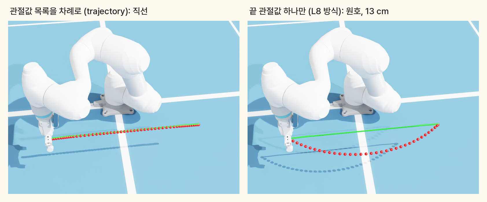
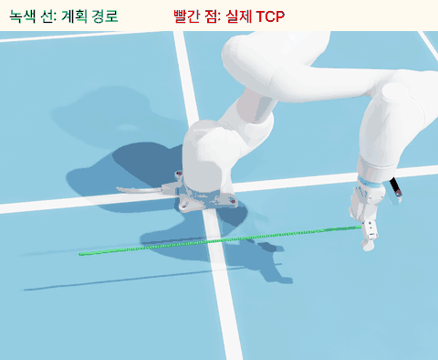
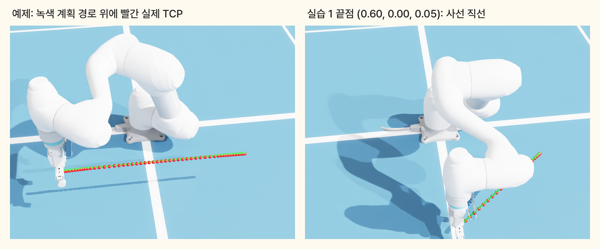
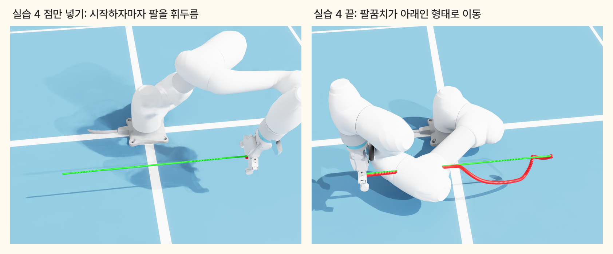
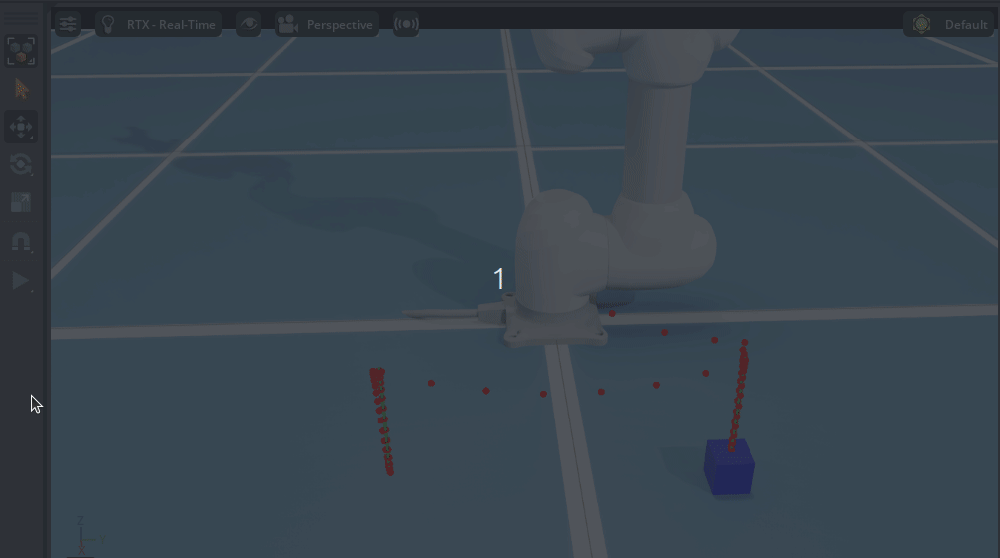

# L10. trajectory 로 직선 이동

---

## 학습 목표
- `LulaTaskSpaceTrajectoryGenerator` 로 시작점 -> 끝점 직선을 **trajectory (시간별 관절값 목록)** 로 만들 수 있다
- 관절값 목록을 출력하고, 계획 경로와 실제 TCP 를 화면에 그려 비교하고, 한 프레임에 하나씩 `apply_action` 으로 보낼 수 있다
- 끝 관절값 하나만 보내는 L8 방식과 차이를 설명하고, L8 pick and place 의 하강·상승을 직선으로 바꾼다

---

## 핵심 개념
### 왜 직선 이동이 필요한가
L8 은 **끝 관절값 하나**만 보낸다. 관절 6개가 각자 목표로 움직이므로 시작과 끝의 TCP 는 맞지만, **그 사이 TCP 는 어디로 지나갈지 정해지지 않는다.**
예제의 시작점 (0.40, 0.35, 0.20) -> 끝점 (0.40, -0.35, 0.20) 을 두 방식으로 움직이면:



| 방식 | 보내는 것 | TCP 가 지나간 길 | 직선에서 벗어난 최대 거리 |
|---|---|---|---|
| L8: 끝 관절값 하나 | `[-42, 23, 67, 0, 89, -42]` 하나를 도착할 때까지 | joint_1 이 주로 돌아서 로봇 둘레의 **원호** | **13.2 cm** (가운데에서 x 0.53) |
| L10: trajectory | 관절값 175 개를 1/60 s 마다 하나씩 | **직선** | 0.1 cm |

- 큐브를 집으러 내려가거나 물체 옆을 지날 때 TCP 가 엉뚱한 길로 가면 부딪힌다
- 직선으로 가려면 "언제 어느 관절값에 있어야 하는지" 를 **경로 전체에 대해** 미리 계산해 두고, 매 프레임 그 값을 보내야 한다. 그 목록이 trajectory 다

### trajectory = 시간별 관절값 목록
| | IK | trajectory |
|---|---|---|
| 입력 | TCP 목표 하나 | 시작점, 끝점 (그 사이 직선) + 시작 관절값 |
| 출력 | 관절값 하나 | 시간에 따라 바뀌는 관절값 (t 를 넣으면 그 시각의 관절값과 속도) |
| 보내는 방법 | 한 번 보내고 도착을 기다림 | 1/60 s 마다 꺼낸 목록을 한 프레임에 하나씩 보냄 |

- 생성기는 관절 속도·가속도 한계 안에서 가장 빨리 가는 시간표를 만든다. 출발할 때 천천히 빨라지고, 도착할 때 천천히 멈춘다
- 한계는 URDF 에 적힌 값이다. 그대로 쓰면 빠르니 `SPEED_SCALE` 을 곱해 줄인다

### 예제의 trajectory 코드
예제(`L10_trajectory.py`)에서 trajectory 를 쓰는 부분은 아래가 전부다. 생성기 -> 시작 관절값 -> 경로 설명서 -> trajectory -> 관절값 목록 순서다.

```python
# ************************************************************
# ★ trajectory 영역 시작: 시작점 -> 끝점 직선 -> 시간별 팔 관절 6개 각도 목록
# ************************************************************

# (다) 계산기 두 개 (같은 파일 두 개로 만든다)
#   ik_solver : IK, FK 용 (L8 의 IK 계산기)
#   generator : trajectory 생성기
ik_solver = LulaKinematicsSolver(
    robot_description_path=DESCRIPTION_PATH,
    urdf_path=URDF_PATH,
)
generator = LulaTaskSpaceTrajectoryGenerator(
    robot_description_path=DESCRIPTION_PATH,
    urdf_path=URDF_PATH,
)

# 속도 조절: 원래 한계값에 SPEED_SCALE 을 곱해 다시 넣는다
velocity_limits = np.array(generator.get_c_space_velocity_limits())
acceleration_limits = np.array(generator.get_c_space_acceleration_limits())
generator.set_c_space_velocity_limits(velocity_limits * SPEED_SCALE)
generator.set_c_space_acceleration_limits(acceleration_limits * SPEED_SCALE)


# (라) 시작 관절값: 시작점의 IK (L8 과 같음)
#    start_joints : [41, 23, 67, 0, 89, 41] deg (rad 로 저장)
start_joints, success = ik_solver.compute_inverse_kinematics(
    TCP_FRAME, START_POS, DOWN_ORIENTATION, warm_start=np.radians(HOME_DEG)
)
if not success:
    raise RuntimeError("시작점의 IK 해가 없다")


# (마) 경로 만들기 (예제 값 기준으로 단계마다 만들어지는 것)

# ① 시작 점과 끝 점 리스트 만듬
line = lula.create_task_space_path_spec(get_pose3(START_POS, rot_quat=DOWN_ORIENTATION))
line.add_linear_path(get_pose3(END_POS, rot_quat=DOWN_ORIENTATION))

# ② 시작 관절값(형상 유지를 위해) + 시작 점과 끝 점 관절값
path = lula.create_composite_path_spec(start_joints)
path.add_task_space_path_spec(line, lula.CompositePathSpec.TransitionMode.SKIP)


# (바) trajectory: 직선 경로 설명서 -> 시간에 따라 움직이는 관절값
#    trajectory : 0 ~ 2.89 s 동안의 관절값. 시각 t 를 넣으면 그때의 관절값과 속도가 나온다
trajectory = generator.compute_task_space_trajectory_from_path_spec(path, TCP_FRAME)
if trajectory is None:
    raise RuntimeError("trajectory 를 만들지 못했다: 팔이 닿지 않는 곳이 있다")


# (사) 관절값 목록: DT 간격의 시각마다 관절값과 관절 속도를 꺼낸다 (여기서 처음으로 세부 점이 생긴다)
#    times         : [0.000, 0.017, 0.033, ..., 2.89] s                            (175 개)
#    joint_list    : [[41, 23, 67, 0, 89, 41], ..., [-42, 23, 67, 0, 89, -42]] deg  (175 개, rad 로 저장)
#    velocity_list : 같은 시각의 관절 속도 (rad/s). 마지막은 0                       (175 개)
times = np.arange(trajectory.start_time, trajectory.end_time, DT)
times = np.append(times, trajectory.end_time)  # 마지막은 끝 시각 (멈춘 자세, 속도 0)

joint_list = []
velocity_list = []
for t in times:
    joints, velocities = trajectory.get_joint_targets(t)
    joint_list.append(joints)
    velocity_list.append(velocities)

# ************************************************************
# ★ trajectory 영역 끝
# ************************************************************
```

### 경로 계획 만들기 (`lula`)
| 코드 | 하는 일 |
|---|---|
| `get_pose3(위치, rot_quat=쿼터니언)` | 위치와 자세를 Lula 가 쓰는 자세 형식으로 바꾼다 |
| `lula.create_task_space_path_spec(시작 자세)` | TCP 경로 **계획**을 만든다. 처음에는 시작 자세만 들어 있다 |
| `line.add_linear_path(끝 자세)` | 경로 계획에 "끝 자세까지 직선" 구간을 덧붙인다 |
| `lula.create_composite_path_spec(시작 관절값)` | "이 관절값에서 출발한다" 를 정한 묶음 경로 계획 |
| `path.add_task_space_path_spec(line, SKIP)` | 묶음 경로 계획에 TCP 경로 계획을 넣는다. `SKIP`: 시작 관절값의 TCP 가 이미 직선의 시작점이므로 그 사이를 잇는 이동은 넣지 않는다 |

- `task_space` = TCP 의 위치·자세로 표현하는 공간 (관절값으로 표현하는 공간은 c-space)
- `path` = 지나갈 모양
- `spec` = 계획 (specification). 어디서 어디까지 어떤 모양으로 갈지만 정해 둔 것
- 경로 계획에는 **세부 점이 없다**. 시작·끝 자세와 "직선" 이라는 모양만 있다. 세부 관절값은 시간 간격으로 꺼낼 때 처음 생긴다
- 직선 말고도 `add_translation` (위치만), `add_rotation` (방향만), `add_three_point_arc` (원호) 구간을 덧붙일 수 있다
- `SKIP` 을 쓰므로 시작 관절값의 TCP 와 `START_POS` 가 같아야 한다. 예제는 (라) 에서 `START_POS` 의 IK 로 시작 관절값을 구하므로 같다

### trajectory 를 만들고 꺼내기
| 코드 | 하는 일 |
|---|---|
| `generator.compute_task_space_trajectory_from_path_spec(path, TCP_FRAME)` | 경로 계획 -> trajectory. 팔이 닿지 않는 곳이 있으면 `None` |
| `trajectory.start_time`, `trajectory.end_time` | trajectory 의 시작·끝 시각 (s) |
| `trajectory.get_joint_targets(t)` | 시각 t 의 (관절값 rad, 관절 속도 rad/s). 팔 관절 6개, `ARM_JOINTS` 순서 |
| `generator.set_c_space_velocity_limits(...)` | 관절 속도 한계 (rad/s). 가속도는 `set_c_space_acceleration_limits` |

### 관절 속도도 같이 보내기
`ArticulationAction` 에 관절값만 주면 관절은 목표를 **뒤쫓아** 가서 늦는다. 그 시각의 속도를 `joint_velocities` 로 같이 주면 늦지 않는다.

| 예제에서 실제 TCP 가 직선에서 벗어난 최대 거리 | |
|---|---|
| `joint_positions` 만 | 1.2 cm |
| `joint_positions` + `joint_velocities` | 0.1 cm |

### 화면에 그리기 (`_debug_draw`)
| 코드 | 하는 일 |
|---|---|
| `_debug_draw.acquire_debug_draw_interface()` | 화면에 점·선을 그리는 도구. Stage 에 물체를 만들지 않아 물리에 영향이 없다 |
| `draw.draw_lines(시작점 목록, 끝점 목록, 색 목록, 굵기 목록)` | 선을 그린다. 선 하나 = 시작점 (x, y, z) 하나 + 끝점 하나. 네 목록의 개수가 같아야 한다 |
| `draw.draw_points(점 목록, 색 목록, 크기 목록)` | 점을 그린다. 점 [(x, y, z), ...], 색 [(R, G, B, 투명도), ...], 크기 [픽셀, ...] 의 개수가 같아야 한다 |
| `draw.clear_points()`, `draw.clear_lines()` | 그린 점 / 선을 모두 지운다 (예제는 Stop -> Play 때 점만 지운다) |

- 예제는 계획 경로(시작점 -> 끝점)를 **녹색 선**, 이동 중 실제 TCP 를 **빨간 점**으로 그린다. 빨간 점이 녹색 선 위에 찍히면 계획대로 간 것이다
- 그린 점은 지울 때까지 남는다. 크기는 화면 픽셀이라 멀리서 봐도 같은 크기다

---

## 실행
### L10_trajectory.py
```python
"""[L10 예제] trajectory 로 직선 이동: 시작점과 끝점을 주면 그 사이를 직선으로 가는 시간별 관절값 목록이 나온다

실행: isaac_python L10_trajectory.py
"""

from pathlib import Path

# ============================================================
# 1. 앱 시작 (Isaac 모듈보다 먼저)
# ============================================================
from isaacsim import SimulationApp

simulation_app = SimulationApp({"headless": False})

# ============================================================
# 2. Isaac 모듈 import (앱을 켠 뒤에)
# ============================================================
import lula
import numpy as np
import omni.kit.commands
from isaacsim.core.api import World
from isaacsim.core.prims import SingleArticulation
from isaacsim.core.utils.rotations import euler_angles_to_quat
from isaacsim.core.utils.stage import add_reference_to_stage
from isaacsim.core.utils.types import ArticulationAction
from isaacsim.core.utils.viewports import set_camera_view
from isaacsim.robot_motion.motion_generation import LulaKinematicsSolver, LulaTaskSpaceTrajectoryGenerator
from isaacsim.robot_motion.motion_generation.lula.utils import get_pose3
from isaacsim.util.debug_draw import _debug_draw

# 파일 경로
M0609_DIR = Path(__file__).resolve().parents[1]                            # isaacpjt/M0609 (이 파일이 있는 basic 의 상위 폴더)
ROBOT_USD = f"{M0609_DIR}/robot/m0609_rg2_d455.usd"                        # 장면에 넣을 로봇 (M0609 + RG2 + D455)
URDF_PATH = f"{M0609_DIR}/robot/m0609_rg2.urdf"                            # 계산용: 링크 길이, 관절 축, 관절 한계
DESCRIPTION_PATH = f"{M0609_DIR}/descriptor/m0609_robot_description.yaml"  # 계산용: 움직일 관절 (팔 6개)

# 로봇 관절
ARM_JOINTS = ["joint_1", "joint_2", "joint_3", "joint_4", "joint_5", "joint_6"]
HOME_DEG = [0, 0, 90, 0, 90, 0]
TCP_FRAME = "gripper_center"  # 경로를 따라갈 기준점: 그리퍼 손가락 사이

# 그리퍼가 아래를 향하는 자세 (L8 연습 문제와 같음)
DOWN_ORIENTATION = euler_angles_to_quat(np.radians([0, 180, 0]))

# 직선 이동 (실습에서 바꿔 볼 값): 그리퍼가 아래를 향한 채 START_POS -> END_POS 직선
START_POS = np.array([0.40, 0.35, 0.20])   # 시작점: 왼쪽 앞, 높이 20 cm
END_POS = np.array([0.40, -0.35, 0.20])    # 끝점: 오른쪽 앞, 같은 높이 (가로로 70 cm)
SPEED_SCALE = 0.3  # 로봇 최고 속도의 몇 배로 움직일지 (작을수록 느리다)

# 진행
DT = 1.0 / 60.0   # 한 프레임 시간 (s). 관절값을 이 간격으로 꺼낸다
START_FRAME = 60  # Play 후 이 프레임부터 이동 시작 (그 전 1 초는 시작 자세)
PRINT_EVERY = 20  # 관절값 목록과 이동 중 TCP 를 20 개(프레임)마다 한 줄씩 출력
DRAW_EVERY = 3    # 실제 TCP 를 3 프레임마다 점 하나로 그린다

# 그리기 (색은 R, G, B, 투명도 / 크기는 화면 픽셀)
PLAN_COLOR = (0.0, 0.8, 0.0, 1.0)    # 계획 경로: 녹색 선
PLAN_WIDTH = 3
ACTUAL_COLOR = (1.0, 0.0, 0.0, 1.0)  # 실제 TCP: 빨간 점 (계획대로 가면 녹색 선 위에 찍힌다)
ACTUAL_SIZE = 10


# ------------------------------------------------------------
# 출력·그리기용 함수: 결과를 보여 주기만 한다 (로직을 볼 때는 건너뛰어도 된다)
#   아래 본문에서 만드는 ik_solver, robot, arm 을 사용한다
# ------------------------------------------------------------
draw = _debug_draw.acquire_debug_draw_interface()  # 화면에 점·선을 그리는 도구 (Stage 에 물체를 만들지 않는다)


def to_deg(joints):
    """관절값 (rad) -> 정수 deg 배열 (출력용)"""
    return np.round(np.degrees(joints)).astype(int)


def print_joint_list(times, joint_list):
    """관절값 목록을 PRINT_EVERY 개마다 한 줄씩, 그 관절값의 TCP 위치 (FK) 와 함께 출력한다"""
    print(f"trajectory | {times[-1]:.2f} s, 관절값 {len(joint_list)} 개 ({DT:.4f} s 간격)")
    for i in range(0, len(joint_list), PRINT_EVERY):
        tcp, _ = ik_solver.compute_forward_kinematics(TCP_FRAME, joint_list[i])
        print(f"  [{i:3d}] t {times[i]:4.2f} s | joint_1 ~ 6 {to_deg(joint_list[i])} deg"
              f" | TCP x {tcp[0]:.2f} y {tcp[1]:5.2f} z {tcp[2]:.3f} m")


def robot_tcp():
    """로봇의 지금 팔 관절값과 그때의 TCP 위치 (FK)"""
    current = robot.get_joint_positions()[arm]
    tcp, _ = ik_solver.compute_forward_kinematics(TCP_FRAME, current)
    return current, tcp


def print_robot(frame, state):
    """로봇의 지금 관절값과 TCP 위치를 한 줄 출력한다"""
    current, tcp = robot_tcp()
    print(f"{frame} 프레임 | {state} | joint_1 ~ 6 {to_deg(current)} deg"
          f" | TCP x {tcp[0]:.2f} y {tcp[1]:5.2f} z {tcp[2]:.3f} m")


def draw_plan_line():
    """계획 경로: 시작점 -> 끝점을 녹색 선으로 그린다"""
    draw.draw_lines(
        [tuple(START_POS)],                           # 선 시작점 목록 [(x, y, z), ...]
        [tuple(END_POS)],                             # 선 끝점 목록
        [PLAN_COLOR],                                 # 선마다 색
        [PLAN_WIDTH],                                 # 선마다 굵기 (픽셀)
    )


def show_moving(frame, index):
    """이동 중: 실제 TCP 를 DRAW_EVERY 프레임마다 빨간 점으로 그리고, PRINT_EVERY 프레임마다 출력한다"""
    if index % DRAW_EVERY == 0:
        _, tcp = robot_tcp()
        draw.draw_points([tuple(tcp)], [ACTUAL_COLOR], [ACTUAL_SIZE])
    if index % PRINT_EVERY == 0:
        print_robot(frame, "이동")


# (가) 장면: World, 바닥, 조명, 카메라
world = World(stage_units_in_meters=1.0)
world.scene.add_default_ground_plane()
omni.kit.commands.execute("SetLightingMenuModeCommand", lighting_mode="Default")  # Lighting 메뉴의 "Default"
set_camera_view(eye=np.array([1.3, -0.2, 1.1]), target=np.array([0.3, 0.0, 0.15]))  # 앞쪽 위에서 내려다본다

# (나) 로봇
add_reference_to_stage(usd_path=ROBOT_USD, prim_path="/World/m0609_rg2_d455")
robot = world.scene.add(SingleArticulation(prim_path="/World/m0609_rg2_d455", name="m0609"))


# ************************************************************
# ★ trajectory 영역 시작: 시작점 -> 끝점 직선 -> 시간별 팔 관절 6개 각도 목록
# ************************************************************

# (다) 계산기 두 개 (같은 파일 두 개로 만든다)
#   ik_solver : IK, FK 용 (L8 의 IK 계산기)
#   generator : trajectory 생성기
ik_solver = LulaKinematicsSolver(
    robot_description_path=DESCRIPTION_PATH,
    urdf_path=URDF_PATH,
)
generator = LulaTaskSpaceTrajectoryGenerator(
    robot_description_path=DESCRIPTION_PATH,
    urdf_path=URDF_PATH,
)

# 속도 조절: 원래 한계값에 SPEED_SCALE 을 곱해 다시 넣는다
velocity_limits = np.array(generator.get_c_space_velocity_limits())
acceleration_limits = np.array(generator.get_c_space_acceleration_limits())
generator.set_c_space_velocity_limits(velocity_limits * SPEED_SCALE)
generator.set_c_space_acceleration_limits(acceleration_limits * SPEED_SCALE)


# (라) 시작 관절값: 시작점의 IK (L8 과 같음)
#    start_joints : [41, 23, 67, 0, 89, 41] deg (rad 로 저장)
start_joints, success = ik_solver.compute_inverse_kinematics(
    TCP_FRAME, START_POS, DOWN_ORIENTATION, warm_start=np.radians(HOME_DEG)
)
if not success:
    raise RuntimeError("시작점의 IK 해가 없다")


# (마) 경로 만들기 (예제 값 기준으로 단계마다 만들어지는 것)

# ① 시작 점과 끝 점 리스트 만듬
line = lula.create_task_space_path_spec(get_pose3(START_POS, rot_quat=DOWN_ORIENTATION))
line.add_linear_path(get_pose3(END_POS, rot_quat=DOWN_ORIENTATION))

# ② 시작 관절값(형상 유지를 위해) + 시작 점과 끝 점 관절값 
path = lula.create_composite_path_spec(start_joints)
path.add_task_space_path_spec(line, lula.CompositePathSpec.TransitionMode.SKIP)


# (바) trajectory: 직선 경로 계획 -> 시간에 따라 움직이는 관절값
#    trajectory : 0 ~ 2.89 s 동안의 관절값. 시각 t 를 넣으면 그때의 관절값과 속도가 나온다
trajectory = generator.compute_task_space_trajectory_from_path_spec(path, TCP_FRAME)
if trajectory is None:
    raise RuntimeError("trajectory 를 만들지 못했다: 팔이 닿지 않는 곳이 있다")


# (사) 관절값 목록: DT 간격의 시각마다 관절값과 관절 속도를 꺼낸다 (여기서 처음으로 세부 점이 생긴다)
#    times         : [0.000, 0.017, 0.033, ..., 2.89] s                            (175 개)
#    joint_list    : [[41, 23, 67, 0, 89, 41], ..., [-42, 23, 67, 0, 89, -42]] deg  (175 개, rad 로 저장)
#    velocity_list : 같은 시각의 관절 속도 (rad/s). 마지막은 0                       (175 개)
times = np.arange(trajectory.start_time, trajectory.end_time, DT)
times = np.append(times, trajectory.end_time)  # 마지막은 끝 시각 (멈춘 자세, 속도 0)

joint_list = []
velocity_list = []
for t in times:
    joints, velocities = trajectory.get_joint_targets(t)
    joint_list.append(joints)
    velocity_list.append(velocities)

# ************************************************************
# ★ trajectory 영역 끝
# ************************************************************

print_joint_list(times, joint_list)  # 관절값 목록 출력
draw_plan_line()                     # 계획 경로 (녹색 선)


# (아) 시작 자세로 순간이동하고, 멈춘 상태로 기다린다
world.reset()
arm = [robot.get_dof_index(name) for name in ARM_JOINTS]  # 팔 관절 6개가 관절 배열(12개)의 몇 번째인지 -> [0, 1, 2, 3, 4, 5]
start = np.zeros(robot.num_dof)
start[arm] = start_joints
robot.set_joint_positions(start)
world.step(render=True)  # 한 프레임 진행해서 순간이동한 자세를 화면에 반영
world.pause()            # 멈춤. 화면 왼쪽의 Play(▶) 를 누르면 시작
print("Play 를 누르면 이동을 시작한다 (Stop -> Play: 처음부터 다시)")

# ============================================================
# 3. 메인 루프 (창이 열려 있는 동안 한 프레임씩 진행)
# ============================================================
frame = 0             # Play 중에 지난 프레임 수
reset_needed = False
while simulation_app.is_running():
    world.step(render=True)

    # Stop 을 감지해 둔다. Play 중일 때만 아래를 진행한다
    if world.is_stopped():
        reset_needed = True
    if not world.is_playing():
        continue
    # Stop 다음 첫 Play 프레임: 시작 자세와 프레임 수를 처음으로
    if reset_needed:
        world.reset()
        robot.set_joint_positions(start)
        frame = 0
        draw.clear_points()  # 빨간 점만 지운다 (녹색 선은 그대로)
        reset_needed = False

    frame += 1
    index = frame - START_FRAME  # 이번 프레임에 보낼 관절값 번호

    # (자) 목록의 관절값을 한 프레임에 하나씩 보낸다
    if 0 <= index < len(joint_list):
        action = ArticulationAction(
            joint_positions=joint_list[index],      # 이 시각의 관절값 (rad)
            joint_velocities=velocity_list[index],  # 이 시각의 관절 속도 (같이 주면 늦지 않게 따라간다)
            joint_indices=arm,                      # 팔 관절 6개 자리에
        )
        robot.apply_action(action)
        show_moving(frame, index)  # 실제 TCP 를 빨간 점으로, 가끔 출력

    # (차) 다 보내고 1 초 뒤: 도착 자세 출력
    if index == len(joint_list) + 60:
        print_robot(frame, "도착")

# ============================================================
# 4. 종료
# ============================================================
simulation_app.close()

```

```bash
cd ~/cobot3_ws/isaacpjt/M0609/basic
isaac_python L10_trajectory.py
```



### 실습 1. 끝점 바꾸기
`END_POS = np.array([0.60, 0.00, 0.05])` 로 바꿔 실행한다 (앞으로 멀리, 아래로).



### 실습 2. 속도 바꾸기
`END_POS` 는 처음 값으로 두고 `SPEED_SCALE` 을 바꾼다.

| `SPEED_SCALE` | trajectory 시간 | 관절값 개수 | 도착 TCP |
|---|---|---|---|
| 1.0 | 1.49 s | 91 | x 0.40 y -0.35 z 0.195 |
| 0.3 | 2.89 s | 175 | x 0.40 y -0.35 z 0.195 |
| 0.1 | 6.48 s | 390 | x 0.40 y -0.35 z 0.195 |

- 경로(빨간 점이 찍히는 곳)는 같고 시간표만 바뀐다. 느리면 같은 경로를 더 촘촘하게 나눈다
- 시간이 속도 비율만큼 늘지는 않는다 (0.3 배인데 시간은 1.9 배). 빨라지고 느려지는 구간이 있기 때문이다

### 실습 3. 끝 관절값 하나만 보내기 (L8 방식)
메인 루프 (자) 의 `action` 을 아래로 바꿔, 목록의 마지막 관절값만 계속 보낸다.

```python
        action = ArticulationAction(
            joint_positions=joint_list[-1],  # 끝 관절값 하나만 (L8 방식)
            joint_indices=arm,
        )
```


- 빨간 점(실제 TCP)이 녹색 직선을 벗어나 **원호**로 지나간다. 가운데에서 x 0.53: 직선(0.40)에서 13 cm 앞으로 나갔다
- 시작과 끝 관절값을 보면 joint_1 만 41 -> -42 로 크게 다르고 나머지는 거의 같다. joint_1 만 돌면 TCP 는 로봇 둘레의 원을 따라 간다
- 관절은 한계 속도로 바로 움직여 0.7 s 만에 도착한다. 속도 조절도 직선도 없다
- 끝 관절값은 같으므로 도착 자세는 예제와 같다. 다른 것은 **가는 길** 이다

### 실습 4. 시작 관절값 없이 점만 넣기
관절 형상을 고려하지 않고 경로 계획을 했을 경우이다.

```python
points = np.array([START_POS, END_POS])
orientations = np.array([DOWN_ORIENTATION, DOWN_ORIENTATION])
trajectory = generator.compute_task_space_trajectory_from_points(points, orientations, TCP_FRAME)
```



- 계획한 TCP 경로는 똑같이 직선이다. 그런데 [0] 이 시작 자세 `[41, 23, 67, 0, 89, 41]` 이 아니라 `[41, 87, -67, 0, 161, 41]` 이다: **TCP 는 같은 곳인데 팔 형태가 다른 답** (팔꿈치 아래)
- 점만 주면 생성기가 시작 관절값을 모르므로 아무 IK 답에서 시작한다. 지금 자세에서 [0] 까지 한 프레임에 보내니 팔을 크게 휘두르고, 그동안 TCP 가 z 0.08 m 까지 떨어진다

---

## 연습 문제
pick and place에서 안정적으로 집고 놓기 위해 상승과 하강할 때 **직선으로** 움직일 수 있도록 구현하세요.



---

## 확인할 것
- [ ] trajectory 가 무엇이고, 끝 관절값 하나만 보낼 때와 TCP 가 지나가는 길이 왜 다른지 설명할 수 있다
- [ ] 직선 경로를 만들 때 시작 관절값을 넣어야 하는 이유를 설명할 수 있다
- [ ] `get_joint_targets(t)` 로 관절값 목록을 만들고, 한 프레임에 하나씩 보낼 수 있다
- [ ] `_debug_draw` 로 계획 경로와 실제 TCP 를 그려 비교할 수 있다
- [ ] 관절 속도를 같이 보내는 이유를 설명할 수 있다
- [ ] `SPEED_SCALE` 을 바꾸면 무엇이 바뀌고 무엇이 그대로인지 설명할 수 있다
