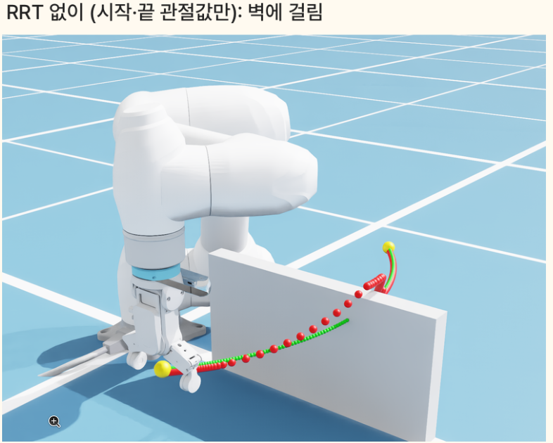
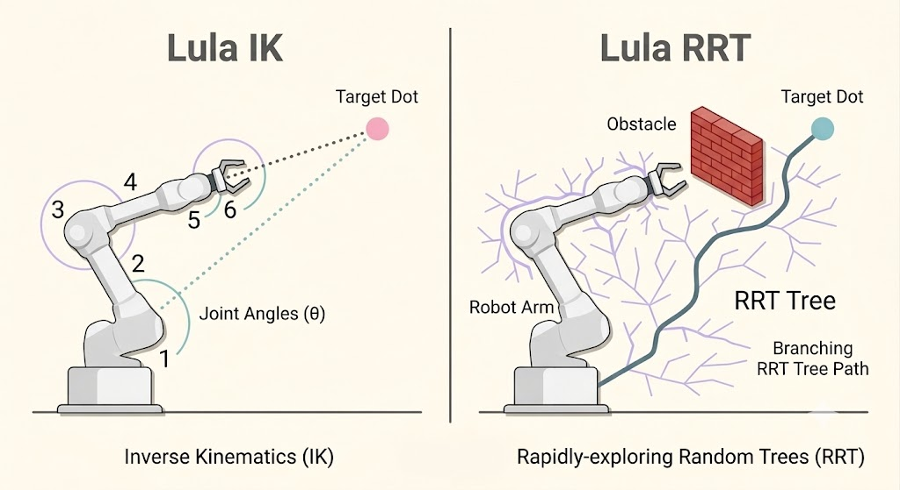
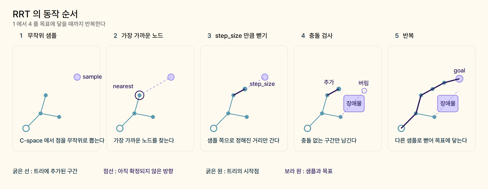
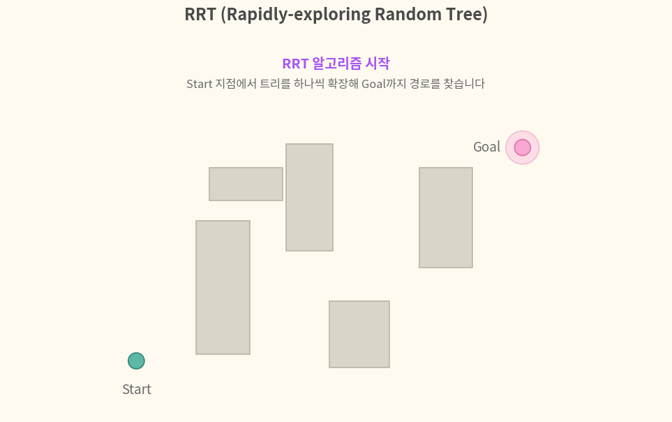
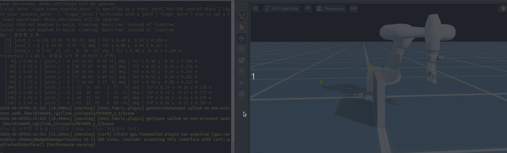
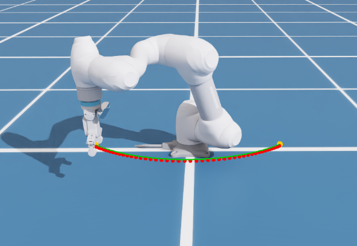
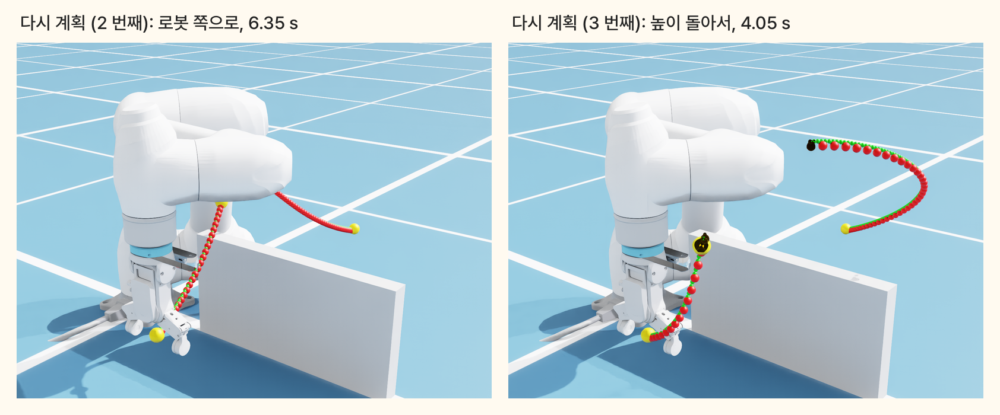
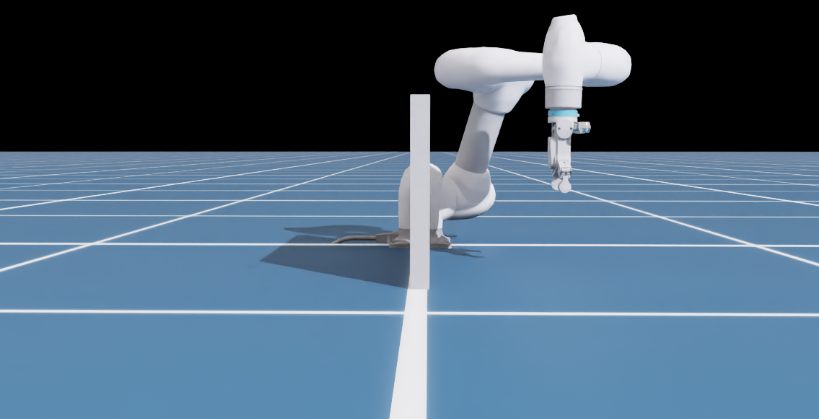
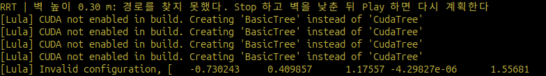
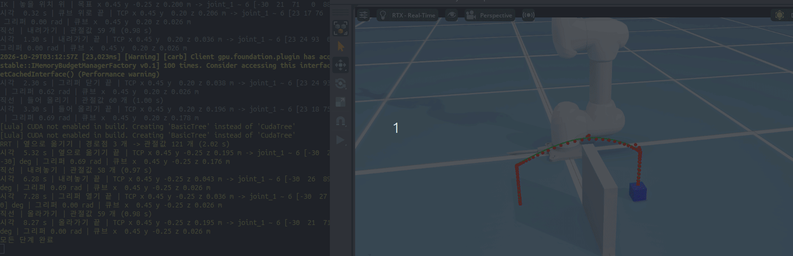

# L11. RRT 로 고정 장애물 피하기

---

## 학습 목표
- IK 기반 직선 이동과 RRT 기반 경로 생성의 차이를 설명할 수 있다
- Lula RRT를 M0609에 연결해 장애물을 회피하는 경로를 생성할 수 있다
- 같은 장면에서 두 방식의 경로를 비교하고 회피 여부를 확인할 수 있다

---

## 핵심 개념
### 왜 RRT 가 필요한가
지금까지는 **경로 모양이 미리 정해져 있었다** (끝 관절값 하나 -> 원호, trajectory -> 직선). 그 길에 벽이 있으면 그대로 부딪힌다.



### RRT 란
1. **RRT — Rapidly-exploring Random Tree**
   고차원의 탐색 공간에서 무작위 샘플링을 통해 나뭇가지 모양의 트리를 확장하며 장애물을 회피하는 최적의 이동 경로를 빠르게 찾아내는 **확률적 경로 계획 알고리즘**입니다.

   
2. **RRT의 동작 원리**
   1. C-space(관절 공간)에서 점을 **무작위**로 뽑는다
   2. 트리에서 가장 가까운 노드를 찾아 그 방향으로 step_size만큼 뻗는다
   3. 뻗은 구간에 충돌이 없으면 트리에 추가한다
   4. 목표에 닿으면 종료하므로 경로 길이는 평가하지 않는다
   5. 샘플이 무작위라 실행마다 결과가 다르며 **seed를 고정하면 재현**된다

   

   
3. C-space**와 경로 계획**
   - 6축 로봇의 자세 하나는 관절각 숫자 6개로 표현된다
   - 이 6개로 이루어진 공간을 configuration space(C-space)라고 한다
   - 손끝 좌표만으로는 링크 전체 위치가 정해지지 않아 충돌을 판정할 수 없다
   - 경로 계획은 C-space에서 충돌 없는 점들을 이어 만든다

### TaskSpace vs CSpace Tranjectory
| | L10 | L11 |
|---|---|---|
| 경로 계획 | 시작점 -> 끝점 TCP 직선 <br />(`lula` 경로 계획) | RRT 가 찾은 **관절값 경로점** |
| trajectory 생성기 | `LulaTaskSpaceTrajectoryGenerator` (TCP 기준) | `LulaCSpaceTrajectoryGenerator` (관절값 기준) |
| 관절값 목록 꺼내기, `apply_action` | DT 간격으로 꺼내 한 프레임에 하나씩 | **같음** |

---

## 실행
### L11_rrt.py
```python
"""[L11 예제] RRT 로 장애물 피하기: 시작 자세와 끝 자세 사이에 벽이 있으면 벽을 넘어가는 관절 경로를 찾는다

실행: isaac_python L11_rrt.py
"""

from pathlib import Path

# ============================================================
# 1. 앱 시작 (Isaac 모듈보다 먼저)
# ============================================================
from isaacsim import SimulationApp

simulation_app = SimulationApp({"headless": False})

# ============================================================
# 2. Isaac 모듈 import (앱을 켠 뒤에)
# ============================================================
import numpy as np
import omni.kit.commands
from isaacsim.core.api import World
from isaacsim.core.api.objects import FixedCuboid
from isaacsim.core.prims import SingleArticulation
from isaacsim.core.utils.rotations import euler_angles_to_quat
from isaacsim.core.utils.stage import add_reference_to_stage
from isaacsim.core.utils.types import ArticulationAction
from isaacsim.core.utils.viewports import set_camera_view
from isaacsim.robot_motion.motion_generation import LulaCSpaceTrajectoryGenerator, LulaKinematicsSolver
from isaacsim.robot_motion.motion_generation.lula import RRT
from isaacsim.util.debug_draw import _debug_draw

# 파일 경로
M0609_DIR = Path(__file__).resolve().parents[1]                            # isaacpjt/M0609 (이 파일이 있는 basic 의 상위 폴더)
ROBOT_USD = f"{M0609_DIR}/robot/m0609_rg2_d455.usd"                        # 장면에 넣을 로봇 (M0609 + RG2 + D455)
URDF_PATH = f"{M0609_DIR}/robot/m0609_rg2.urdf"                            # 계산용: 링크 길이, 관절 축, 관절 한계
DESCRIPTION_PATH = f"{M0609_DIR}/descriptor/m0609_robot_description.yaml"  # 계산용: 움직일 관절, 충돌 검사용 구
RRT_CONFIG_PATH = f"{M0609_DIR}/descriptor/m0609_rrt_config.yaml"          # RRT 설정: 탐색 간격, 최대 반복 횟수 등

# 로봇 관절
ARM_JOINTS = ["joint_1", "joint_2", "joint_3", "joint_4", "joint_5", "joint_6"]
HOME_DEG = [0, 0, 90, 0, 90, 0]
TCP_FRAME = "gripper_center"  # 기준점: 그리퍼 손가락 사이

# 그리퍼가 아래를 향하는 자세 (L8 연습 문제와 같음)
DOWN_ORIENTATION = euler_angles_to_quat(np.radians([0, 180, 0]))

# 이동 (실습에서 바꿔 볼 값): L10 과 같은 시작점, 끝점. 그 사이에 벽이 있다
START_POS = np.array([0.40, 0.35, 0.20])   # 시작점: 왼쪽 앞, 높이 20 cm
END_POS = np.array([0.40, -0.35, 0.20])    # 끝점: 오른쪽 앞, 같은 높이
WALL_POS = np.array([0.45, 0.00, 0.125])   # 벽 중심 (m)
WALL_SIZE = np.array([0.50, 0.04, 0.25])   # 벽 크기 [앞뒤, 두께, 높이] (m). 높이 25 cm 라 직선으로 가면 부딪힌다
SPEED_SCALE = 0.3  # 로봇 최고 속도의 몇 배로 움직일지 (작을수록 느리다)

# 진행
DT = 1.0 / 60.0   # 한 프레임 시간 (s). 관절값을 이 간격으로 꺼낸다
START_FRAME = 60  # Play 후 이 프레임부터 이동 시작 (그 전 1 초는 시작 자세)
PRINT_EVERY = 20  # 관절값 목록과 이동 중 TCP 를 20 개(프레임)마다 한 줄씩 출력
DRAW_EVERY = 3    # 실제 TCP 를 3 프레임마다 점 하나로 그린다

# 그리기 (색은 R, G, B, 투명도 / 크기는 화면 픽셀)
PLAN_COLOR = (0.0, 0.8, 0.0, 1.0)      # 계획 경로: 녹색 선
PLAN_WIDTH = 3
WAYPOINT_COLOR = (1.0, 0.8, 0.0, 1.0)  # RRT 경로점: 노란 점
WAYPOINT_SIZE = 16
ACTUAL_COLOR = (1.0, 0.0, 0.0, 1.0)    # 실제 TCP: 빨간 점 (계획대로 가면 녹색 선 위에 찍힌다)
ACTUAL_SIZE = 10


# ------------------------------------------------------------
# 출력·그리기용 함수: 결과를 보여 주기만 한다 (로직을 볼 때는 건너뛰어도 된다)
#   아래 본문에서 만드는 ik_solver, robot, arm 을 사용한다
# ------------------------------------------------------------
draw = _debug_draw.acquire_debug_draw_interface()  # 화면에 점·선을 그리는 도구 (Stage 에 물체를 만들지 않는다)


def to_deg(joints):
    """관절값 (rad) -> 정수 deg 배열 (출력용)"""
    return np.round(np.degrees(joints)).astype(int)


def tcp_of(joints):
    """관절값의 TCP 위치 (FK)"""
    tcp, _ = ik_solver.compute_forward_kinematics(TCP_FRAME, joints)
    return tcp


def print_waypoints(waypoints):
    """RRT 경로점 (관절값) 과 그 TCP 위치를 출력한다"""
    print(f"RRT | 경로점 {len(waypoints)} 개")
    for i, joints in enumerate(waypoints):
        tcp = tcp_of(joints)
        print(f"  [{i}] joint_1 ~ 6 {to_deg(joints)} deg | TCP x {tcp[0]:.2f} y {tcp[1]:5.2f} z {tcp[2]:.3f} m")


def print_joint_list(times, joint_list):
    """관절값 목록을 PRINT_EVERY 개마다 한 줄씩, 그 관절값의 TCP 위치와 함께 출력한다"""
    print(f"trajectory | {times[-1]:.2f} s, 관절값 {len(joint_list)} 개 ({DT:.4f} s 간격)")
    for i in range(0, len(joint_list), PRINT_EVERY):
        tcp = tcp_of(joint_list[i])
        print(f"  [{i:3d}] t {times[i]:4.2f} s | joint_1 ~ 6 {to_deg(joint_list[i])} deg"
              f" | TCP x {tcp[0]:.2f} y {tcp[1]:5.2f} z {tcp[2]:.3f} m")


def draw_plan(waypoints, joint_list):
    """계획 경로: 관절값 목록의 TCP 를 녹색 선으로 잇고, RRT 경로점을 노란 점으로 그린다"""
    points = [tuple(tcp_of(joints)) for joints in joint_list]
    draw.draw_lines(points[:-1], points[1:], [PLAN_COLOR] * (len(points) - 1), [PLAN_WIDTH] * (len(points) - 1))
    waypoint_tcps = [tuple(tcp_of(joints)) for joints in waypoints]
    draw.draw_points(waypoint_tcps, [WAYPOINT_COLOR] * len(waypoints), [WAYPOINT_SIZE] * len(waypoints))


def redraw_plan(waypoints, joint_list):
    """그린 것을 모두 지우고 계획 경로만 다시 그린다 (Stop -> Play 때)"""
    draw.clear_points()
    draw.clear_lines()
    draw_plan(waypoints, joint_list)


def robot_tcp():
    """로봇의 지금 팔 관절값과 그때의 TCP 위치"""
    current = robot.get_joint_positions()[arm]
    return current, tcp_of(current)


def print_robot(frame, state):
    """로봇의 지금 관절값과 TCP 위치를 한 줄 출력한다"""
    current, tcp = robot_tcp()
    print(f"{frame} 프레임 | {state} | joint_1 ~ 6 {to_deg(current)} deg"
          f" | TCP x {tcp[0]:.2f} y {tcp[1]:5.2f} z {tcp[2]:.3f} m")


def show_moving(frame, index):
    """이동 중: 실제 TCP 를 DRAW_EVERY 프레임마다 빨간 점으로 그리고, PRINT_EVERY 프레임마다 출력한다"""
    if index % DRAW_EVERY == 0:
        _, tcp = robot_tcp()
        draw.draw_points([tuple(tcp)], [ACTUAL_COLOR], [ACTUAL_SIZE])
    if index % PRINT_EVERY == 0:
        print_robot(frame, "이동")


# (가) 장면: World, 바닥, 조명, 카메라
world = World(stage_units_in_meters=1.0)
world.scene.add_default_ground_plane()
omni.kit.commands.execute("SetLightingMenuModeCommand", lighting_mode="Default")  # Lighting 메뉴의 "Default"
set_camera_view(eye=np.array([1.2, -1.1, 0.8]), target=np.array([0.35, 0.0, 0.2]))  # 오른쪽 앞에서 벽을 비스듬히 본다

# (나) 로봇과 벽
add_reference_to_stage(usd_path=ROBOT_USD, prim_path="/World/m0609_rg2_d455")
robot = world.scene.add(SingleArticulation(prim_path="/World/m0609_rg2_d455", name="m0609"))
wall = world.scene.add(
    FixedCuboid(
        prim_path="/World/Wall",                      # Stage 에 만들 prim 경로
        name="wall",                                  # 장면에서 찾을 때 쓰는 이름
        position=WALL_POS,                            # 벽 중심 위치 (m)
        scale=WALL_SIZE,                              # 크기 배율. size 1 m x scale = 실제 크기
        size=1.0,
        color=np.array([0.6, 0.6, 0.6]),              # 회색
    )
)  # FixedCuboid: 움직이지 않고 충돌은 있는 상자 (로봇이 부딪히면 막힌다)


# ************************************************************
# ★ RRT 영역 시작: 시작 관절값 -> (벽을 피하는) 경로점 몇 개 -> 시간별 팔 관절 6개 각도 목록
# ************************************************************

# (다) 계산기 세 개 (같은 로봇 파일로 만든다)
#   ik_solver : IK, FK 용 (L8 의 IK 계산기)
#   rrt       : 장애물을 피하는 관절 경로를 찾는 계획기
#   generator : 관절값 경로점 -> trajectory 생성기 (L10 은 TCP 직선용, 이것은 관절값 점들을 잇는다)
ik_solver = LulaKinematicsSolver(
    robot_description_path=DESCRIPTION_PATH,
    urdf_path=URDF_PATH,
)
rrt = RRT(
    robot_description_path=DESCRIPTION_PATH,
    urdf_path=URDF_PATH,
    rrt_config_path=RRT_CONFIG_PATH,                  # RRT 설정 파일
    end_effector_frame_name=TCP_FRAME,
)
generator = LulaCSpaceTrajectoryGenerator(
    robot_description_path=DESCRIPTION_PATH,
    urdf_path=URDF_PATH,
)

# 속도 조절: 원래 한계값에 SPEED_SCALE 을 곱해 다시 넣는다 (L10 과 같음)
velocity_limits = np.array(generator.get_c_space_velocity_limits())
acceleration_limits = np.array(generator.get_c_space_acceleration_limits())
generator.set_c_space_velocity_limits(velocity_limits * SPEED_SCALE)
generator.set_c_space_acceleration_limits(acceleration_limits * SPEED_SCALE)


# (라) 시작 관절값과 끝 관절값: 두 점의 IK (L8 과 같음)
#    start_joints : [41, 23, 67, 0, 89, 41] deg
#    goal_joints  : [-42, 23, 67, 0, 89, -42] deg
def solve_ik(position):
    """TCP 가 position 에서 아래를 보게 하는 팔 관절 6개 각도 (rad)"""
    joints, success = ik_solver.compute_inverse_kinematics(
        TCP_FRAME, position, DOWN_ORIENTATION, warm_start=np.radians(HOME_DEG)
    )
    if not success:
        raise RuntimeError(f"IK 해가 없다: {position}")
    return joints


start_joints = solve_ik(START_POS)
goal_joints = solve_ik(END_POS)


# (마) RRT: 벽을 알려 주고, 시작 관절값 -> 끝 관절값 사이의 충돌 없는 경로점을 찾는다
#    무작위로 탐색하지만 설정 파일의 seed 로 시작하므로, 실행할 때마다 같은 경로가 나온다
#    waypoints : [[41, 23, 67, 0, 89, 41], [-6, 16, 64, 3, 77, 0], [-42, 23, 67, 0, 89, -42]] deg  (3 개)
#                 시작                     벽 위 (TCP z 0.32)       끝
rrt.add_obstacle(wall, static=True)  # 피할 장애물 등록 (static: 움직이지 않는 물체)
rrt.update_world()                   # 등록한 장애물의 지금 위치를 RRT 에 반영
rrt.set_cspace_target(goal_joints)   # 목표: 끝 관절값
waypoints = rrt.compute_path(start_joints, np.array([]))  # (지금 관절값, 그 밖의 관절값: 없음)
if waypoints is None:
    raise RuntimeError("RRT 가 경로를 찾지 못했다: 벽을 피해 갈 수 없다")


# (바) trajectory: 경로점을 차례로 지나는, 시간에 따라 움직이는 관절값
#    trajectory : 0 ~ 2.86 s 동안의 관절값. 시각 t 를 넣으면 그때의 관절값과 속도가 나온다
trajectory = generator.compute_c_space_trajectory(waypoints)
if trajectory is None:
    raise RuntimeError("trajectory 를 만들지 못했다")


# (사) 관절값 목록: DT 간격의 시각마다 관절값과 관절 속도를 꺼낸다 (L10 과 같음)
#    times         : [0.000, 0.017, 0.033, ..., 2.86] s  (173 개)
#    joint_list    : 시각마다 팔 관절 6개 각도 (rad)    (173 개)
#    velocity_list : 같은 시각의 관절 속도 (rad/s)      (173 개)
times = np.arange(trajectory.start_time, trajectory.end_time, DT)
times = np.append(times, trajectory.end_time)  # 마지막은 끝 시각 (멈춘 자세, 속도 0)

joint_list = []
velocity_list = []
for t in times:
    joints, velocities = trajectory.get_joint_targets(t)
    joint_list.append(joints)
    velocity_list.append(velocities)

# ************************************************************
# ★ RRT 영역 끝
# ************************************************************

print_waypoints(waypoints)           # RRT 경로점 출력
print_joint_list(times, joint_list)  # 관절값 목록 출력
draw_plan(waypoints, joint_list)     # 계획 경로 (녹색 선) 와 경로점 (노란 점)


# (아) 시작 자세로 순간이동하고, 멈춘 상태로 기다린다
world.reset()
arm = [robot.get_dof_index(name) for name in ARM_JOINTS]  # 팔 관절 6개가 관절 배열(12개)의 몇 번째인지 -> [0, 1, 2, 3, 4, 5]
start = np.zeros(robot.num_dof)
start[arm] = start_joints
robot.set_joint_positions(start)
world.step(render=True)  # 한 프레임 진행해서 순간이동한 자세를 화면에 반영
world.pause()            # 멈춤. 화면 왼쪽의 Play(▶) 를 누르면 시작
print("Play 를 누르면 이동을 시작한다 (Stop -> Play: 처음부터 다시)")

# ============================================================
# 3. 메인 루프 (창이 열려 있는 동안 한 프레임씩 진행)
# ============================================================
frame = 0             # Play 중에 지난 프레임 수
reset_needed = False
while simulation_app.is_running():
    world.step(render=True)

    # Stop 을 감지해 둔다. Play 중일 때만 아래를 진행한다
    if world.is_stopped():
        reset_needed = True
    if not world.is_playing():
        continue
    # Stop 다음 첫 Play 프레임: 시작 자세와 프레임 수를 처음으로
    if reset_needed:
        world.reset()
        robot.set_joint_positions(start)
        frame = 0
        redraw_plan(waypoints, joint_list)  # 빨간 점을 지우고 계획 경로만 다시 그린다
        reset_needed = False

    frame += 1
    index = frame - START_FRAME  # 이번 프레임에 보낼 관절값 번호

    # (자) 목록의 관절값을 한 프레임에 하나씩 보낸다 (L10 과 같음)
    if 0 <= index < len(joint_list):
        action = ArticulationAction(
            joint_positions=joint_list[index],      # 이 시각의 관절값 (rad)
            joint_velocities=velocity_list[index],  # 이 시각의 관절 속도 (같이 주면 늦지 않게 따라간다)
            joint_indices=arm,                      # 팔 관절 6개 자리에
        )
        robot.apply_action(action)
        show_moving(frame, index)  # 실제 TCP 를 빨간 점으로, 가끔 출력

    # (차) 다 보내고 1 초 뒤: 도착 자세 출력
    if index == len(joint_list) + 60:
        print_robot(frame, "도착")

# ============================================================
# 4. 종료
# ============================================================
simulation_app.close()
```

```bash
cd ~/cobot3_ws/isaacpjt/M0609/basic
isaac_python L11_rrt.py
```



### 실습 1. 벽 없이 계획하기


### 실습 2. 다시 계획하기
`waypoints = rrt.compute_path(...)` 줄 아래에 같은 줄을 한 번(2 번째), 또는 두 번(3 번째) 더 써서 실행한다.

| 계획 | 가운데 경로점 joint_1 ~ 6 (deg) | 가운데 경로점 TCP | trajectory 시간 |
|---|---|---|---|
| 1 번째 (예제) | `[-6, 16, 64, 3, 77, 0]` | (0.60, -0.04, 0.32): 벽 위 | 2.86 s |
| 2 번째 | `[-40, 8, 78, 36, 125, -123]` | (0.30, -0.05, 0.36): 벽 위, 로봇 가까이 | 6.35 s |
| 3 번째 | `[-47, 16, 64, 36, 56, -66]` | (0.57, -0.40, 0.43): 높이 크게 돌아서 | 4.05 s |



- 같은 시작, 같은 목표인데 **<span color="pink">계획할 때마다 경로가 다르다.</span>** RRT 는 관절값을 무작위로 뽑아 길을 찾기 때문이다
- 프로그램을 다시 실행하면 1 번째 경로가 다시 나온다. 설정 파일의 `seed` 로 무작위 순서가 정해져 있어서, 처음부터 같은 순서로 뽑는다
- RRT 는 **처음 찾은** 충돌 없는 경로를 돌려준다. **<span color="pink">가장 짧은 경로가 아니다</span>**

### 실습 4. 벽 높이기




- 그리퍼가 아래를 향한 시작·끝 자세에서는 30 cm 벽을 넘을 길이 없어 `compute_path` 가 `None` 을 돌려준다
- RRT 는 설정 파일의 최대 반복 횟수까지 찾다가 포기한다. 경로가 없을 때 쓸 코드를 반드시 두어야 한다 (예제와 연습 문제는 `RuntimeError` 로 멈춘다)

---

## 연습 문제
**벽을 넘어 옮기는 pick and place를 완성하시오.**



---

## 확인할 것
- [ ] RRT 가 경로를 찾는 방법 (무작위로 뽑고, 부딪히지 않는 것만 잇는다) 을 설명할 수 있다
- [ ] RRT 결과(경로점)와 trajectory(시간별 관절값)의 차이를 설명할 수 있다
- [ ] RRT 목표를 TCP 위치가 아니라 관절값으로 주는 이유를 설명할 수 있다
- [ ] 같은 문제를 다시 계획하면 다른 경로가 나오는 이유와, 그 경로가 가장 짧지 않을 수 있음을 설명할 수 있다
