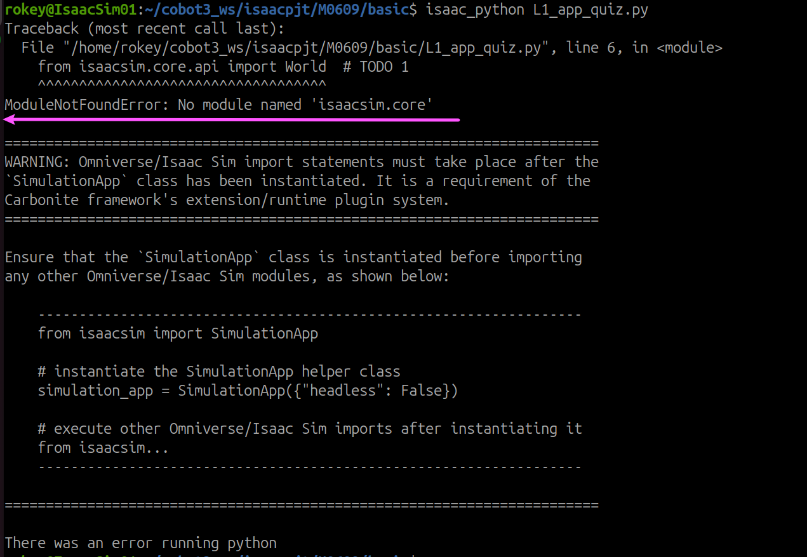
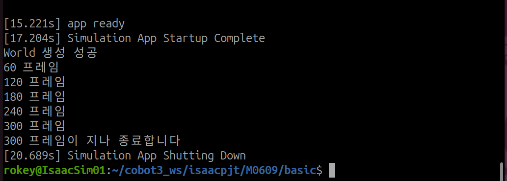

# L1. 연습 문제 정답

---

## 정답 코드

### L1_app_answer.py

```python
"""[L1 연습 정답] 앱 시작과 종료"""

# ============================================================
# 1. 앱 시작 (Isaac 모듈보다 먼저)
# ============================================================
from isaacsim import SimulationApp

simulation_app = SimulationApp({"headless": False})

# ============================================================
# 2. Isaac 모듈 import (앱을 켠 뒤에)
# ============================================================
from isaacsim.core.api import World  # TODO 1: SimulationApp 을 만든 뒤에 import

world = World()
print("World 생성 성공")

# ============================================================
# 3. 메인 루프 (창이 열려 있는 동안 한 프레임씩 진행)
# ============================================================
frame = 0
while simulation_app.is_running():
    simulation_app.update()
    frame += 1  # TODO 2
    if frame % 60 == 0:
        print(f"{frame} 프레임")
    if frame >= 300:  # TODO 3
        print("300 프레임이 지나 종료합니다")
        break

# ============================================================
# 4. 종료
# ============================================================
simulation_app.close()
```

```bash
cd ~/cobot3_ws/isaacpjt/M0609/basic
isaac_python L1_app_answer.py
```

---

## 해설
1. **import 순서 고치기**
   - **문제 코드를 실행했을 때 나오는 에러**
     

     - `isaacsim.core` 라는 모듈을 찾지 못했다는 에러다
     - 창이 뜨기도 전에 바로 끝난다. 앱을 켜는 줄(`SimulationApp(...)`)까지 가지도 못했기 때문이다
   - **왜 에러가 나는가**
     - `from isaacsim import SimulationApp` 은 앱을 켜기 전에도 쓸 수 있는 유일한 import 다
     - `isaacsim.core`, `omni`, `pxr` 같은 모듈은 `SimulationApp` 이 만들어지면서 확장 기능(extension)을 불러올 때 생긴다
     - 그래서 앱을 켜기 전에 import 하면 파이썬 입장에서는 아직 없는 모듈이다
   - **고친 방법**
     - `from isaacsim.core.api import World` 를 `simulation_app = SimulationApp(...)` **아래로** 옮긴다
     - 실행하면 `World 생성 성공` 이 출력된다
2. **프레임 세기**
   ```python
   frame += 1
   if frame % 60 == 0:
       print(f"{frame} 프레임")
   ```
   - `simulation_app.update()` 한 번 = 한 프레임이다. 루프를 한 번 돌 때마다 `frame` 을 1 늘리면 지나간 프레임 수가 된다
   - `frame % 60` 은 `frame` 을 60 으로 나눈 나머지다. 60, 120, 180 ... 일 때만 0 이 되므로 60 프레임마다 한 번 출력된다
   - `frame += 1` 을 출력 판단보다 **먼저** 해야 첫 출력이 `60 프레임` 이 된다 (나중에 하면 0 프레임에서 한 번 더 출력된다)
3. **정해진 프레임 후 종료**
   ```python
   if frame >= 300:
       print("300 프레임이 지나 종료합니다")
       break
   ```
   - `break` 로 `while` 루프를 빠져나오면 그 아래 `simulation_app.close()` 가 실행되어 앱이 정상 종료된다
   - 그래서 창을 직접 닫지 않아도 스크립트가 끝난다
   - 시간(초) 대신 프레임으로 세는 이유: 컴퓨터가 느리거나 창이 뜨는 데 오래 걸려도 "300 프레임 = 시뮬레이션이 300 번 진행됨" 은 항상 같다. 실제 시간으로 세면 컴퓨터마다 진행된 양이 달라진다
   - `==` 대신 `>=` 를 쓰면, 나중에 증가량이 바뀌어도 300 을 건너뛰어 루프가 안 끝나는 실수를 막을 수 있다
   - **실행 결과**
     

---

## 확인할 것
- [ ] 문제 코드를 그대로 실행해서 `ModuleNotFoundError` 를 직접 봤다
- [ ] Isaac 모듈을 앱을 켠 뒤에 import 해야 하는 이유를 설명할 수 있다
- [ ] `break` 뒤에 `simulation_app.close()` 가 실행되는 흐름을 설명할 수 있다
