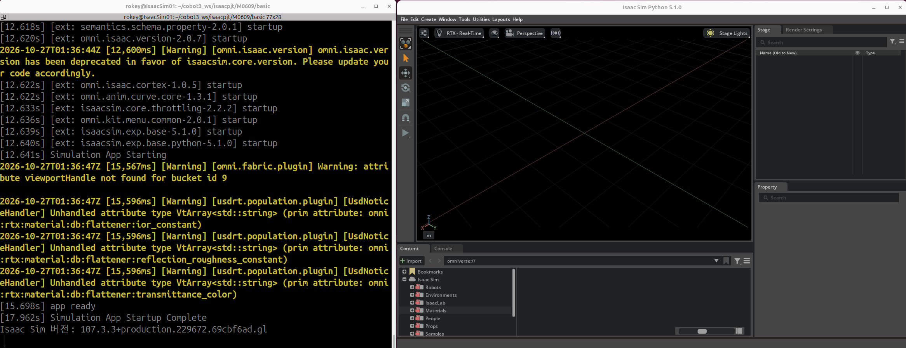

# L1. SimulationApp: standalone 의 기본 골격

---

## 학습 목표
- Isaac Sim standalone 스크립트의 4단계 골격(앱 시작, import, 메인 루프, 종료)을 설명하고 직접 쓸 수 있다
- Isaac 모듈을 `SimulationApp` 생성 뒤에 import 해야 하는 이유를 설명할 수 있다
- 메인 루프에서 프레임을 세고, 정해진 프레임 뒤에 프로그램을 끝낼 수 있다

---

## 핵심 개념

### standalone 이란
Isaac Sim 은 원래 창이 있는 프로그램이다. **standalone** 은 그 프로그램을 파이썬 스크립트에서 직접 켜고 조종하는 방식이다.
모든 standalone 스크립트는 아래 4단계 골격을 가진다 (`L1_app.py`).

```python
# ============================================================
# 1. 앱 시작 (Isaac 모듈보다 먼저)
# ============================================================
from isaacsim import SimulationApp

simulation_app = SimulationApp({"headless": False})

# ============================================================
# 2. Isaac 모듈 import (앱을 켠 뒤에)
# ============================================================
import omni.kit.app

# ============================================================
# 3. 메인 루프 (창이 열려 있는 동안 한 프레임씩 진행)
# ============================================================
while simulation_app.is_running():
    simulation_app.update()

# ============================================================
# 4. 종료
# ============================================================
simulation_app.close()
```

| 코드 | 의미 |
|---|---|
| `SimulationApp({"headless": False})` | Isaac Sim 을 창 모드로 켠다 |
| `simulation_app.update()` | 앱을 한 프레임 진행 (화면 갱신, 이벤트 처리) |
| `simulation_app.is_running()` | 창이 열려 있으면 True. 창을 닫으면 False 가 되어 루프가 끝난다 |
| `simulation_app.close()` | 종료 |

### 가장 중요한 규칙: import 순서
Isaac 모듈(`isaacsim.core...`, `omni...`, `pxr`)은 앱이 켜지면서 불러오는 확장 기능 안에 있다.
그래서 **`SimulationApp` 을 만든 뒤에** import 해야 한다. 먼저 import 하면 `ModuleNotFoundError` 가 난다.
`numpy`, `sys`, `time` 같은 일반 파이썬 모듈은 언제 import 해도 된다.

---

## 실행
```bash
cd ~/cobot3_ws/isaacpjt/M0609/basic
isaac_python L1_app.py
```

### L1_app.py

```python
"""[L1 예제] Isaac Sim standalone 의 가장 기본 골격 (4단계)

실행: isaac_python L1_app.py   (창을 닫으면 종료)

1. 앱 시작          : SimulationApp 을 만들어 Isaac Sim 프로그램을 켠다. 스크립트에서 가장 먼저
2. Isaac 모듈 import : isaacsim.core, omni, pxr 같은 모듈은 앱을 켠 "뒤에" import 한다
                      (앱이 켜지면서 확장 기능(extension)을 불러와야 이 모듈들이 생긴다)
3. 메인 루프        : 창이 열려 있는 동안(is_running) 한 프레임씩 진행(update)
4. 종료             : close()
"""

# ============================================================
# 1. 앱 시작 (Isaac 모듈보다 먼저)
# ============================================================
from isaacsim import SimulationApp

simulation_app = SimulationApp({"headless": False})

# ============================================================
# 2. Isaac 모듈 import (앱을 켠 뒤에)
# ============================================================
import omni.kit.app

print("Isaac Sim 버전:", omni.kit.app.get_app().get_build_version())

# ============================================================
# 3. 메인 루프 (창이 열려 있는 동안 한 프레임씩 진행)
# ============================================================
while simulation_app.is_running():
    simulation_app.update()

# ============================================================
# 4. 종료
# ============================================================
simulation_app.close()

```



- Isaac Sim 의 파이썬은 시스템 파이썬과 다르다. 항상 `isaac_python` 으로 실행한다
- 창이 뜨기까지 10 ~ 20초 걸린다
- 검은 화면이 나타난다.
- 창을 닫으면 스크립트가 끝난다

---

## 연습 문제

### L1_app_quiz.py

```python
"""[L1 연습] 앱 시작과 종료 (문제는 L1_app_readme.md 의 "연습 문제")

실행: isaac_python L1_app_quiz.py
"""

from isaacsim.core.api import World  # TODO 1

# ============================================================
# 1. 앱 시작 (Isaac 모듈보다 먼저)
# ============================================================
from isaacsim import SimulationApp

simulation_app = SimulationApp({"headless": False})

# ============================================================
# 2. Isaac 모듈 import (앱을 켠 뒤에)
# ============================================================
world = World()
print("World 생성 성공")

# ============================================================
# 3. 메인 루프 (창이 열려 있는 동안 한 프레임씩 진행)
# ============================================================
frame = 0
while simulation_app.is_running():
    simulation_app.update()
    # TODO 2
    # TODO 3

# ============================================================
# 4. 종료
# ============================================================
simulation_app.close()
```

### 코드 안의 `# TODO 1` ~ `# TODO 3` 위치를 채운다.
1. **import 순서 고치기**
   - `L1_app_quiz.py` 를 그대로 실행하면 에러가 난다
   - 에러 메시지의 마지막 줄을 읽고, 무엇을 찾지 못했다는 에러인지 적어 본다
   - import 순서를 고쳐서 `World 생성 성공` 이 출력되게 한다
2. **프레임 세기**
   - 루프를 한 번 돌 때마다 `frame` 을 1 씩 늘린다
   - 60 프레임마다 `60 프레임`, `120 프레임` ... 처럼 출력한다
   - 힌트: 나머지 연산자 `%` (`frame % 60 == 0`)
3. **정해진 프레임 후 종료**
   - 300 프레임이 되면 `300 프레임이 지나 종료합니다` 를 출력하고 루프를 빠져나온다 (`break`)
   - 창을 닫지 않아도 스크립트가 끝나는지 확인한다

---

## 확인할 것
- [ ] 4단계 골격을 보지 않고 쓸 수 있다
- [ ] import 순서를 틀렸을 때 나오는 에러를 본 적이 있다 (TODO 1)
- [ ] 연습 문제 TODO 3개를 완료했다
