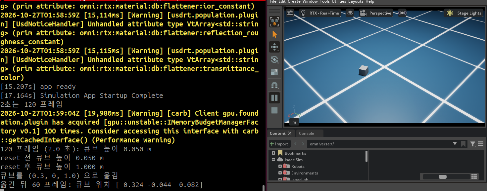

# L2. 연습 문제 정답

---

## 정답 코드

### L2_world_time_answer.py

```python
"""[L2 연습 정답] World 와 프레임 시간

TODO 2 답: world.reset() 은 장면의 모든 물체를 처음 상태(위치, 속도)로 되돌린다. 그래서 바닥에 있던 큐브가
           다시 1 m 높이로 돌아가 떨어진다.
TODO 3 답: set_world_pose 는 그 물체 하나만 옮긴다. reset 과 달리 다른 물체와 시뮬레이션 상태는 그대로다.
"""

# ============================================================
# 1. 앱 시작 (Isaac 모듈보다 먼저)
# ============================================================
from isaacsim import SimulationApp

simulation_app = SimulationApp({"headless": False})

# ============================================================
# 2. Isaac 모듈 import (앱을 켠 뒤에)
# ============================================================
import numpy as np
import omni.kit.commands
from isaacsim.core.api import World
from isaacsim.core.api.objects import DynamicCuboid

RENDERING_DT = 1.0 / 60.0

world = World(stage_units_in_meters=1.0, physics_dt=1.0 / 120.0, rendering_dt=RENDERING_DT)
world.scene.add_default_ground_plane()
# 조명: 화면 위 Lighting 메뉴에서 "Default" 를 고른 것과 같다
omni.kit.commands.execute("SetLightingMenuModeCommand", lighting_mode="Default")
cube = world.scene.add(
    DynamicCuboid(prim_path="/World/Cube", name="cube", position=np.array([0.0, 0.0, 1.0]), size=0.1)
)
world.reset()

FRAMES_2S = round(2.0 / RENDERING_DT)  # TODO 1: 2초 = 120 프레임
print(f"2초는 {FRAMES_2S} 프레임")

# ============================================================
# 3. 메인 루프 (창이 열려 있는 동안 한 프레임씩 진행)
# ============================================================
frame = 0
while simulation_app.is_running():
    world.step(render=True)
    frame += 1
    height = cube.get_world_pose()[0][2]
    if frame == FRAMES_2S:  # TODO 1
        print(f"{frame} 프레임 ({frame * RENDERING_DT:.1f} 초): 큐브 높이 {height:.3f} m")
    if frame == 180:  # TODO 2
        print(f"reset 전 큐브 높이 {height:.3f} m")
        world.reset()
        print(f"reset 후 큐브 높이 {cube.get_world_pose()[0][2]:.3f} m")
    if frame == 300:  # TODO 3
        cube.set_world_pose(position=np.array([0.3, 0.0, 1.0]))
        print("큐브를 (0.3, 0, 1.0) 으로 옮김")
    if frame == 360:  # TODO 3
        print(f"옮긴 뒤 60 프레임: 큐브 위치 {np.round(cube.get_world_pose()[0], 3)}")

# ============================================================
# 4. 종료
# ============================================================
simulation_app.close()

```

```bash
cd ~/cobot3_ws/isaacpjt/M0609/basic
isaac_python L2_world_time_answer.py
```



---

## 해설
1. **2초 뒤 큐브 높이**
   ```python
   FRAMES_2S = round(2.0 / RENDERING_DT)   # 2 / (1/60) = 120
   ...
   if frame == FRAMES_2S:
       print(f"{frame} 프레임 ({frame * RENDERING_DT:.1f} 초): 큐브 높이 {height:.3f} m")
   ```
   - **시간 / rendering_dt = 프레임 수**. 2초 = 2 / (1/60) = 120 프레임
   - `round()` 를 쓰는 이유: `2.0 / (1/60)` 은 소수 계산 오차로 `119.99999...` 처럼 나올 수 있다. `int()` 로 자르면 119 가 되므로 반올림한다
   - `frame == FRAMES_2S` 는 정확히 그 프레임 한 번만 True 라서 한 번만 출력된다
   - 결과: 큐브는 1초도 안 돼 바닥에 닿으므로 2초 뒤 높이는 약 `0.050 m` (큐브 반 변)
2. **루프 도중 reset**
   ```python
   if frame == 180:
       print(f"reset 전 큐브 높이 {height:.3f} m")
       world.reset()
       print(f"reset 후 큐브 높이 {cube.get_world_pose()[0][2]:.3f} m")
   ```
   - reset 전: 바닥에 놓인 상태라 약 `0.050 m`
   - reset 후: `1.000 m`. 큐브가 처음 위치로 돌아가 다시 떨어진다
   - **`world.reset()` 은 장면의 모든 물체를 처음 상태(위치, 속도)로 되돌린다**
   - reset 후 높이는 `height` 변수가 아니라 다시 `get_world_pose()` 로 읽어야 한다. `height` 는 reset 전에 읽어 둔 값이다
3. **물체 하나만 옮기기**
   ```python
   if frame == 300:
       cube.set_world_pose(position=np.array([0.3, 0.0, 1.0]))
   if frame == 360:
       print(f"옮긴 뒤 60 프레임: 큐브 위치 {np.round(cube.get_world_pose()[0], 3)}")
   ```
   - 360 프레임(옮긴 지 1초 뒤) 위치: 약 `[0.3 0. 0.05]`. 옮긴 자리에서 다시 떨어져 바닥에 놓였다
   - **reset 과의 차이**
     - `world.reset()`: 장면 **전체** 를 처음 상태로
     - `set_world_pose()`: 그 물체 **하나** 만 원하는 위치로. 다른 물체와 시뮬레이션은 그대로 이어진다

---

## 확인할 것
- [ ] 2초가 120 프레임인 이유를 계산으로 설명할 수 있다
- [ ] `world.reset()` 과 `set_world_pose()` 의 차이를 설명할 수 있다
