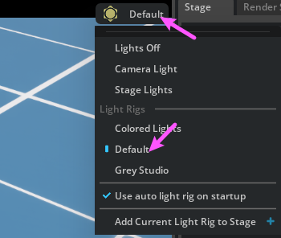
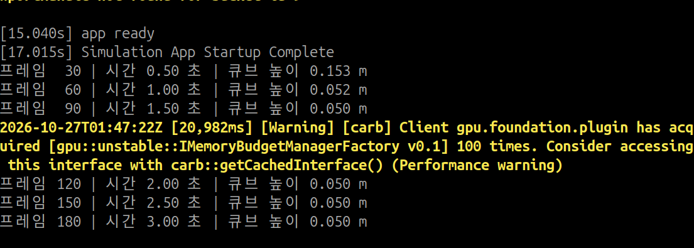

# L2. World 와 프레임 시간

---

## 학습 목표
- `World` 를 만들고 물체 추가 -> `reset()` -> `step()` 순서로 시뮬레이션을 진행할 수 있다
- 프레임 수와 시간의 관계(`프레임 수 x rendering_dt = 시간`)로 "몇 초 뒤" 를 "몇 프레임 뒤" 로 바꿀 수 있다
- `world.reset()` 이 장면을 처음 상태로 되돌린다는 것을 설명할 수 있다

---

## 핵심 개념

### World
`World` 는 장면(물체들)과 물리 시뮬레이션을 관리한다. 프로그램에 하나만 만든다.

| 코드 | 의미 |
|---|---|
| `World(rendering_dt=1/60)` | 시뮬레이션 설정 ("프레임 시간") |
| `world.scene.add(...)` | 장면에 물체 추가 (큐브, 로봇 등) |
| `world.reset()` | 장면의 모든 물체를 처음 상태(위치, 속도)로 되돌림. 물체를 다 넣은 뒤 한 번 호출 |
| `world.step(render=True)` | 한 프레임 진행. 중력, 충돌 같은 물리 계산은 이 안에서 Isaac Sim 이 알아서 한다 |

### 프레임 시간
- `world.step()` 한 번 = **한 프레임** = `rendering_dt` 초 (1/60 초)
- **프레임 수 x rendering_dt = 시간**. 예) 2초 = 2 / (1/60) = 120 프레임

### 조명
화면의 기본 조명(Default)을 켠다.

```python
import omni.kit.commands

omni.kit.commands.execute("SetLightingMenuModeCommand", lighting_mode="Default")
```

- 창 위쪽 **Lighting** 메뉴에서 **Default** 를 고른 것과 같다
  

---

## 실행

### L2_world_time.py

```python
"""[L2 예제] World 와 프레임 시간

실행: isaac_python L2_world_time.py   (창을 닫으면 종료)
"""

# ============================================================
# 1. 앱 시작 (Isaac 모듈보다 먼저)
# ============================================================
from isaacsim import SimulationApp

simulation_app = SimulationApp({"headless": False})

# ============================================================
# 2. Isaac 모듈 import (앱을 켠 뒤에)
# ============================================================
import numpy as np
import omni.kit.commands
from isaacsim.core.api import World
from isaacsim.core.api.objects import DynamicCuboid

RENDERING_DT = 1.0 / 60.0  # 한 프레임의 시간 (초)

# 장면 구성: World 생성 -> 물체 추가 -> reset
world = World(stage_units_in_meters=1.0, physics_dt=1.0 / 120.0, rendering_dt=RENDERING_DT)
world.scene.add_default_ground_plane()
# 조명: 화면 위 Lighting 메뉴에서 "Default" 를 고른 것과 같다
omni.kit.commands.execute("SetLightingMenuModeCommand", lighting_mode="Default")
cube = world.scene.add(
    DynamicCuboid(prim_path="/World/Cube", name="cube", position=np.array([0.0, 0.0, 1.0]), size=0.1)
)
world.reset()  # 물체를 다 넣은 뒤 한 번: 물리를 시작할 준비

# ============================================================
# 3. 메인 루프 (창이 열려 있는 동안 한 프레임씩 진행)
# ============================================================
frame = 0
while simulation_app.is_running():
    world.step(render=True)  # 한 프레임(1/60 초) 진행. 이 안에서 큐브가 중력으로 떨어진다
    frame += 1
    if frame % 30 == 0 and frame <= 180:  # 처음 180 프레임 동안 30 프레임마다 출력
        height = cube.get_world_pose()[0][2]
        print(f"프레임 {frame:3d} | 시간 {frame * RENDERING_DT:.2f} 초 | 큐브 높이 {height:.3f} m")

# ============================================================
# 4. 종료
# ============================================================
simulation_app.close()

```

```bash
cd ~/cobot3_ws/isaacpjt/M0609/basic
isaac_python L2_world_time.py
```



- 1 m 높이에서 큐브가 떨어진다
- 처음 180 프레임(3초) 동안 30 프레임마다 프레임 번호, 시간, 큐브 높이를 출력한다
- 큐브 크기가 0.1 m 라서 바닥에 놓이면 높이(중심)가 0.05 m 다

---

## 연습 문제

### L2_world_time_quiz.py

```python
"""[L2 연습] World 와 프레임 시간 (문제는 L2_world_time_readme.md 의 "연습 문제")

실행: isaac_python L2_world_time_quiz.py
"""

# ============================================================
# 1. 앱 시작 (Isaac 모듈보다 먼저)
# ============================================================
from isaacsim import SimulationApp

simulation_app = SimulationApp({"headless": False})

# ============================================================
# 2. Isaac 모듈 import (앱을 켠 뒤에)
# ============================================================
import numpy as np
import omni.kit.commands
from isaacsim.core.api import World
from isaacsim.core.api.objects import DynamicCuboid

RENDERING_DT = 1.0 / 60.0

world = World(stage_units_in_meters=1.0, physics_dt=1.0 / 120.0, rendering_dt=RENDERING_DT)
world.scene.add_default_ground_plane()
# 조명: 화면 위 Lighting 메뉴에서 "Default" 를 고른 것과 같다
omni.kit.commands.execute("SetLightingMenuModeCommand", lighting_mode="Default")
cube = world.scene.add(
    DynamicCuboid(prim_path="/World/Cube", name="cube", position=np.array([0.0, 0.0, 1.0]), size=0.1)
)
world.reset()

# TODO 1

# ============================================================
# 3. 메인 루프 (창이 열려 있는 동안 한 프레임씩 진행)
# ============================================================
frame = 0
while simulation_app.is_running():
    world.step(render=True)
    frame += 1
    # TODO 1
    # TODO 2
    # TODO 3

# ============================================================
# 4. 종료
# ============================================================
simulation_app.close()

```

코드 안의 `# TODO 1` ~ `# TODO 3` 위치를 채운다.

1. **2초 뒤 큐브 높이**
   - 2초가 몇 프레임인지 `RENDERING_DT` 로 계산해 변수에 저장하고 출력한다 (`round(2.0 / RENDERING_DT)`)
   - 그 프레임이 되면 프레임 번호, 시간(초), 큐브 높이를 출력한다
   - 큐브 높이: `cube.get_world_pose()[0][2]`
2. **루프 도중 reset**
   - 180 프레임이 되면 큐브 높이를 출력하고, `world.reset()` 을 부른 뒤 다시 높이를 출력한다
   - 큐브가 어떻게 되는지 보고, `reset()` 이 무엇을 하는지 적어 본다
3. **물체 하나만 옮기기**
   - 300 프레임이 되면 `cube.set_world_pose(position=np.array([0.3, 0.0, 1.0]))` 로 큐브를 옮긴다
   - 360 프레임에 큐브 위치를 출력한다
   - `reset()` 과 무엇이 다른지 적어 본다

---

## 확인할 것
- [ ] "N 초 뒤" 를 프레임 수로 바꿀 수 있다
- [ ] `world.reset()` 이 무엇을 하는지 설명할 수 있다
- [ ] 연습 문제 TODO 3개를 완료했다
