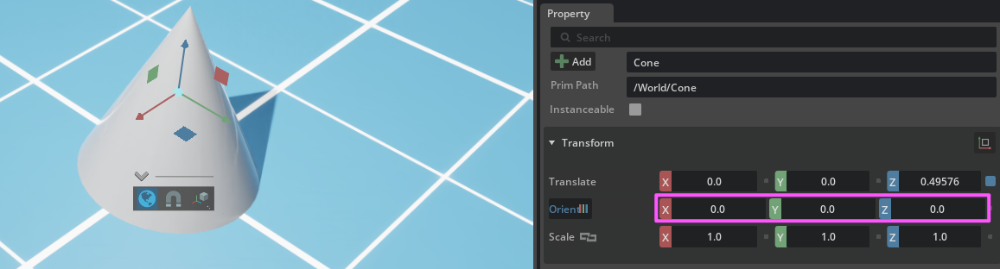
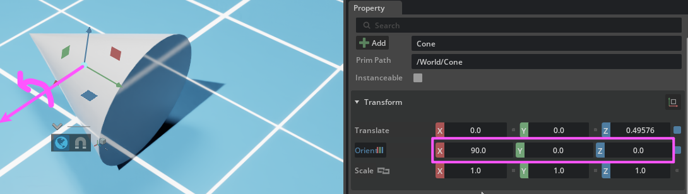
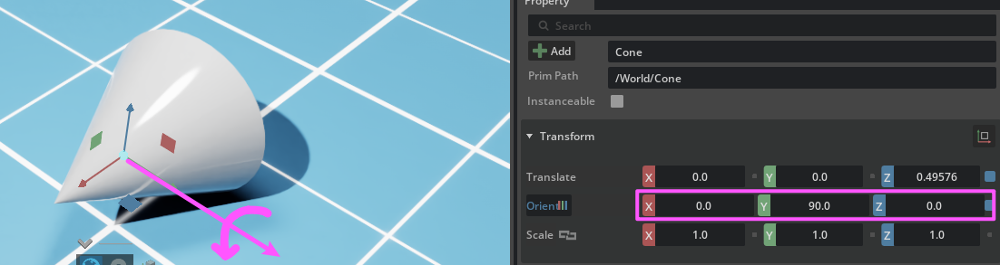
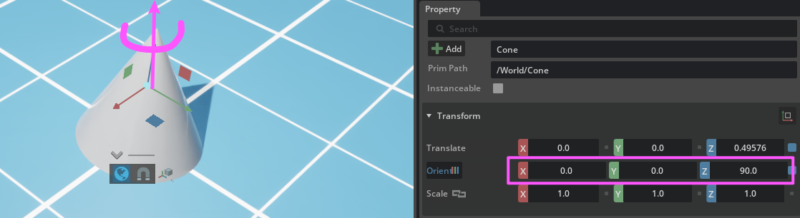
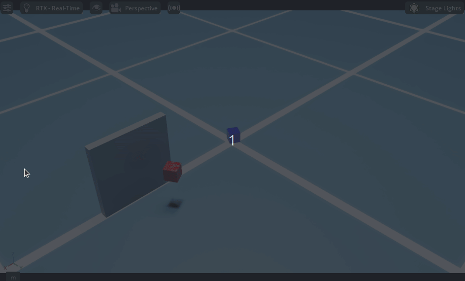
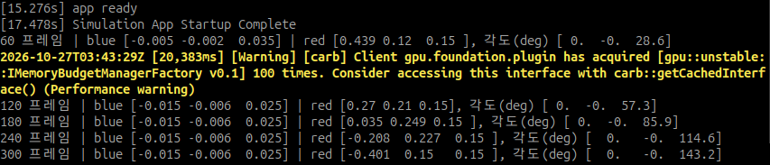
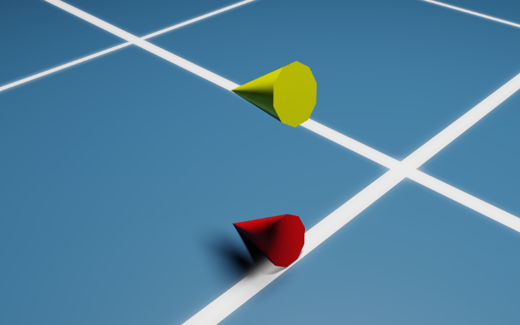
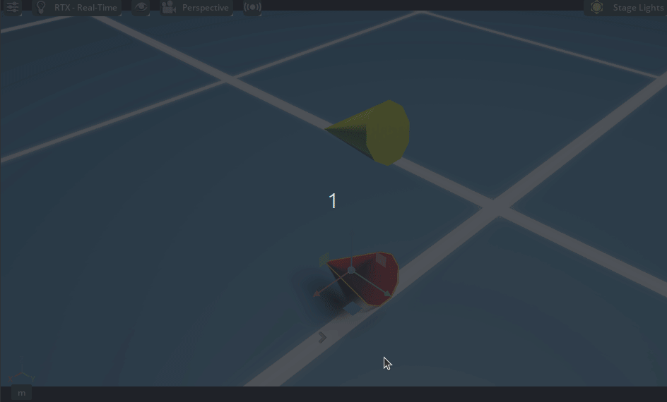
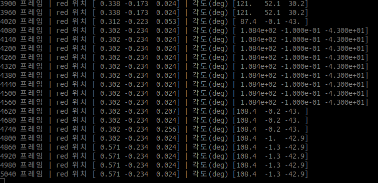

# L3. 장면 객체: 추가, 조회, 이동

---

## 학습 목표
- `Dynamic`, `Fixed`, `Visual` 물체의 차이(물리, 충돌)를 설명하고 골라 쓸 수 있다
- 장면에 물체를 추가하고, 이름으로 찾고, 위치와 자세를 읽고 바꿀 수 있다
- 자세를 각도(deg)로 생각하고 쿼터니언으로 바꿔 넣고 읽을 수 있다

---

## 핵심 개념

### 세 종류의 물체
| 종류 | 물리(중력) | 충돌 | 용도 예 |
|---|---|---|---|
| `DynamicCuboid` | O | O | 집을 큐브 |
| `FixedCuboid` | X | O | 벽 (부딪히지만 움직이지 않음) |
| `VisualCuboid` | X | X | 목표 위치 표시 (보이기만 함) |

- 모양만 다르고 같은 세 종류가 원뿔(`DynamicCone`, `FixedCone`, `VisualCone`), 구(`...Sphere`), 원기둥(`...Cylinder`)에도 있다
- 원뿔은 `radius`(밑면 반지름), `height`(높이)로 크기를 정한다. 뾰족한 끝이 처음에는 위(+z)를 향한다

### 물체 다루기
| 코드 | 의미 |
|---|---|
| `world.scene.add(DynamicCuboid(prim_path=..., name=..., position=..., scale=..., size=1.0, color=...))` | 장면에 추가. 돌려받은 객체를 변수에 저장 |
| `world.scene.get_object("이름")` | 이름으로 다시 찾기 |
| `obj.get_world_pose()` | (위치 `[x, y, z]`, 자세 쿼터니언 `[w, x, y, z]`) 두 개를 돌려줌 |
| `obj.set_world_pose(position=..., orientation=...)` | 위치, 자세 바꾸기 (하나만 줘도 된다) |

- **prim_path**: 장면 안의 주소. 폴더처럼 `/World/Blue` 식으로 쓴다. 겹치면 안 된다
- **name**: scene 에서 찾을 때 쓰는 이름. 겹치면 안 된다
- **size 와 scale**: `size=1.0` 에 `scale=[0.3, 0.03, 0.3]` 이면 30 x 3 x 30 cm 상자
- **좌표**: 단위는 m. z 가 위쪽. 로봇은 원점(0, 0, 0)에 서 있다

### 자세 (orientation)
Isaac Sim 은 자세를 **쿼터니언** `[w, x, y, z]` 4개 숫자로 다룬다. 사람이 직접 계산하기 어려우므로 **각도(deg)로 생각하고 변환 함수로 바꾼다**.

| 코드 | 의미 |
|---|---|
| `euler_angles_to_quat(np.array([rx, ry, rz]), degrees=True)` | 각도(deg) -> 쿼터니언. 넣을 때 |
| `quat_to_euler_angles(q, degrees=True)` | 쿼터니언 -> 각도(deg). 읽을 때 |

- `[rx, ry, rz]`: x, y, z 축 둘레로 돌린 각도. 예) `[0, 0, 90]` = 위에서 볼 때 반시계로 90 deg
  

  

  

  

- import: `from isaacsim.core.utils.rotations import euler_angles_to_quat, quat_to_euler_angles`
- 각도는 -180 ~ 180 으로 나온다. 190 deg 는 -170 deg 로 출력된다

---

## 실행

### L3_scene_objects.py

```python
"""[L3 예제] 장면 객체: 추가, 조회, 이동

실행: isaac_python L3_scene_objects.py
"""

# ============================================================
# 1. 앱 시작 (Isaac 모듈보다 먼저)
# ============================================================
from isaacsim import SimulationApp

simulation_app = SimulationApp({"headless": False})

# ============================================================
# 2. Isaac 모듈 import (앱을 켠 뒤에)
# ============================================================
import numpy as np
import omni.kit.commands
from isaacsim.core.api import World
from isaacsim.core.api.objects import DynamicCuboid, FixedCuboid, VisualCuboid
from isaacsim.core.utils.rotations import euler_angles_to_quat, quat_to_euler_angles

world = World(stage_units_in_meters=1.0)
world.scene.add_default_ground_plane()

# 조명: 화면 위 Lighting 메뉴에서 "Default" 를 고른 것과 같다
omni.kit.commands.execute("SetLightingMenuModeCommand", lighting_mode="Default")

# 1) 떨어지는 파란 큐브 (5 cm)
world.scene.add(
    DynamicCuboid(
        prim_path="/World/Blue", name="blue", position=np.array([0.0, 0.0, 1.0]),
        scale=np.array([0.05, 0.05, 0.05]), size=1.0, color=np.array([0, 0, 1.0]),
    )
)
# 2) 움직이지 않는 회색 벽 (30 x 3 x 30 cm)
world.scene.add(
    FixedCuboid(
        prim_path="/World/Wall", name="wall", position=np.array([0.5, 0.0, 0.15]),
        scale=np.array([0.3, 0.03, 0.3]), size=1.0, color=np.array([0.5, 0.5, 0.5]),
    )
)
# 3) 보이기만 하는 빨간 타겟 (파란 큐브 둘레를 돌며 벽을 그대로 통과)
red = world.scene.add(
    VisualCuboid(
        prim_path="/World/Red", name="red", position=np.array([0.5, 0.0, 0.15]),
        size=0.05, color=np.array([1.0, 0, 0]),
    )
)
world.reset()

# ============================================================
# 3. 메인 루프 (창이 열려 있는 동안 한 프레임씩 진행)
# ============================================================
frame = 0
while simulation_app.is_running():
    world.step(render=True)
    frame += 1
    angle = frame / 120.0  # 120 프레임(2초)에 1 rad
    # 파란 큐브 (0, 0) 둘레의 타원 (x 방향 0.5 m, y 방향 0.25 m): 한 바퀴에 한 번 벽 중심 (0.5, 0) 을 지난다
    # 자세: 도는 각도만큼 z 축 둘레로 돌린다
    yaw = np.degrees(angle)
    red.set_world_pose(
        position=np.array([0.5 * np.cos(angle), 0.25 * np.sin(angle), 0.15]),
        orientation=euler_angles_to_quat(np.array([0, 0, yaw]), degrees=True),
    )
    if frame % 60 == 0 and frame <= 300:  # 처음 300 프레임 동안 60 프레임마다 출력
        blue = world.scene.get_object("blue")  # 이름으로 찾기
        red_position, red_orientation = red.get_world_pose()
        red_angles = quat_to_euler_angles(red_orientation, degrees=True)
        print(f"{frame} 프레임 | blue {np.round(blue.get_world_pose()[0], 3)} | red {np.round(red_position, 3)}, 각도(deg) {np.round(red_angles, 1)}")

# ============================================================
# 4. 종료
# ============================================================
simulation_app.close()

```

```bash
cd ~/cobot3_ws/isaacpjt/M0609/basic
isaac_python L3_scene_objects.py
```





- 파란 큐브(`blue`)가 떨어지고, 회색 벽(`wall`)은 움직이지 않으며, 빨간 타겟(`red`)이 파란 큐브 둘레를 타원으로 돈다
- `red` 는 `VisualCuboid` 라서 충돌이 없다. 한 바퀴(약 12초)마다 회색 벽을 그대로 통과한다
- `red` 는 도는 각도만큼 z 축 둘레로 함께 돈다
- 60 프레임마다 `blue` 와 `red` 의 위치, `red` 의 각도(deg)를 출력한다

---

## 연습 문제

### L3_scene_objects_quiz.py

```python
"""[L3 연습] 장면 객체: 위치와 자세 (문제는 L3_scene_objects_readme.md 의 "연습 문제")

실행: isaac_python L3_scene_objects_quiz.py
"""

# ============================================================
# 1. 앱 시작 (Isaac 모듈보다 먼저)
# ============================================================
from isaacsim import SimulationApp

simulation_app = SimulationApp({"headless": False})

# ============================================================
# 2. Isaac 모듈 import (앱을 켠 뒤에)
# ============================================================
import numpy as np
from isaacsim.core.api import World
from isaacsim.core.api.objects import DynamicCone, VisualCone
from isaacsim.core.utils.rotations import euler_angles_to_quat, quat_to_euler_angles

world = World(stage_units_in_meters=1.0)
world.scene.add_default_ground_plane()

# TODO 1

world.reset()

# ============================================================
# 3. 메인 루프 (창이 열려 있는 동안 한 프레임씩 진행)
# ============================================================
frame = 0
while simulation_app.is_running():
    world.step(render=True)
    frame += 1
    # TODO 2
    # TODO 3

# ============================================================
# 4. 종료
# ============================================================
simulation_app.close()
```

코드 안의 `# TODO 1` ~ `# TODO 3` 위치를 채운다.

1. **원뿔 두 개 추가**
   - `red`: `DynamicCone`, 위치 `(0.4, 0.0, 0.5)`, x 축으로 60 deg 기울인 자세(`euler_angles_to_quat`), 반지름 0.05 m, 높이 0.15 m, 빨간색
   - `yellow`: `VisualCone`, 위치 `(0.4, 0.0, 0.8)`, 같은 크기, 노란색
   - 실행해서 `red` 는 떨어져 넘어지고 `yellow` 는 공중에 그대로 있는지 확인한다

   
2. **위치, 자세 복사**
   - 매 프레임 `red.get_world_pose()` 로 위치와 자세를 읽는다
   - `yellow.set_world_pose()` 로 위치는 `red` 보다 0.3 m 위, 자세는 그대로 넣는다
   - Play 중에  `red` 를 끌어 던져 보고, `yellow` 가 따라 하는지 확인한다
     
3. **각도 출력**
   - 60 프레임마다 `red` 의 위치와 각도(deg, `quat_to_euler_angles`)를 출력한다
   - `red` 를 굴려 보며 어느 각도가 바뀌는지 본다. 원뿔을 자기 축 둘레로 돌리면 모양은 그대로지만 숫자는 바뀐다
     

---

## 확인할 것
- [ ] `Dynamic`, `Fixed`, `Visual` 의 차이를 설명할 수 있다
- [ ] `get_world_pose()` 가 돌려주는 두 값이 무엇인지 설명할 수 있다
- [ ] 각도(deg)와 쿼터니언을 서로 바꿀 수 있다
- [ ] 연습 문제 TODO 3개를 완료했다
