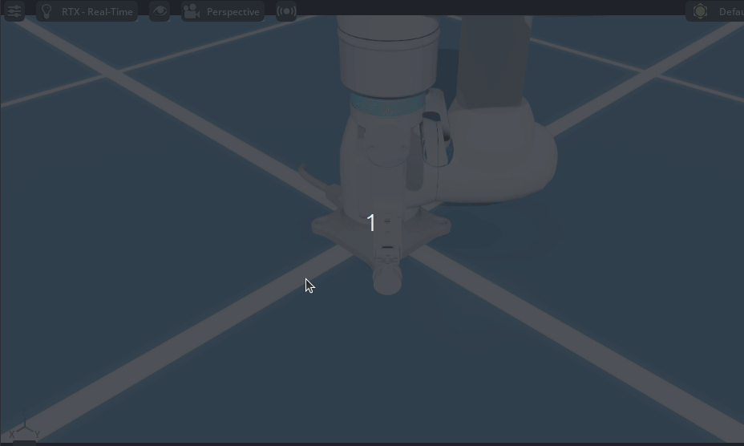
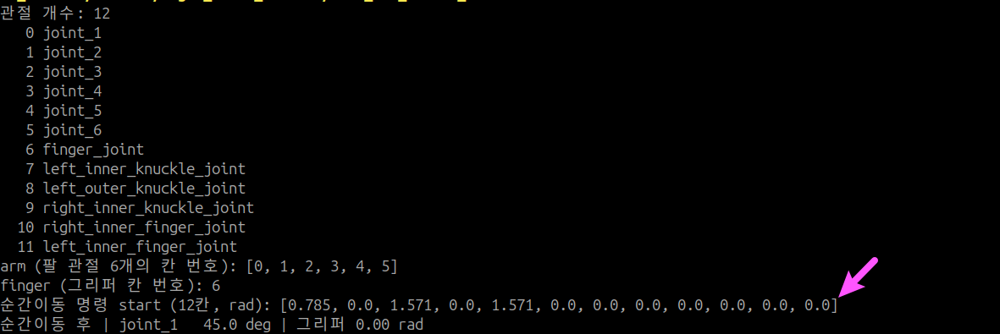
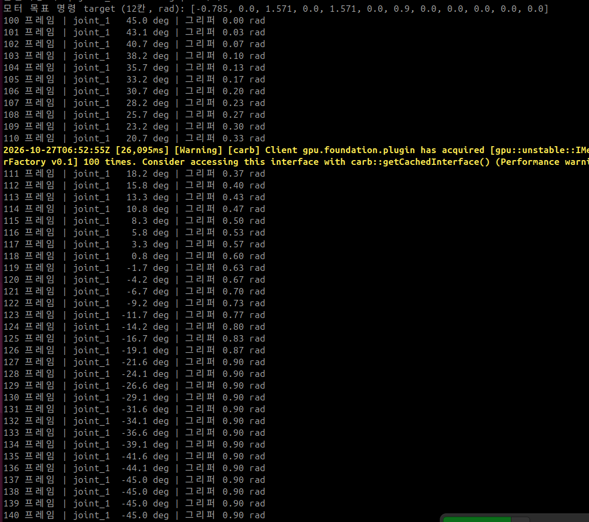
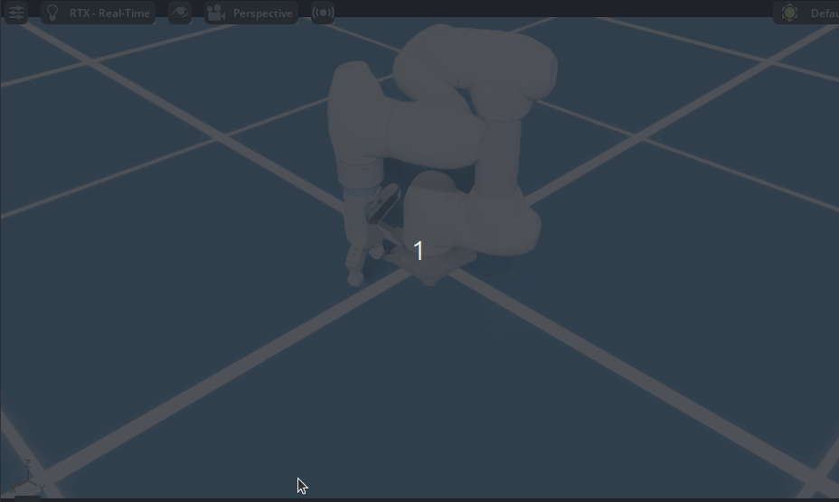
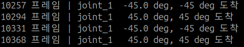

# L4. 로봇 불러오기와 관절 제어

---

## 학습 목표
- 로봇 USD 를 장면에 불러오고 관절(dof) 목록을 확인할 수 있다
- 관절을 순간이동(`set_joint_positions`)과 모터 목표(`apply_action`)로 움직이고, 두 방법의 차이를 설명할 수 있다
- 모터 목표를 보낸 뒤, 관절이 목표에 도착했는지 판정할 수 있다

---

## 핵심 개념

### 로봇 기초 용어
| 용어 | 뜻 |
|---|---|
| 관절 (joint) | 로봇 팔의 회전하는 마디. M0609 은 joint_1 (바닥 회전) ~ joint_6 (손목 회전) |
| dof | 움직일 수 있는 관절 수. M0609 팔 6 + RG2 그리퍼 6 = 12 |
| mimic 관절 | 다른 관절을 따라 움직이는 관절. RG2 는 `finger_joint` 만 움직이면 나머지 손가락이 따라온다 |
| 각도 단위 | 코드에서는 rad. `np.radians(90)` = 1.5708 |
| 홈 자세 | `[0, 0, 90, 0, 90, 0]` deg. <br />Join3, 5 번만 90도로 설정. |
| USD | Isaac Sim 의 장면/모델 파일 형식. 로봇 모양, 관절, 모터 설정이 들어 있다 |

### 관절을 움직이는 두 방법
| 방법 | 코드 | 언제 |
|---|---|---|
| 순간이동 | `robot.set_joint_positions(값)` | 시작, reset 할 때 자세 맞추기 |
| 모터 목표 | `robot.apply_action(ArticulationAction(joint_positions=값))` | 실제 제어. 모터가 힘을 써서 목표로 간다 |

- **순간이동**: 그 프레임에 바로 그 각도가 된다. Isaac Sim 5.1 은 이때 모터 목표도 같은 값으로 바꿔 주므로 자세가 유지된다
- **모터 목표**: 모터가 힘을 써서 **여러 프레임에 걸쳐** 목표로 간다. 실제 로봇처럼 움직인다
- 관절값 배열은 12칸이다. 팔 관절만 다룰 때는 `arm = [robot.get_dof_index(이름) ...]` 처럼 칸 번호 목록을 만들어 `값[arm]` 으로 꺼내고 넣는다

---

## 실행

### L4_robot_joints.py

```python
"""[L4 예제] M0609 로봇 불러오기와 관절 제어

실행: isaac_python L4_robot_joints.py
"""

from pathlib import Path

# ============================================================
# 1. 앱 시작 (Isaac 모듈보다 먼저)
# ============================================================
from isaacsim import SimulationApp

simulation_app = SimulationApp({"headless": False})

# ============================================================
# 2. Isaac 모듈 import (앱을 켠 뒤에)
# ============================================================
import numpy as np
import omni.kit.commands
from isaacsim.core.api import World
from isaacsim.core.prims import SingleArticulation
from isaacsim.core.utils.stage import add_reference_to_stage
from isaacsim.core.utils.types import ArticulationAction

ROBOT_USD = Path(__file__).resolve().parents[1] / "robot" / "m0609_rg2_d455.usd"  # isaacpjt/M0609/robot

world = World(stage_units_in_meters=1.0)
world.scene.add_default_ground_plane()
# 조명: 화면 위 Lighting 메뉴에서 "Default" 를 고른 것과 같다
omni.kit.commands.execute("SetLightingMenuModeCommand", lighting_mode="Default")

# (가) 로봇 USD 참조: 파일의 기본 prim(로봇)을 /World/m0609_rg2_d455 에 넣는다
add_reference_to_stage(usd_path=str(ROBOT_USD), prim_path="/World/m0609_rg2_d455")
robot = world.scene.add(SingleArticulation(prim_path="/World/m0609_rg2_d455", name="m0609"))
world.reset()  # reset 후에 관절 정보를 읽을 수 있다

# (나) 관절 정보
print("관절 개수:", robot.num_dof)
for index, name in enumerate(robot.dof_names):
    print(f"  {index:2d} {name}")
arm = [robot.get_dof_index(f"joint_{i}") for i in range(1, 7)]
finger = robot.get_dof_index("finger_joint")
print("arm (팔 관절 6개의 칸 번호):", arm)
print("finger (그리퍼 칸 번호):", finger)

# (다) 순간이동: joint_1 45 deg, 그리퍼 열기
start = np.zeros(robot.num_dof)
start[arm] = np.radians([45, 0, 90, 0, 90, 0])  # 팔
start[finger] = 0.0                             # 그리퍼 열기 (0.0 rad)
print("순간이동 명령 start (12칸, rad):", np.round(start, 3).tolist())
robot.set_joint_positions(start)
q = robot.get_joint_positions()
print(f"순간이동 후 | joint_1 {np.degrees(q[arm[0]]):6.1f} deg | 그리퍼 {abs(q[finger]):.2f} rad")


# ============================================================
# 3. 메인 루프 (창이 열려 있는 동안 한 프레임씩 진행)
# ============================================================
MOVE_FRAME = 100  # 이 프레임에 모터 목표를 보낸다 (그 전까지는 순간이동한 자세 그대로)
END_FRAME = 150  # 이 프레임까지 출력한다 (joint_1 이 -45 deg 에 도착하는 데 약 37 프레임 걸림)

frame = 0
while simulation_app.is_running():
    world.step(render=True)
    frame += 1
    if frame == MOVE_FRAME:  # (라) 모터 목표: joint_1 -45 deg, 그리퍼 닫기
        target = start.copy()
        target[arm] = np.radians([-45, 0, 90, 0, 90, 0])  # 팔
        target[finger] = 0.9                              # 그리퍼 닫기 (0.9 rad)
        print("모터 목표 명령 target (12칸, rad):", np.round(target, 3).tolist())
        robot.apply_action(ArticulationAction(joint_positions=target))
    if MOVE_FRAME <= frame <= END_FRAME:  # 목표를 보낸 뒤 매 프레임 출력
        q = robot.get_joint_positions()
        print(f"{frame} 프레임 | joint_1 {np.degrees(q[arm[0]]):6.1f} deg | 그리퍼 {abs(q[finger]):.2f} rad")

# ============================================================
# 4. 종료
# ============================================================
simulation_app.close()

```

```bash
cd ~/cobot3_ws/isaacpjt/M0609/basic
isaac_python L4_robot_joints.py
```



- 로봇의 관절 12개 이름을 출력한다
- `arm` 은 `[0, 1, 2, 3, 4, 5]`, `finger` 는 `6` 으로 출력된다. 관절값 배열 12칸 중 몇 번째 칸인지를 이름으로 찾은 것이다
- 시작할 때 joint_1 45 deg, 그리퍼 열림 자세로 순간이동한다. 바로 각도를 읽어 출력하면 프레임이 지나지 않았는데도 이미 45 deg 다
- 순간이동 명령 `start` 와 모터 목표 명령 `target` 을 보내기 직전에 출력한다. 관절값 배열 12칸(rad)이 그대로 보인다 (0.785 = 45 deg, 1.571 = 90 deg, 7번째 칸 = 그리퍼)
  
- 100 프레임에 모터 목표(joint_1 -45 deg, 그리퍼 0.9 닫힘)를 한 번 보내고, 그때부터 매 프레임 joint_1 과 그리퍼 각도를 출력한다
- 150 프레임까지 출력하고, 창은 닫을 때까지 열려 있다
- 모터 목표는 한 번만 보내도 모터가 목표에 갈 때까지 계속 움직인다
  

---

## 연습 문제

### L4_robot_joints_quiz.py

```python
직접 작성핫
```

**시나리오: 고개 젓는 로봇**

로봇이 홈 자세에서 출발해, 바닥 회전 관절(joint_1)로 좌우 45 deg 를 계속 오가게 만든다.

- 왼쪽(-45 deg)으로 갈 때는 그리퍼를 닫고, 오른쪽(45 deg)으로 갈 때는 연다
- 한쪽에 **도착한 것을 확인한 뒤에** 반대쪽으로 출발한다
- 도착할 때마다 몇 번째 프레임에 도착했는지 출력한다



- **출력 예**
  

---

## **확인할 것**
- [ ] 로봇의 12개 dof 이름과 칸 번호(`arm`, `finger`)를 출력해 봤다
- [ ] 순간이동과 모터 목표의 차이를 출력 숫자로 설명할 수 있다
- [ ] 목표에 도착했는지 판정하고 다음 동작으로 넘어가게 할 수 있다
- [ ] 연습 문제를 완료했다
