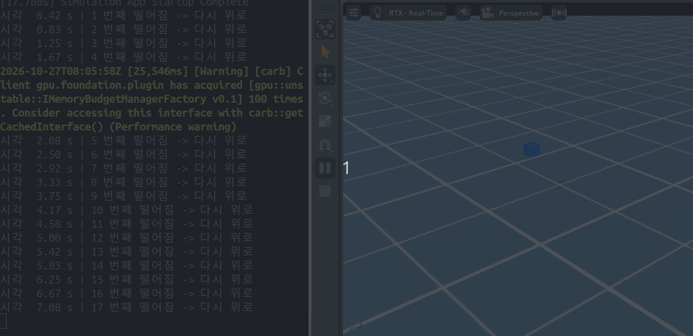
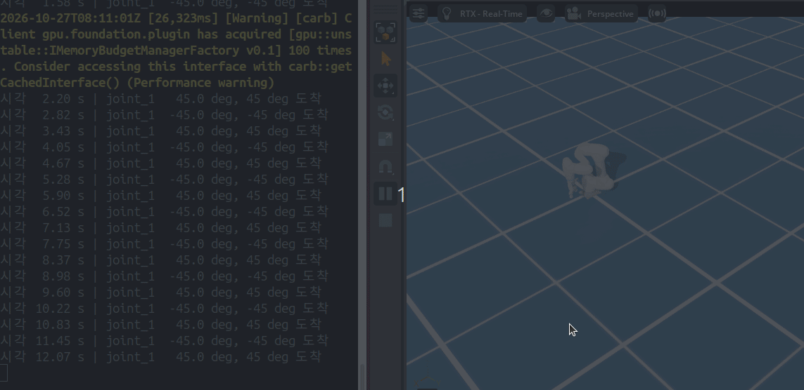

# L5. 메인 루프와 Play / Stop

---

## 학습 목표
- Play / Pause / Stop 상태를 코드에서 구분할 수 있다
- Stop -> Play 에서 에러가 나는 이유를 설명할 수 있다
- reset 할 때 장면과 내 변수를 함께 처음으로 되돌릴 수 있다 (`reset_needed` 패턴)

---

## 핵심 개념

### 타임라인 상태
창 왼쪽의 **Play / Pause / Stop** 버튼은 타임라인을 조작한다. 물리는 Play 중에만 계산된다.

| 상태 | 확인 코드 |
|---|---|
| 재생 중 | `world.is_playing()` |
| 정지 | `world.is_stopped()` |
| 일시정지 | 둘 다 False |

**Stop 의 함정**: **<span color="pink">Stop 을 누르면 물리 데이터가 지워진다</span>**. 그대로 Play 하면 `robot.get_joint_positions()` 가 `None` 을 돌려줘서 에러가 난다.

### 표준 메인 루프 (Isaac Sim 예제들이 쓰는 모양)
```python
reset_needed = False
while simulation_app.is_running():
    world.step(render=True)
    if world.is_stopped() and not reset_needed:   # 1) Stop 을 기억해 둔다
        reset_needed = True
    if world.is_playing():
        if reset_needed:                          # 2) Play 첫 프레임에 먼저 reset
            world.reset()
            # 내 변수 = 처음 값                    #    내가 만든 변수도 처음으로
            reset_needed = False
        q = robot.get_joint_positions()           # 3) 관측
        target = ...                              # 4) 계산
        robot.apply_action(ArticulationAction(joint_positions=target))  # 5) 명령
```

---

## 실행

### L5_main_loop.py

```python
"""[L5 예제] 메인 루프와 Play / Stop

실행: isaac_python L5_main_loop.py
      큐브가 떨어져 바닥 가까이 오면 다시 위로 올라간다. 창에서 Pause -> Play, Stop -> Play 를 눌러 본다
"""

# ============================================================
# 1. 앱 시작 (Isaac 모듈보다 먼저)
# ============================================================
from isaacsim import SimulationApp

simulation_app = SimulationApp({"headless": False})

# ============================================================
# 2. Isaac 모듈 import (앱을 켠 뒤에)
# ============================================================
import numpy as np
import omni.kit.commands
from isaacsim.core.api import World
from isaacsim.core.api.objects import DynamicCuboid

START_POSITION = np.array([0.0, 0.0, 1.0])
LOW_HEIGHT = 0.15  # 큐브 중심이 이보다 낮으면 "바닥 가까이" (바닥에 닿기 전에 올려서 튕기거나 구르지 않게)

world = World(stage_units_in_meters=1.0)
world.scene.add_default_ground_plane()
# 조명: 화면 위 Lighting 메뉴에서 "Default" 를 고른 것과 같다
omni.kit.commands.execute("SetLightingMenuModeCommand", lighting_mode="Default")
cube = world.scene.add(
    DynamicCuboid(prim_path="/World/Cube", name="cube", position=START_POSITION, size=0.1, color=np.array([0, 0, 1.0]))
)
world.reset()

drop_count = 0  # 내 변수: 떨어진 횟수

# ============================================================
# 3. 메인 루프 (창이 열려 있는 동안 한 프레임씩 진행)
# ============================================================
reset_needed = False
while simulation_app.is_running():
    world.step(render=True)

    # 1) Stop 을 감지해 둔다
    if world.is_stopped() and not reset_needed:
        reset_needed = True
        print("Stop 감지: 다음 Play 때 reset 한다")
    # 2) Play 중일 때만 제어 (Pause 중에는 물리도 내 코드도 멈춘다)
    if world.is_playing():
        if reset_needed:  # Stop 다음 첫 Play 프레임: 먼저 reset
            world.reset()   # 장면: 큐브는 처음 위치로, 시각은 0 으로
            drop_count = 0  # 내 변수도 처음 값으로
            reset_needed = False
            print("reset 완료: 처음부터 다시 시작")
        height = cube.get_world_pose()[0][2]  # 관측
        if height < LOW_HEIGHT:  # 계산: 바닥 가까이 왔으면
            drop_count += 1
            print(f"시각 {world.current_time:5.2f} s | {drop_count} 번째 떨어짐 -> 다시 위로")
            cube.set_world_pose(position=START_POSITION)  # 명령: 처음 위치로 올리고 멈춘 상태로
            cube.set_linear_velocity(np.zeros(3))

# ============================================================
# 4. 종료
# ============================================================
simulation_app.close()
```

```bash
cd ~/cobot3_ws/isaacpjt/M0609/basic
isaac_python L5_main_loop.py
```



- 1 m 높이에서 큐브가 떨어지고, 바닥 가까이(중심 높이 0.15 m 아래) 오면 처음 위치로 다시 올린다. 약 0.42 초마다 반복하며 떨어진 횟수(`drop_count`)와 시각을 출력한다
- 창에서 버튼을 눌러 비교해 본다
  | 버튼 | 큐브 | 시각, `drop_count` |
  |---|---|---|
  | Pause | 공중에서 멈춘다 | 멈춘다 |
  | Pause 뒤 Play | 멈춘 자리에서 이어서 떨어진다 | 이어서 늘어난다 |
  | Stop | `Stop 감지` 출력 |  |
  | Stop 뒤 Play | `reset 완료` 출력, 1 m 에서 다시 떨어진다 | 둘 다 0 부터 다시 |
- `world.reset()` 은 장면(큐브 위치, 속도, 시각)만 되돌린다. `drop_count` 같은 **내 변수**는 모르므로 직접 처음 값으로 되돌린다
- `set_world_pose()` 는 위치만 바꾸고 속도는 그대로 둔다. 큐브를 올릴 때 `set_linear_velocity(np.zeros(3))` 로 떨어지던 속도도 0 으로 만든다. 빼면 떨어질 때마다 점점 빨라진다

---

## 연습 문제

### L5_main_loop_quiz.py

```python
"""[L5 연습] Stop -> Play 해도 처음부터 다시 (문제는 L5_main_loop_readme.md 의 "연습 문제")

실행: isaac_python L5_main_loop_quiz.py
      창에서 Play 중에 Stop -> 다시 Play 를 눌러 보라
"""

from pathlib import Path

# ============================================================
# 1. 앱 시작 (Isaac 모듈보다 먼저)
# ============================================================
from isaacsim import SimulationApp

simulation_app = SimulationApp({"headless": False})

# ============================================================
# 2. Isaac 모듈 import (앱을 켠 뒤에)
# ============================================================
import numpy as np
import omni.kit.commands
from isaacsim.core.api import World
from isaacsim.core.prims import SingleArticulation
from isaacsim.core.utils.stage import add_reference_to_stage
from isaacsim.core.utils.types import ArticulationAction

ROBOT_USD = Path(__file__).resolve().parents[1] / "robot" / "m0609_rg2_d455.usd"
HOME_DEG = [0, 0, 90, 0, 90, 0]
TOLERANCE_DEG = 1.0  # 목표와 이만큼 안으로 들어오면 "도착"

world = World(stage_units_in_meters=1.0)
world.scene.add_default_ground_plane()
# 조명: 화면 위 Lighting 메뉴에서 "Default" 를 고른 것과 같다
omni.kit.commands.execute("SetLightingMenuModeCommand", lighting_mode="Default")
add_reference_to_stage(usd_path=str(ROBOT_USD), prim_path="/World/m0609_rg2_d455")
robot = world.scene.add(SingleArticulation(prim_path="/World/m0609_rg2_d455", name="m0609"))
world.reset()
arm = [robot.get_dof_index(f"joint_{i}") for i in range(1, 7)]
finger = robot.get_dof_index("finger_joint")

# 홈 자세: world.reset() 때 돌아갈 자세로 등록하고, 지금 순간이동
home = np.zeros(robot.num_dof)
home[arm] = np.radians(HOME_DEG)
robot.set_joints_default_state(positions=home)
robot.set_joint_positions(home)


def send_goal(goal_deg):
    """joint_1 을 goal_deg 로 보내는 모터 목표. -45 deg 로 갈 때 그리퍼 닫기, 45 deg 로 갈 때 열기"""
    target = home.copy()
    target[arm[0]] = np.radians(goal_deg)
    target[finger] = 0.9 if goal_deg < 0 else 0.0
    robot.apply_action(ArticulationAction(joint_positions=target))


goal_deg = -45.0  # 지금 joint_1 이 가고 있는 목표 (deg)
send_goal(goal_deg)

# ============================================================
# 3. 메인 루프 (창이 열려 있는 동안 한 프레임씩 진행)
# ============================================================
# TODO
while simulation_app.is_running():
    world.step(render=True)
    # TODO
    if world.is_playing():
        # TODO
        joint_1_deg = np.degrees(robot.get_joint_positions()[arm[0]])
        if abs(joint_1_deg - goal_deg) < TOLERANCE_DEG:
            print(f"시각 {world.current_time:5.2f} s | joint_1 {joint_1_deg:6.1f} deg, {goal_deg:.0f} deg 도착")
            goal_deg = -goal_deg
            send_goal(goal_deg)

# ============================================================
# 4. 종료
# ============================================================
simulation_app.close()
```



로봇의 joint_1 이 -45 deg 와 45 deg 를 오간다 (L4 연습 문제와 같은 동작). 메인 루프에 Stop 처리가 없다. 코드 안의 `# TODO` 위치를 채운다.

1. **Stop -> Play 해도 처음부터 다시 시작하게 만들기**
   - 먼저 그대로 실행해서 Play 중에 Stop -> 다시 Play 를 누른다. 에러 메시지에서 어느 줄인지, 무엇이 `None` 이라서 나는 에러인지 적어 본다
   - `reset_needed` 패턴을 넣는다: Stop 을 기억해 두고, Stop 다음 첫 Play 프레임에 `world.reset()` 을 먼저 한다
   - reset 할 때 `goal_deg` 를 처음 값으로 되돌리고, 첫 목표를 다시 보낸다
   - 확인: Stop -> Play 뒤 첫 출력이 `시각 0.33 s | joint_1 -44.2 deg, -45 deg 도착` 으로 처음 실행했을 때와 같아야 한다

---

## 확인할 것
- [ ] Play / Pause / Stop 일 때 물체와 시각이 어떻게 되는지 설명할 수 있다
- [ ] Stop -> Play 에러를 직접 재현하고 원인을 설명할 수 있다
- [ ] reset 할 때 `world.reset()` 말고 무엇을 더 되돌려야 하는지 설명할 수 있다
- [ ] 연습 문제를 완료했다
