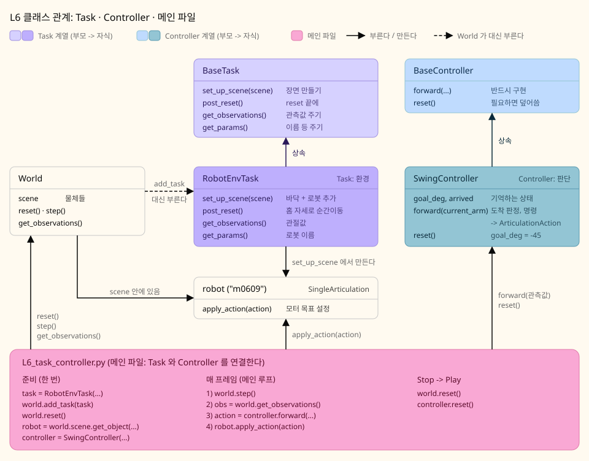
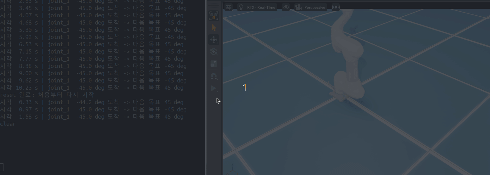
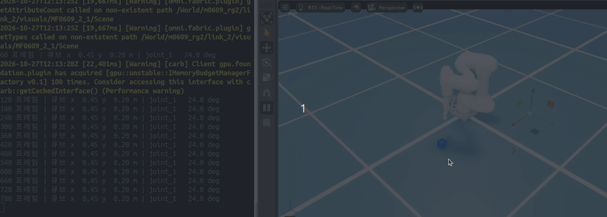

# L6. Task 와 Controller

---

## 학습 목표
- 코드를 Task(환경: 장면, 시작 자세, 관측)와 Controller(판단: 관측 -> 명령)로 나누는 이유를 설명할 수 있다
- `BaseTask` 를 상속해 장면을 만들고, 시작 자세를 맞추고, 관측값을 돌려줄 수 있다
- `BaseController` 를 상속해 `forward()` 에서 관측값으로 명령(`ArticulationAction`)을 계산할 수 있다

---

## 핵심 개념

### 두 가지 역할
Isaac Sim 예제는 코드를 두 역할로 나눈다.

| 역할 | 부모 클래스 | 하는 일 | 주요 함수 |
|---|---|---|---|
| Task | `BaseTask` | 장면 구성과 관측 | `set_up_scene`, `get_observations`, `get_params`, `post_reset` |
| Controller | `BaseController` | 관측 -> 명령 계산 | `forward`, `reset` |

메인 파일은 둘을 **연결**한다. Task 에게 관측값을 받아 Controller 에 넘기고, Controller 가 돌려준 명령을 로봇에 보낸다.

### 클래스 관계
- 회색은 Isaac Sim 이 준 부모 클래스, 파랑과 주황은 내가 만든 자식 클래스다
- Task 는 `world.add_task()` 로 World 에 등록한다. 그 뒤로는 World 가 정해진 때에 Task 의 함수를 대신 불러 준다
- Controller 는 World 와 상관없다. 메인 파일이 직접 `forward()` 와 `reset()` 을 부른다



### 실행

---

### L6_task_controller.py

```python
"""[L6 예제] Task 와 Controller 로 코드 나누기

실행: isaac_python L6_task_controller.py
"""

from pathlib import Path

# ============================================================
# 1. 앱 시작 (Isaac 모듈보다 먼저)
# ============================================================
from isaacsim import SimulationApp

simulation_app = SimulationApp({"headless": False})

# ============================================================
# 2. Isaac 모듈 import (앱을 켠 뒤에)
# ============================================================
import numpy as np
import omni.kit.commands
from isaacsim.core.api import World
from isaacsim.core.api.controllers import BaseController
from isaacsim.core.api.tasks import BaseTask
from isaacsim.core.prims import SingleArticulation
from isaacsim.core.utils.stage import add_reference_to_stage
from isaacsim.core.utils.types import ArticulationAction

ROBOT_USD = Path(__file__).resolve().parents[1] / "robot" / "m0609_rg2_d455.usd"
ARM_JOINTS = ["joint_1", "joint_2", "joint_3", "joint_4", "joint_5", "joint_6"]
HOME_DEG = [0, 0, 90, 0, 90, 0]
TOLERANCE_DEG = 1.0  # 목표와 이만큼 안으로 들어오면 "도착"


# ------------------------------------------------------------
# (가) Task: 로봇이 놓인 환경 (장면 + 시작 자세 + 관측값)
#      BaseTask 의 함수를 덮어써서 채운다. 직접 부르지 않아도 World 가 정해진 때에 불러 준다
# ------------------------------------------------------------
class RobotEnvTask(BaseTask):
    """장면(바닥 + M0609)을 만들고, 시작 자세를 맞추고, 관측값을 돌려준다"""

    # 언제: 첫 world.reset() 때 한 번
    # 할 일: 장면에 물체 추가
    def set_up_scene(self, scene):
        super().set_up_scene(scene)  # 부모 것을 먼저 (self.scene 을 저장한다)
        scene.add_default_ground_plane()
        add_reference_to_stage(usd_path=str(ROBOT_USD), prim_path="/World/m0609_rg2_d455")
        self._robot = scene.add(SingleArticulation(prim_path="/World/m0609_rg2_d455", name="m0609"))
        self._task_objects[self._robot.name] = self._robot  # 이 Task 에 속한 물체로 등록

    # 언제: 매 world.reset() 끝에 (Stop -> Play 때도)
    # 할 일: 시작 자세 맞추기 (홈 자세로 순간이동)
    def post_reset(self):
        home = np.zeros(self._robot.num_dof)
        for name, angle in zip(ARM_JOINTS, np.radians(HOME_DEG)):
            home[self._robot.get_dof_index(name)] = angle
        self._robot.set_joint_positions(home)

    # 언제: world.get_observations() 를 부를 때
    # 돌려줄 값: {물체 이름: {값 이름: 값}}
    def get_observations(self):
        return {self._robot.name: {"joint_positions": self._robot.get_joint_positions()}}

    # 언제: 메인 루프가 물체 이름을 알아낼 때 (task.get_params())
    # 돌려줄 값: {파라미터 이름: {"value": 값}}
    def get_params(self):
        return {"robot_name": {"value": self._robot.name}}


# ------------------------------------------------------------
# (나) Controller: 관측값을 받아 명령(ArticulationAction)을 계산한다
#      forward() 는 반드시 구현해야 한다. 기억하는 상태가 있으면 reset() 에서 비운다
# ------------------------------------------------------------
class SwingController(BaseController):
    """joint_1 을 -45 deg 와 45 deg 사이로 오가게 한다"""

    def __init__(self, name, arm_indices):
        super().__init__(name)
        self._arm_indices = arm_indices  # 명령을 보낼 관절이 관절 배열의 몇 번째인지 (팔 6개)
        self.reset()

    # 언제: 처음 만들 때, 그리고 메인 루프가 world.reset() 할 때
    # 할 일: 기억하는 상태를 처음 값으로
    def reset(self):
        self.goal_deg = -45.0  # 지금 가고 있는 joint_1 목표 (deg)
        self.arrived = False   # 이번 forward 에서 도착했는지

    # 언제: 매 프레임 메인 루프가 부른다
    # 받는 값: 팔 관절 6개의 지금 각도 (rad) / 돌려줄 값: ArticulationAction
    def forward(self, current_arm):
        # 1) 도착 판정: 도착하면 목표를 반대쪽으로
        joint_1_deg = np.degrees(current_arm[0])
        self.arrived = abs(joint_1_deg - self.goal_deg) < TOLERANCE_DEG
        if self.arrived:
            self.goal_deg = -self.goal_deg
        # 2) 목표 자세: 홈 자세에서 joint_1 만 goal_deg
        goal_arm = np.radians(HOME_DEG)
        goal_arm[0] = np.radians(self.goal_deg)
        # 3) 명령 (팔 관절 6개에만)
        # joint_indices: 6개 값을 관절 배열의 몇 번째에 넣을지. 나머지(그리퍼)의 목표는 그대로 둔다
        #    예) joint_indices = [0, 1, 2, 3, 4, 5] 이면 6개 값이 0 ~ 5 번째 (joint_1 ~ joint_6) 에 들어가고,
        #        6 번째 (finger_joint) ~ 11 번째는 이전 목표 그대로
        return ArticulationAction(joint_positions=goal_arm, joint_indices=self._arm_indices)


# ------------------------------------------------------------
# (다) 등록과 준비: Task 를 World 에 등록하고 reset, 이름으로 로봇을 찾아 Controller 를 만든다
# ------------------------------------------------------------
world = World(stage_units_in_meters=1.0)
# 조명: 화면 위 Lighting 메뉴에서 "Default" 를 고른 것과 같다
omni.kit.commands.execute("SetLightingMenuModeCommand", lighting_mode="Default")
task = RobotEnvTask(name="robot_env")
world.add_task(task)
world.reset()  # 여기서 task.set_up_scene() -> task.post_reset() 이 불린다

robot_name = task.get_params()["robot_name"]["value"]  # 이름은 Task 에게 물어본다
robot = world.scene.get_object(robot_name)
arm = [robot.get_dof_index(name) for name in ARM_JOINTS]
controller = SwingController("swing_controller", arm_indices=arm)

# ============================================================
# 3. 메인 루프 (창이 열려 있는 동안 한 프레임씩 진행)
# ============================================================
# L5 연습 정답과 같은 동작이다. 코드를 Task 와 Controller 로 나눴더니:
#   - 장면, 시작 자세, 관측은 Task 안으로        -> 루프에서는 world.get_observations() 한 줄
#   - 목표 기억, 도착 판정, 목표 바꾸기는 Controller 안으로 -> 루프에서는 controller.forward() 한 줄
#   - reset 때 되돌릴 내 변수가 controller.reset() 하나로 모였다
#   - 동작을 바꾸려면 Controller 만 바꾸면 된다. 이 메인 루프는 그대로 쓴다
reset_needed = False
while simulation_app.is_running():
    world.step(render=True)

    # 1) Stop 을 감지해 둔다
    if world.is_stopped() and not reset_needed:
        reset_needed = True
    if world.is_playing():
        # 2) Stop 다음 첫 Play 프레임: 장면과 컨트롤러를 함께 처음으로
        if reset_needed:
            world.reset()       # 장면: task.post_reset() 으로 홈 자세
            controller.reset()  # 컨트롤러가 기억하는 목표도 처음으로
            reset_needed = False
            print("reset 완료: 처음부터 다시 시작")
        # 3) 관측 (Task)
        observations = world.get_observations()
        current_arm = observations[robot_name]["joint_positions"][arm]
        # 4) 계산 (Controller)
        action = controller.forward(current_arm)
        # 5) 명령
        robot.apply_action(action)

        if controller.arrived:
            print(f"시각 {world.current_time:5.2f} s | joint_1 {np.degrees(current_arm[0]):6.1f} deg 도착 -> 다음 목표 {controller.goal_deg:.0f} deg")

# ============================================================
# 4. 종료
# ============================================================
simulation_app.close()

```

```bash
cd ~/cobot3_ws/isaacpjt/M0609/basic
isaac_python L6_task_controller.py
```



- 로봇이 홈 자세에서 시작해 joint_1 이 -45 deg 와 45 deg 를 오간다
- 도착할 때마다 시각과 다음 목표를 출력한다 (약 0.35 s 에 -45 deg, 0.98 s 에 45 deg, 1.60 s 에 -45 deg ...)
- Stop -> Play 하면 `reset 완료` 를 출력하고 처음과 같은 시각에 같은 순서로 다시 도착한다

---

## 연습 문제
로봇이 joint_1 을 돌려 큐브가 있는 쪽을 바라본다. 예제의 메인 루프 구조는 그대로 두고 Task 와 Controller 만 바꾼다.



1. **큐브를 바라보는 로봇 만들기**
   - TODO 1 (`set_up_scene`): 큐브를 추가하고 `self._task_objects` 에 등록한다
     - `DynamicCuboid`, 위치 `CUBE_POSITION`, 한 변 `CUBE_SIZE` (`scale=np.array([CUBE_SIZE] * 3), size=1.0`), 파란색
   - TODO 2 (`get_observations`, `get_params`): 관측값에 `{큐브 이름: {"position": 큐브 위치}}`, 파라미터에 `"cube_name"` 을 추가한다
     - 큐브 위치: `self._cube.get_world_pose()[0]`
   - TODO 3 (`FaceCubeController.forward`): 큐브 방향으로 joint_1 목표를 계산해 `ArticulationAction` 을 돌려준다
     - 로봇(원점)에서 본 큐브 방향 각도(rad): `np.arctan2(큐브 y, 큐브 x)`
     - 홈 자세에서 joint_1 만 그 각도로 바꾸고, 팔 6개에만 보낸다 (`joint_indices=self._arm_indices`)

---

## 확인할 것
- [ ] Task 와 Controller 의 역할을 설명할 수 있다
- [ ] Task 의 각 함수가 언제, 누구에 의해 불리는지 설명할 수 있다
- [ ] 예제에서 Stop -> Play 해도 처음부터 다시 시작하는 것을 확인했다
- [ ] 연습 문제를 완료했다
