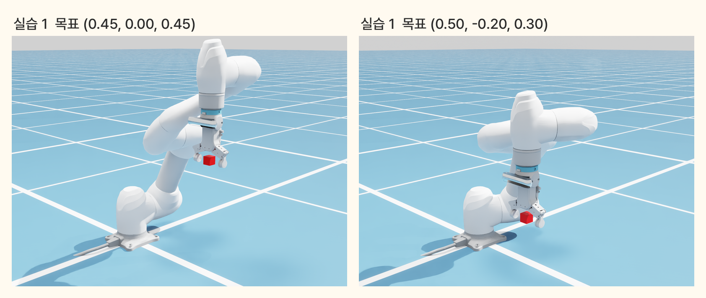
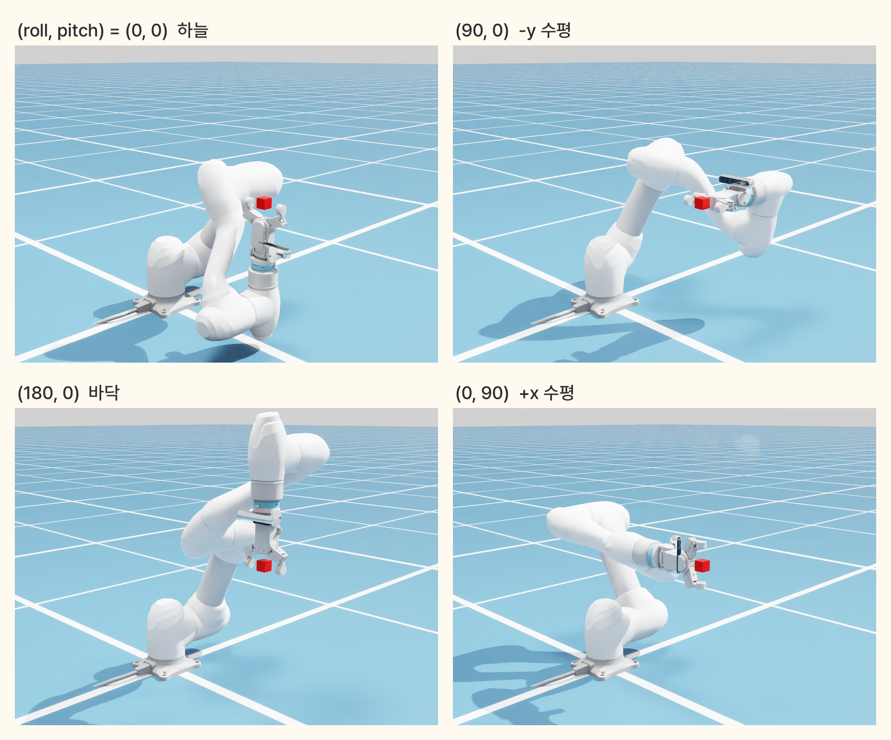
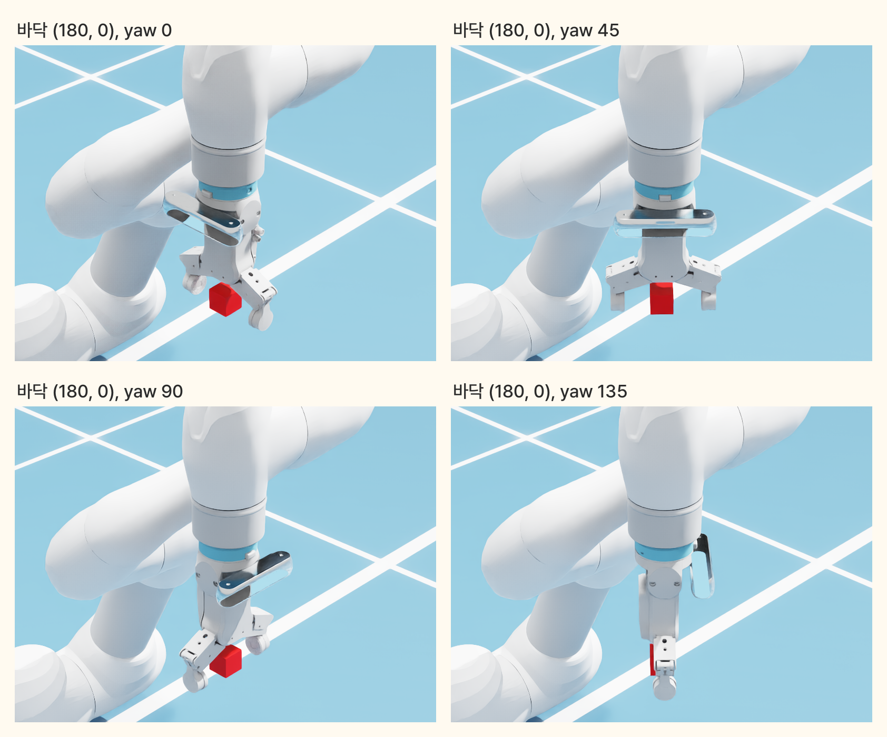
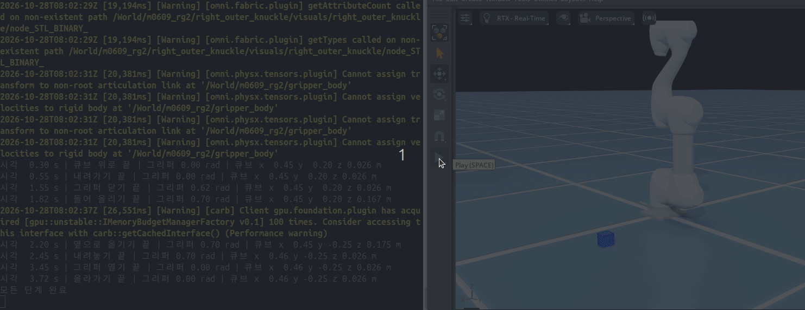

# L8. IK 로 관절 각도 구하기

---

## 학습 목표
- `LulaKinematicsSolver` 에 TCP 목표(위치 + 자세)를 넣어 팔 관절 각도를 구할 수 있다 (IK)
- pick and place 에서 직접 적어 둔 관절값을 IK 계산으로 바꿔, 큐브와 놓을 위치가 바뀌어도 옮길 수 있게 만든다

---

## 핵심 개념

### FK(정기구학) 와 IK(역기구학)
- **정기구학(FK)**: 관절 각도 → TCP 위치
- **역기구학(IK)**: TCP 위치 → 관절 각도
- 우리가 원하는 것은 "손끝을 여기로"이므로 IK를 쓴다

> 📢 **TCP** (Tool Center Point) 란>
>
> 그리퍼 손가락 사이의 기준점이다 (URDF 의 `gripper_center` 프레임). "로봇 손의 위치" 는 TCP 위치를 말한다.

https://mirangy2e.github.io/rokey_isaacsim/fk_ik_playground.html

### Lula IK 계산기 만들기
- Lula 는 Isaac Sim 에 들어 있는 로봇 계산 라이브러리다.
- 장면의 로봇과 상관없이 **파일 두 개**만 있으면 계산한다.

```python
ik_solver = LulaKinematicsSolver(
    robot_description_path=DESCRIPTION_PATH,          # 로봇 설명 파일
    urdf_path=URDF_PATH,                              # URDF 파일
)
```

| 파일 | 내용 |
|---|---|
| `robot/m0609_rg2.urdf` | 링크 길이, 관절 축, 관절 한계, `gripper_center` 프레임 |
| `descriptor/m0609_robot_description.yaml` | IK 가 움직일 관절 (팔 `joint_1` ~ `joint_6`). 그리퍼 관절은 계산에 쓰지 않는다 |

### IK: compute_inverse_kinematics

```python
joints, success = ik_solver.compute_inverse_kinematics(
    TCP_FRAME,                        # 목표에 맞출 프레임
    position,                         # 목표 위치 [x, y, z] (m)
    DOWN_ORIENTATION,                 # 목표 자세 (쿼터니언 [w, x, y, z])
    warm_start=np.radians(HOME_DEG),  # 계산을 시작할 관절값 (rad). 
)
```

| 인자 / 돌려주는 값 | 의미 |
|---|---|
| `TCP_FRAME` | 목표에 맞출 프레임 `"gripper_center"` |
| `TARGET_POS` | 목표 위치 [x, y, z] (m) |
| `TARGET_ORIENT` | 목표 자세 (쿼터니언 [w, x, y, z]). roll, pitch, yaw 로 만든다 (아래 절) |
| `warm_start` | IK 는 시작 관절값에서 조금씩 고쳐 가며 답을 찾는다. 같은 위치에도 답이 여러 개(팔꿈치 위 / 아래 등)라서, **시작 관절값에 가까운 답**이 나온다. 홈 자세에서 시작하면 홈과 같은 팔 형태가 나온다 |
| `joints` | 팔 관절 6개 각도 (rad). 순서는 `joint_1` ~ `joint_6` |
| `success` | 답을 찾았는지. 팔이 닿지 않는 위치나 자세면 `False` |

### 목표 자세: roll, pitch, yaw

```python
TARGET_ORIENT = euler_angles_to_quat(np.radians([ROLL_DEG, PITCH_DEG, YAW_DEG]))
```

- 세계 축 x(roll) -> y(pitch) -> z(yaw) 순서로 돌린 자세를 쿼터니언으로 바꾼다
- **TCP 의 z 축이 그리퍼가 향하는 방향(접근 방향)** 이다. 하나도 돌리지 않으면 z 축이 위를 보므로 그리퍼는 하늘을 향한다

| (roll, pitch) | 그리퍼 방향 | 이유 |
|---|---|---|
| (0, 0) | 하늘 | 돌리지 않음: z 축 = 위 |
| (90, 0) | -y 수평 | x 축으로 90 deg: z 축이 -y 로 |
| (180, 0) | 바닥 | x 축으로 180 deg: z 축이 아래로 |
| (0, 90) | +x 수평 | y 축으로 90 deg: z 축이 +x 로 |

- (180, 90) 은 바닥을 본 뒤 y 축으로 90 deg 더 돌린 것이라 z 축이 **x (로봇 쪽)** 를 향한다. 로봇 앞의 목표에서는 IK 답이 없다
- yaw: 접근 방향을 정한 뒤 세계 세로축(z)으로 돌린 각도. 바닥 방향에서는 손가락이 벌어지는 방향이 돈다

---

## 실행

### L8_ik.py

```python
"""[L8 예제] IK 로 관절 각도 구하기: 목표 위치와 자세를 넣으면 팔 관절 각도가 나온다

실행: isaac_python L8_ik.py
"""

from pathlib import Path

# ============================================================
# 1. 앱 시작 (Isaac 모듈보다 먼저)
# ============================================================
from isaacsim import SimulationApp

simulation_app = SimulationApp({"headless": False})

# ============================================================
# 2. Isaac 모듈 import (앱을 켠 뒤에)
# ============================================================
import numpy as np
import omni.kit.commands
from isaacsim.core.api import World
from isaacsim.core.api.objects import VisualCuboid
from isaacsim.core.prims import SingleArticulation
from isaacsim.core.utils.rotations import euler_angles_to_quat
from isaacsim.core.utils.stage import add_reference_to_stage
from isaacsim.core.utils.types import ArticulationAction
from isaacsim.robot_motion.motion_generation import LulaKinematicsSolver

# 파일 경로
M0609_DIR = Path(__file__).resolve().parents[1]                            # isaacpjt/M0609 (이 파일이 있는 basic 의 상위 폴더)
ROBOT_USD = f"{M0609_DIR}/robot/m0609_rg2_d455.usd"                        # 장면에 넣을 로봇 (M0609 + RG2 + D455)
URDF_PATH = f"{M0609_DIR}/robot/m0609_rg2.urdf"                            # IK 용: 링크 길이, 관절 축, 관절 한계
DESCRIPTION_PATH = f"{M0609_DIR}/descriptor/m0609_robot_description.yaml"  # IK 용: 움직일 관절 (팔 6개)

# 로봇 관절
ARM_JOINTS = ["joint_1", "joint_2", "joint_3", "joint_4", "joint_5", "joint_6"]
HOME_DEG = [0, 0, 90, 0, 90, 0]
TCP_FRAME = "gripper_center"  # IK 로 위치를 맞출 기준점: 그리퍼 손가락 사이 (URDF 의 프레임 이름)

# 목표 위치와 자세 (실습에서 바꿔 볼 값)
TARGET_POS = np.array([0.45, 0.00, 0.45])  # TCP 목표 위치 [x, y, z] (m)
ROLL_DEG = 180   # 접근 방향 (roll, pitch): (0, 0) 하늘 / (90, 0) -y 수평 / (180, 0) 바닥 / (0, 90) +x 수평
PITCH_DEG = 0
YAW_DEG = 0      # 그리퍼 회전: 바닥 방향 (180, 0) 일 때 세로축으로 돌린 각도. 0 / 45 / 90 / 135
TARGET_ORIENT = euler_angles_to_quat(np.radians([ROLL_DEG, PITCH_DEG, YAW_DEG]))  # deg -> rad -> 쿼터니언 [w, x, y, z]

# 진행
MOVE_FRAME = 60    # 이 프레임에 IK 결과를 팔에 보낸다 (그 전 1 초는 홈 자세)
CHECK_FRAME = 240  # 이 프레임에 도착한 자세를 출력한다 (보낸 뒤 3 초)

# (가) 장면: World, 바닥, 조명
world = World(stage_units_in_meters=1.0)
world.scene.add_default_ground_plane()
# 조명: 화면 위 Lighting 메뉴에서 "Default" 를 고른 것과 같다
omni.kit.commands.execute("SetLightingMenuModeCommand", lighting_mode="Default")

# (나) 로봇과 목표 표시 상자
add_reference_to_stage(usd_path=ROBOT_USD, prim_path="/World/m0609_rg2_d455")
robot = world.scene.add(SingleArticulation(prim_path="/World/m0609_rg2_d455", name="m0609"))
marker = world.scene.add(
    VisualCuboid(
        prim_path="/World/Marker",                    # Stage 에 만들 prim 경로
        name="marker",                                # 장면에서 찾을 때 쓰는 이름
        position=TARGET_POS,                          # 목표 위치에 둔다 (그리퍼 손가락 사이가 여기로 온다)
        orientation=TARGET_ORIENT,                    # 목표 자세만큼 돌려 둔다
        scale=np.array([0.03] * 3),                   # 한 변 3 cm
        size=1.0,                                     # 기본 한 변 1 m. 실제 크기 = size x scale
        color=np.array([1.0, 0, 0]),                  # 빨간색
    )
)
world.reset()

# ************************************************************
# ★ IK 영역 시작: 목표 위치 [x, y, z] + 자세 -> 팔 관절 6개 각도
# ************************************************************

# 팔 관절 6개가 관절 배열(12개)의 몇 번째인지 -> [0, 1, 2, 3, 4, 5]
arm = [robot.get_dof_index(name) for name in ARM_JOINTS]

# (다) IK 계산기: 파일 두 개로 만든다 (장면의 로봇과 상관없이 계산만 한다)
ik_solver = LulaKinematicsSolver(
    robot_description_path=DESCRIPTION_PATH,          # 로봇 설명 파일
    urdf_path=URDF_PATH,                              # URDF 파일
)

# (라) IK: 목표 위치 + 자세 -> 팔 관절 6개 각도 (rad)
joints, success = ik_solver.compute_inverse_kinematics(
    TCP_FRAME,                                        # 목표에 맞출 프레임
    TARGET_POS,                                       # 목표 위치 [x, y, z] (m)
    TARGET_ORIENT,                                    # 목표 자세 (쿼터니언 [w, x, y, z])
    warm_start=np.radians(HOME_DEG),                  # 계산을 시작할 관절값 (rad). 여기서 가까운 답을 찾는다
)
x, y, z = TARGET_POS
print(f"IK | 목표 x {x:.2f} y {y:5.2f} z {z:.2f} m, roll {ROLL_DEG} pitch {PITCH_DEG} yaw {YAW_DEG} deg"
      f" -> joint_1 ~ 6 {np.round(np.degrees(joints)).astype(int)} deg | 성공 {success}")
if not success:
    print("IK 해 없음: 팔이 닿지 않는 위치나 자세다. 팔은 홈 자세에 그대로 있는다")

# (마) 홈 자세로 순간이동
home = np.zeros(robot.num_dof)
home[arm] = np.radians(HOME_DEG)
robot.set_joint_positions(home)

# ============================================================
# 3. 메인 루프 (창이 열려 있는 동안 한 프레임씩 진행)
# ============================================================
frame = 0
while simulation_app.is_running():
    world.step(render=True)
    frame += 1
    if frame == MOVE_FRAME and success:  # (바) IK 로 구한 관절값을 팔에 보낸다 (답이 없으면 보내지 않음)
        robot.apply_action(ArticulationAction(joint_positions=joints, joint_indices=arm))
        print(f"{frame} 프레임 | IK 결과로 이동 시작")
    if frame == CHECK_FRAME:  # (사) 도착한 자세 확인: 지금 관절값으로 FK 를 계산해 TCP 위치를 본다
        current = robot.get_joint_positions()[arm]
        tcp, _ = ik_solver.compute_forward_kinematics(TCP_FRAME, current)
        print(f"{frame} 프레임 | 도착 | joint_1 ~ 6 {np.round(np.degrees(current)).astype(int)} deg"
              f" | TCP x {tcp[0]:.2f} y {tcp[1]:5.2f} z {tcp[2]:.2f} m")

# ============================================================
# 4. 종료
# ============================================================
simulation_app.close()
```

```bash
cd ~/cobot3_ws/isaacpjt/M0609/basic
isaac_python L8_ik.py
```

- 빨간 상자가 목표 위치에 놓이고, 1 초 뒤 팔이 IK 결과로 움직여 그리퍼 손가락 사이가 상자로 간다
- 실행할 때마다 위쪽 상수(`TARGET_POS`, `ROLL_DEG`, `PITCH_DEG`, `YAW_DEG`)를 바꾸고 다시 실행해서 결과를 비교한다
- 로그 두 줄을 본다: 처음 줄은 IK 결과, 마지막 줄은 3 초 뒤 실제로 도착한 관절값과 TCP 위치(FK)

### 실습 1. 목표 좌표 바꾸기
`TARGET_POS` 를 아래 두 값으로 바꿔 실행한다 (자세는 바닥 `(180, 0)`, yaw 0).

```python
TARGET_POS = np.array([0.45, 0.00, 0.45])   # 정면
TARGET_POS = np.array([0.50, -0.20, 0.30])  # 오른쪽 앞, 낮게
```



- 빨간 상자가 목표로 옮겨지고, 그리퍼가 그 상자로 간다. 도착한 TCP 가 목표와 같다 (z 는 중력으로 약 5 mm 처짐)
- joint_1 이 목표 방향(-22 deg) 으로 돌고, 거리와 높이에 맞게 joint_2, joint_3, joint_5 가 바뀐다

### 실습 2. 도달 범위 넘기기
`TARGET_POS = np.array([1.00, 0.00, 0.30])` 으로 실행한다.

```
IK | 목표 x 1.00 y  0.00 z 0.30 m, roll 180 pitch 0 yaw 0 deg -> joint_1 ~ 6 [ 181  -64    0    0 -110    0] deg | 성공 False
IK 해 없음: 팔이 닿지 않는 위치나 자세다. 팔은 홈 자세에 그대로 있는다
240 프레임 | 도착 | joint_1 ~ 6 [ 0  0 90  0 90  0] deg | TCP x 0.37 y  0.01 z 0.24 m
```

- `success` 가 `False` 면 `joints` 는 계산하다 멈춘 값일 뿐이라 쓰면 안 된다. 예제는 보내지 않고 홈 자세에 둔다
- 손이 닿는 거리 밖이거나, 닿더라도 그 자세로는 갈 수 없으면 `False` 가 나온다 (실습 3 의 (180, 90))

### 실습 3. 접근 방향 바꾸기
`TARGET_POS` 는 `[0.45, 0.00, 0.45]`, yaw 는 0 으로 두고 `ROLL_DEG`, `PITCH_DEG` 를 바꾼다.

| (roll, pitch) | 방향 | IK 결과 joint_1 ~ 6 (deg) |
|---|---|---|
| (0, 0) | 하늘 | `[-1, 38, 110, -180, 148, -179]` |
| (90, 0) | -y 수평 | `[34, 26, 72, -84, 123, -170]` |
| (180, 0) | 바닥 | `[-1, 27, 20, 0, 134, 179]` |
| (0, 90) | +x 수평 | `[-3, -33, 127, -30, -5, 29]` |
| (180, 90) | -x (로봇 쪽) | `성공 False` |



- 위치는 같아도 방향이 바뀌면 6개 관절이 모두 크게 바뀐다. 손목(joint_4 ~ 6)만으로는 방향을 다 바꿀 수 없어서 팔 전체 자세가 달라진다
- 하늘 방향은 손목을 뒤집어야 해서(joint_4 -180 deg) 목표가 낮으면 팔이 몸에 걸려 도착하지 못한다. 0.35 m 에서는 도착하지 못했다

### 실습 4. 그리퍼 돌리기
접근 방향은 바닥 `(180, 0)` 으로 두고 `YAW_DEG` 를 0, 45, 90, 135 로 바꾼다.

| yaw (deg) | IK 결과 joint_1 ~ 6 (deg) |
|---|---|
| 0 | `[-1, 27, 20, 0, 134, 179]` |
| 45 | `[-1, 27, 20, 0, 134, 134]` |
| 90 | `[-1, 27, 20, 0, 134, 89]` |
| 135 | `[-1, 27, 20, 0, 134, 44]` |



- joint_6 만 바뀐다. 접근 방향과 위치가 같으므로 나머지 관절은 그대로다
- yaw 가 45 deg 늘 때 joint_6 은 45 deg 준다. 그리퍼가 아래를 보도록 뒤집혀 있어서, 세계 세로축으로 돌리는 방향과 joint_6 이 도는 방향이 반대다
- 큐브를 집을 때 큐브가 돌아가 있으면 yaw 를 큐브 방향에 맞추면 된다

---

## 연습 문제
목표: L7 연습 문제의 pick and place 를 IK 로 만든다.

- 큐브 pick 위치 (0.45, 0.20)
- 큐브 place 위치는 (0.45, -0.25)
- 자세 4개를 직접 적지 않고 IK 로 계산한다.
  `Task`, `StepController`, `STEPS`, 메인 루프는 L7 과 같다.



---

## 확인할 것
- [ ] FK 와 IK 의 입력과 출력을 설명할 수 있다
- [ ] `compute_inverse_kinematics` 의 `warm_start` 가 무엇이고 왜 필요한지 설명할 수 있다
- [ ] 목표 위치가 바뀌면 joint_1 뿐 아니라 다른 관절도 바뀌는 이유를 설명할 수 있다
- [ ] roll, pitch 로 접근 방향을, yaw 로 그리퍼 회전을 정할 수 있다
- [ ] `success` 가 `False` 일 때 결과를 쓰면 안 되는 이유를 설명할 수 있다
