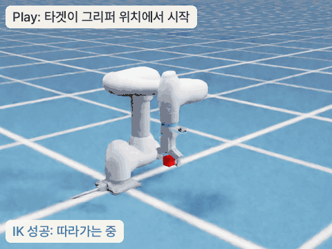
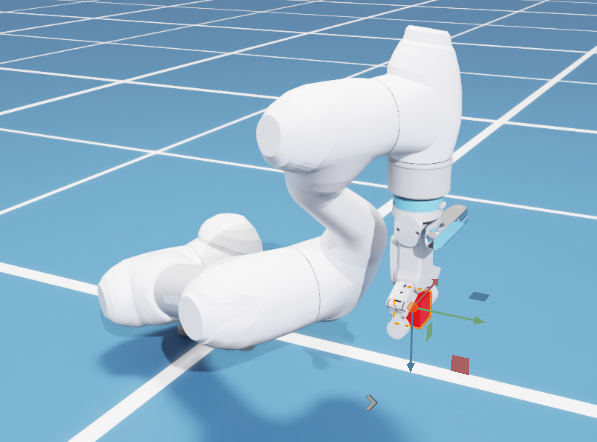

# L9. 타겟 따라가기 (종합 미션)

---

## 미션
뷰포트에서 빨간 타겟을 끌고 돌리면 로봇 그리퍼가 따라가는 프로그램을 새 파일로 직접 만든다.
L5 ~ L8 에서 만든 코드(메인 루프, Task, Controller, IK)를 복사해서 시작한다.

---

## 요구 사항
1. **장면 (Task)**
   - 바닥, 로봇 (M0609 + RG2, 그리퍼 열림), 빨간 타겟 (`VisualCuboid`, 한 변 4 cm)
   - 타겟 시작: 홈 자세의 TCP 위치, 그리퍼가 아래를 향하는 자세
2. **컨트롤러 (`BaseController` 를 상속해 직접 설계)**
   - 매 프레임 타겟 위치·자세로 IK 를 풀어 팔 관절 6개 명령을 돌려준다
   - IK 시작 관절값(`warm_start`)은 지금 관절값
   - 쓸 답이 없으면 마지막 명령을 그대로 보낸다 (그 자리에서 기다림)
   - 따라가는 중인지(쓸 답이 있었는지)를 메인 루프가 읽을 수 있게 둔다
   - `reset()` 은 기억하는 상태를 처음 값으로 되돌린다
3. **팔 형태 유지**
   - 아래와 같이 팔 형태가 되지 않도록 할 것. 90-90 자세를 선호함.
     
4. **메인 루프**
   - Stop -> Play 하면 처음부터 다시 시작한다
   - 따라감 / 기다림이 바뀔 때 한 줄 출력한다

### 팔 형태 유지가 필요한 이유
타겟을 앞쪽 멀리 끌었다가 다시 가져올 때 같은 목표인데 팔 형태가 바뀌고 돌아오지 않는다.

| 시점 | joint_1 ~ 6 (deg) | 팔 형태 |
|---|---|---|
| 처음, 타겟 (0.45, 0, 0.30) | `[-1, 13, 67, 0, 101, -1]` | J3 +67: 홈(90-90) 계열, 팔꿈치 위 |
| 멀리 (1.0, -0.1, 0.30) 에서 기다림 | `[-3, 54, 0, 0, 127, -3]` | J3 0: 팔이 일자로 펴짐 |
| 다시 (0.45, 0, 0.30) | `[-1, 76, -67, 0, 172, -1]` | J3 -67: 팔꿈치 아래 계열로 바뀌고 계속 유지 |

- 같은 TCP 목표에 IK 답이 여러 개(팔꿈치 위 / 아래)다. J3 이 0 (펴짐) 을 지나면 양쪽 답이 모두 가까워지고, `warm_start` 가 지금 관절값이라 그 뒤로는 지금 형태의 답만 나온다

---

완성 코드: `L9_follow_target.py`, 해설: `L9_follow_target_code.md`
