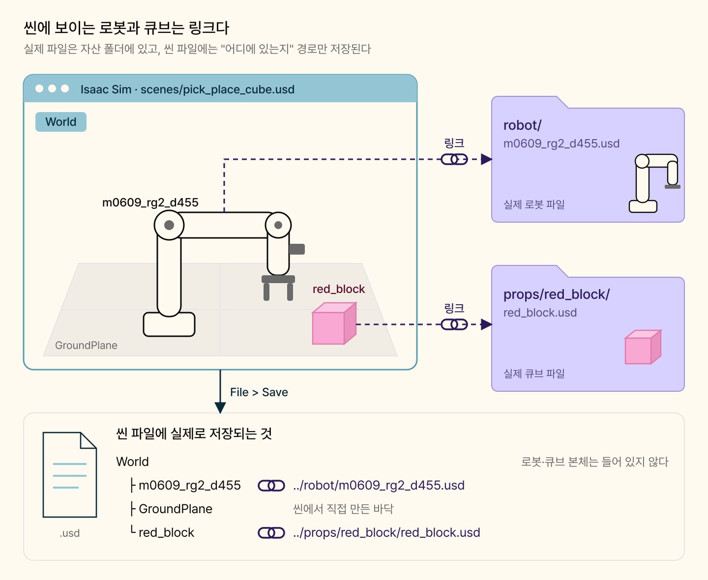

# GUI—자산 참조로 작업 씬 만들기

## 📚 학습 목표
- 자산(로봇, 소품)과 작업 씬을 나누어 관리하는 이유를 설명할 수 있다.
- Isaac Sim 내장 자산을 **Collect and Save As** 로 작업 폴더에 다운로드할 수 있다.
- 다운로드한 자산을 **참조(Reference)** 로 작업 씬에 넣고, 상대 경로로 저장할 수 있다.

## 🔑 핵심 개념
1. **자산과 작업 씬: 참조와 복사**
   - 자산(로봇, 소품)은 자산 폴더(`robot/`, `props/`)에 모아 두고, 작업 씬(`scenes/`)은 자산을 **참조만** 한다.
   - 참조한 씬에는 "어느 파일의 어느 prim을 가져온다" 는 정보만 저장된다. 자산 원본을 고치면 그 자산을 참조하는 모든 씬에 반영된다.

   

   ```
   ~/cobot3_ws/isaacpjt/M0609/
   ├── robot/    로봇 자산 (수정하지 않음)
   ├── props/    소품 자산 (다운로드한 것, 수정하지 않음)
   └── scenes/   자산을 참조하는 작업 씬
   ```

   | 방법 | 씬에 저장되는 것 | 원본을 고치면 |
   |---|---|---|
   | 자산 파일을 열고 Save As | 자산 전체의 **복사본** | 반영되지 않음 |
   | Add Reference | 자산 파일 경로 + prim 경로 | **반영됨** |

2. **자산 다운로드 및 활용**
   - 자산은 **다운로드**(한 번)와 **활용**(참조) 두 단계로 다룬다.

   | 단계 | 방법 | 결과 |
   |---|---|---|
   | 다운로드 | Content 탭에서 자산 열기 → File > Collect and Save As → `props/<이름>/` | 자산과 자산이 쓰는 파일(재질 등)이 작업 폴더에 함께 저장된다 |
   | 활용 | 작업 씬에서 File > Add Reference → `props/<이름>/<이름>.usd` 선택 | 씬에는 파일 경로만 저장된다 |

   - Content 탭의 원격 자산을 바로 넣으면 인터넷 연결이 필요하고, 서버의 자산이 바뀌면 씬도 함께 바뀐다. 다운로드한 로컬 자산을 참조한다.

3. **상대 경로**
   - 참조 경로는 **상대 경로**(`../robot/m0609_rg2_d455.usd`)로 넣는다. 씬 파일이 있는 `scenes/` 기준으로 찾으므로, `M0609/` 폴더째 다른 PC로 옮겨도 열린다.
   - `/home/<사용자>/...` 같은 절대 경로는 사용자 이름이 다른 PC에서는 파일을 찾지 못한다.
   - 상대 경로의 기준이 씬 파일 위치이므로, 자산을 넣기 **전에** 씬을 먼저 저장한다.

## ☑️ 사전 준비
1. **로봇 자산 확인**
   - 작업 씬에 넣을 로봇 자산 (M0609 + RG2 + D455)

   ```
   ~/cobot3_ws/isaacpjt/M0609/robot/m0609_rg2_d455.usd
   ```

2. **소품 자산 폴더와 씬 저장 폴더 생성**

   ```bash
   mkdir -p ~/cobot3_ws/isaacpjt/M0609/props
   mkdir -p ~/cobot3_ws/isaacpjt/M0609/scenes
   ```

3. **Isaac Sim 실행**

   ```bash
   isaac
   ```

## 💡학습 내용
1. **큐브 자산 다운로드**
   Isaac Sim 내장 큐브 자산을 작업 폴더에 저장한다. 자산마다 한 번만 한다.

   - 큐브 자산 열기

   ```
   Content 탭 > Isaac Sim > Props > Blocks > red_block.usd 더블클릭
       └── Opening a Read Only File 창 > Open Original File 클릭
   ```

   - 저장 위치 지정

   ```
   File > Collect and Save As...
       └── Select Collect Destination 창
           ├── 경로: ~/cobot3_ws/isaacpjt/M0609/props/
           ├── Folder name: red_block
           └── Select 클릭
   ```

   - 저장 실행

   ```
   Collection Options 창
       └── Start 클릭
   ```

   - 확인 포인트: `props/red_block/` 폴더에 `red_block.usd` 가 생성됨

   ```
   ~/cobot3_ws/isaacpjt/M0609/props/red_block/
   ├── Materials/
   ├── basic_block.usd
   └── red_block.usd
   ```

   - 자산 폴더는 통째로 관리한다. 폴더 안의 파일을 옮기거나 지우지 않는다

2. **새 씬 만들고 저장**
   새 씬을 만들고 자산을 넣기 전에 먼저 저장해 상대 경로의 기준 위치를 정한다.

   - 새 씬 열기

   ```
   File > New
   ```

   - `World` prim 확인

   ```
   Stage: World 가 있는지 확인
       └── 없으면: Stage 빈 곳 우클릭 > Create > Xform
           ├── 더블클릭해 이름 변경: World
           └── World 우클릭 > Set as Default Prim
   ```

   - 확인 포인트: Stage에 `World (defaultPrim)` 가 있음

   - 작업 씬으로 저장

   ```
   File > Save As...
       └── ~/cobot3_ws/isaacpjt/M0609/scenes/pick_place_cube.usd
   ```

   - 확인 포인트: 창 제목에 `pick_place_cube.usd` 가 표시됨

3. **로봇 자산 참조**
   File 메뉴의 Add Reference 로 로봇 자산을 참조한다.

   ```
   File > Add Reference
       └── Select File 창
           ├── ~/cobot3_ws/isaacpjt/M0609/robot/m0609_rg2_d455.usd 선택
           └── Add Reference 클릭
   ```

   > 💡 Add Reference 는 파일 이름으로 prim 을 만들고(`/World/m0609_rg2_d455`), 파일의 기본 prim(로봇)을 그 안에 가져온다. 씬이 저장되어 있으면 경로를 상대 경로로 바꿔 넣는다.

   - 확인 포인트: 뷰포트에 카메라가 달린 로봇이 보이고, Stage의 `World > m0609_rg2_d455` 바로 아래에 `base_link`, `link_1` … 이 있음
   - 확인 포인트: `m0609_rg2_d455` 를 선택했을 때 Property > References 의 Asset Path 가 `../robot/m0609_rg2_d455.usd` 임

   📷 새 캡처: Stage의 World > m0609_rg2_d455 와 Property > References (Asset Path)

   - 로봇 자산 파일(`robot/m0609_rg2_d455.usd`)은 열지도, 수정하지도 않는다

4. **바닥 추가**
   큐브를 놓을 바닥을 씬에 넣는다.

   ```
   Create > Physics > Ground Plane
   ```

   - 확인 포인트: Stage에 `World > GroundPlane` 이 있음

5. **큐브 자산 참조**
   다운로드한 큐브 자산을 같은 방법으로 참조하고 로봇 앞에 놓는다.

   ```
   File > Add Reference
       └── Select File 창
           ├── ~/cobot3_ws/isaacpjt/M0609/props/red_block/red_block.usd 선택
           └── Add Reference 클릭
   ```

   - 확인 포인트: Stage의 `World > red_block` 아래에 `Cube`, `Materials` 가 있고, Property > References 의 Asset Path 가 `../props/red_block/red_block.usd` 임

   📷 새 캡처: Stage의 World > red_block > Cube 와 Property > References (Asset Path)

   - 큐브 위치 지정

   ```
   Stage: red_block 선택
       └── Property > Transform > Translate: X 0.35 / Y 0.1 / Z 0.05
   ```

   - 확인 포인트: 큐브가 로봇 앞 바닥에 놓임

6. **저장 후 다시 열어 확인**
   씬을 저장하고 다시 열어 참조한 자산이 모두 불러와지는지 확인한다.

   - 저장

   ```
   File > Save
   ```

   - 다시 열기

   ```
   File > Open > ~/cobot3_ws/isaacpjt/M0609/scenes/pick_place_cube.usd
   ```

   - 확인 포인트: 로봇, 바닥, 큐브가 모두 보이고 Stage가 다음과 같음

   ```
   World (defaultPrim)
   ├── m0609_rg2_d455 ../robot/m0609_rg2_d455.usd 참조
   ├── GroundPlane
   └── red_block      ../props/red_block/red_block.usd 참조
   ```

   - 확인 포인트: 폴더 구조

   ```
   ~/cobot3_ws/isaacpjt/M0609/
   ├── robot/m0609_rg2_d455.usd        로봇 자산 (수정하지 않음)
   ├── props/red_block/                큐브 자산 (다운로드한 것, 수정하지 않음)
   └── scenes/pick_place_cube.usd      로봇(../robot/...)과 큐브(../props/...)를 참조하는 작업 씬 + 바닥
   ```

   - 이 씬은 기본 씬이다. 기능을 추가할 때는 다른 이름으로 저장해 기본 씬을 보존한다

## 📝 요약 정리

```
red_block 자산을 props/ 에 다운로드 (Collect and Save As)
    → 새 씬 → scenes/pick_place_cube.usd 로 먼저 저장
    → File > Add Reference 로 로봇 자산 참조 (World/m0609_rg2_d455)
    → 바닥 추가 → File > Add Reference 로 큐브 자산 참조 (World/red_block) → 위치 지정
    → 저장 → 다시 열어 확인
```

### 트러블슈팅

| 증상 | 원인 | 해결 |
|---|---|---|
| Asset Path 가 `/home/...` 같은 절대 경로로 들어감 | 씬을 저장하기 전에 Add Reference 를 함 | 씬을 `scenes/` 에 먼저 저장한 뒤 그 prim 을 지우고 다시 Add Reference |
| 씬을 열면 로봇이 보이지 않음 | `robot/` 폴더가 옮겨지거나 지워짐 | `M0609/` 폴더 구조 유지, Property > References 의 Asset Path 확인 |
| 씬을 다시 열면 큐브만 보이지 않음 | Asset Path 가 상대 경로가 아님 | `World > red_block` 의 Property > References 가 `../props/red_block/red_block.usd` 인지 확인하고 고쳐서 저장 |
| 내 PC에서는 보이는데 다른 PC에서 로봇이나 큐브가 보이지 않음 | Asset Path 가 절대 경로(`/home/<사용자>/...`) 로 저장됨 | Asset Path 를 `../robot/...`, `../props/...` 상대 경로로 고치고 저장 |

## 📎 참고 문서
- OpenUSD References — https://openusd.org/release/glossary.html#usdglossary-references
