# GUI—ROS2 연동 Action Graph: Clock

## 📚 학습 목표
- Isaac Sim에서 Clock Graph를 생성하고 `/clock` 토픽을 발행할 수 있다.
- 같은 PC 및 다른 PC에서 `/clock` 토픽 수신을 확인해 Isaac Sim ↔ ROS2 연동을 검증할 수 있다.

## 🔑 핵심 개념

**/clock 토픽과 시뮬레이션 시간(Simulation Time)**

- `/clock`은 Isaac Sim이 Play 중일 때 계속 발행하는 시뮬레이션 시간 토픽이다.
- 설정이 간단하고 로봇 없이도 발행되므로 Isaac Sim과 ROS2의 연동 상태를 가장 빨리 확인할 수 있다. 이후 ROS2 연동 작업을 시작하기 전에 이 확인을 먼저 한다.
- ROS2 노드는 `use_sim_time`을 켜면 실제 시계 대신 이 토픽의 시간을 기준으로 동작한다.

---

## ☑️ 사전 준비
1. **작업 씬**
   - 로봇과 큐브를 참조한 큐브 Pick & Place 용 작업 씬

   ```
   ~/cobot3_ws/isaacpjt/M0609/scenes/pick_place_cube.usd
   ```

2. **ROS2 환경변수 설정 후 Isaac Sim 실행**
   - 환경변수 설정, `isaac_ros`, `isaac`을 **같은 터미널**에서 차례로 실행한다.

   ```bash
   #`ROS_DOMAIN_ID`는 팀별로 공지된 값이 표시된다. 위의 50은 예시다
   export ROS_DOMAIN_ID=50
   export RMW_IMPLEMENTATION=rmw_fastrtps_cpp
   export FASTRTPS_DEFAULT_PROFILES_FILE=$HOME/.ros/fastdds_whitelist.xml

   #Isaac Sim용 ROS2 환경 적용 (Isaac Sim 내부 ROS2 라이브러리 경로 등록)
   isaac_ros

   #같은 터미널에서 Isaac Sim 실행
   isaac
   ```

   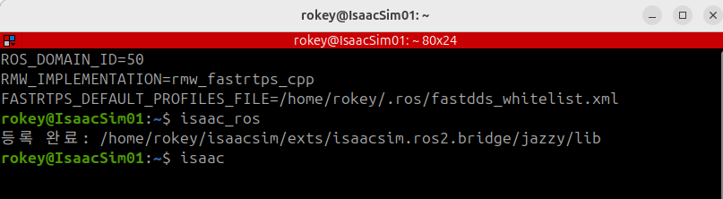

3. **ROS2 Bridge Extension 활성화 확인**
   - Isaac Sim에서 ROS2 토픽을 발행하려면 ROS2 Bridge Extension이 활성화되어 있어야 한다.
   - 이 설정이 꺼져 있으면 Clock Graph를 만들어도 `/clock`이 발행되지 않는다.

   ```
   Window > Extensions
       └── 검색창에 "ROS2" 입력
           └── ROS 2 BRIDGE (isaacsim.ros2.bridge): ENABLED 확인
   ```

   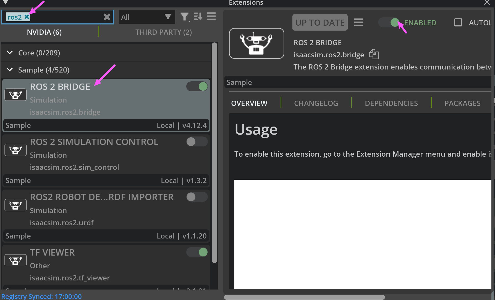

   - 활성화 상태 확인

   ```
   Tools > Robotics > ROS 2 OmniGraphs
       └── 메뉴 항목이 보이면 활성화 상태 ✅
       └── 메뉴가 회색(비활성)이면 Extension 재확인
   ```

   > 💡 Extension 활성화 상태는 Isaac Sim 재시작 후에도 유지된다. 최초 1회만 설정하면 된다.

---

## 💡학습 내용
1. **작업 씬 열기**
   GUI—자산 참조로 작업 씬 만들기에서 만든 작업 씬을 열어 이어서 작업한다.

   ```
   File > Open > ~/cobot3_ws/isaacpjt/M0609/scenes/pick_place_cube.usd
   ```

   - 확인 포인트: Stage에 `World > m0609_rg2_d455`, `World > GroundPlane`, `World > red_block` 이 있음

2. **Clock Graph 생성**
   ROS 2 OmniGraphs 메뉴로 `/clock`을 발행하는 그래프를 자동 생성한다.

   - 메뉴 실행

   ```
   Tools > Robotics > ROS 2 OmniGraphs > Clock
   ```

   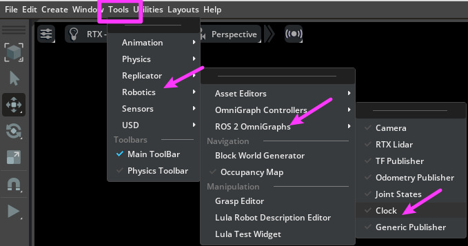

   - 그래프 경로 지정

   ```
   ROS2 Clock Graph 창
       ├── Graph Path: /World/Graph/ROS_Clock
       └── OK 클릭
   ```

   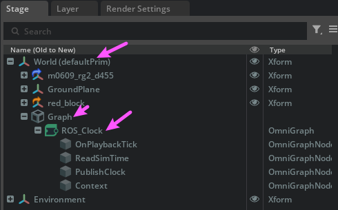

   - 확인 포인트: Stage에 `World > Graph > ROS_Clock`이 생기고 그 아래 `OnPlaybackTick`, `ReadSimTime`, `PublishClock`, `Context` 노드가 있음

3. **Clock Graph 구성 확인**
   Action Graph 편집기에서 노드 연결을 확인한다.

   - 편집기에서 그래프 열기 ⚠️

   ```
   Window > Graph Editors > Action Graph
       └── Edit Action Graph 클릭
           └── /World/Graph/ROS_Clock 선택
   ```

   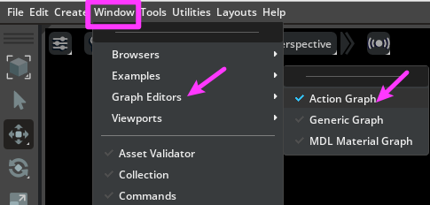

   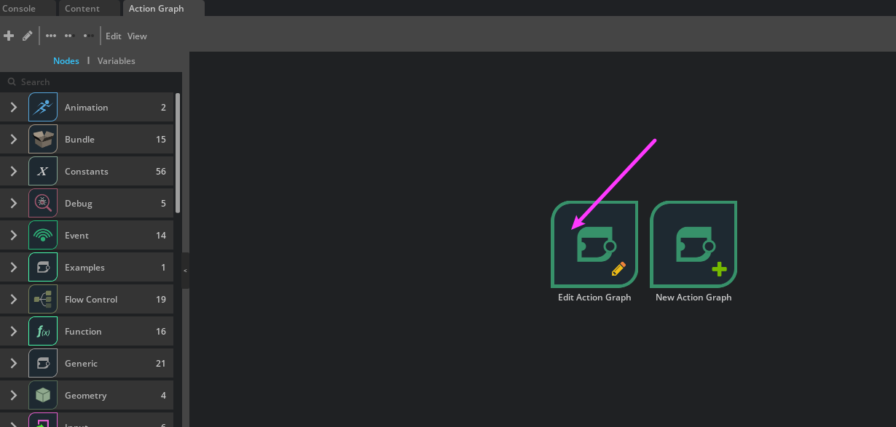

   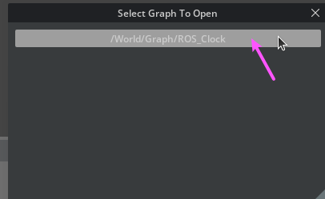

   - 확인 포인트: 세 노드의 출력이 모두 `ROS2 Publish Clock`으로 연결됨

   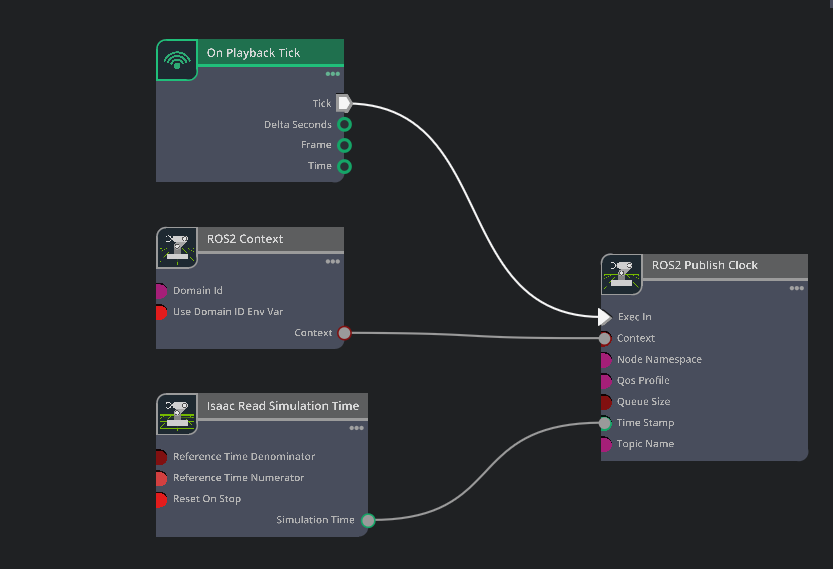

   세 노드가 각각 실행 신호, 통신 설정, 시간을 만들어 `ROS2 Publish Clock`에 전달한다.

   | 노드 | 역할 | ROS2 Publish Clock에 전달하는 것 |
   |---|---|---|
   | On Playback Tick | Play 중 매 프레임마다 실행 신호 발생 | 실행 신호 (Exec In) |
   | ROS2 Context | ROS2 통신 설정 (Domain ID) | 통신 설정 (Context) |
   | Isaac Read Simulation Time | 시뮬레이션 현재 시간 읽기 | 시간 (Time Stamp) |
   | ROS2 Publish Clock | 받은 시간을 `/clock` 토픽으로 발행 | |

4. **노드 설정 확인**
   발행할 토픽 이름과 Domain ID 설정을 확인한다.

   - 토픽 이름

   ```
   Action Graph: ROS2 Publish Clock 노드 클릭
       └── Property > Inputs > topicName: clock
   ```

   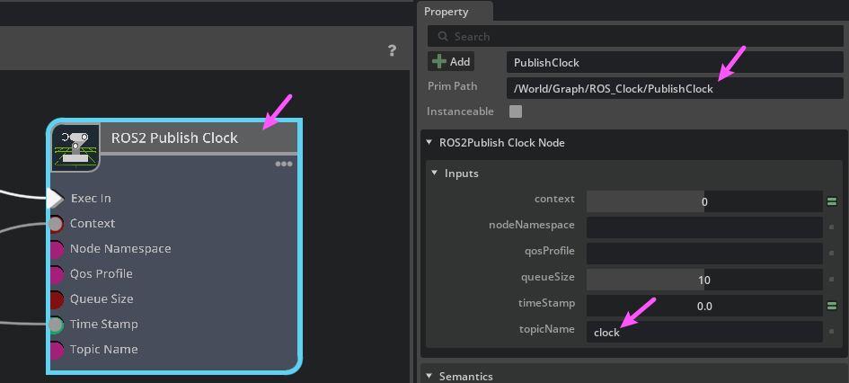

   - Domain ID

   ```
   Action Graph: ROS2 Context 노드 클릭
       └── Property > ROS2Context Node > Inputs
           ├── domain_id: 0
           └── useDomainIDEnvVar: 체크
   ```

   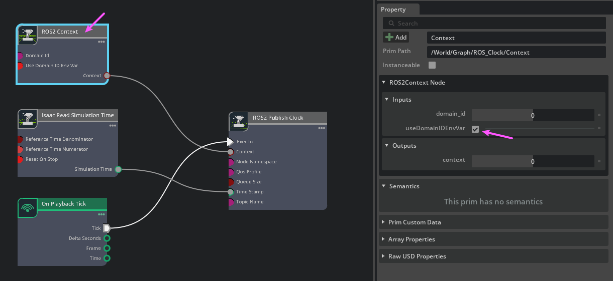

   - `useDomainIDEnvVar`가 체크되어 있으면 Isaac Sim을 실행한 터미널의 환경변수 `ROS_DOMAIN_ID`를 사용한다.

5. **IsaacSim 실행**
   `/clock`은 Play 중에만 발행되므로 시뮬레이션을 실행한다.

   ```
   Play 버튼 클릭
   ```

   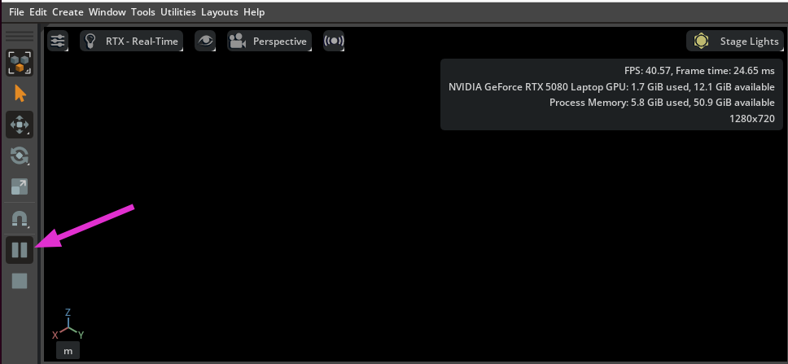

6. **같은 PC에서 수신 확인**
   **<span color="red">새 터미널, 새 터미널, 새 터미널, 새 터미널, 새 터미널, 새 터미널이라고!!!</span>**

   `/clock` 토픽이 발행되는지 확인한다.

   - ROS2 환경 설정

   ```bash
   ros_set
   ```

   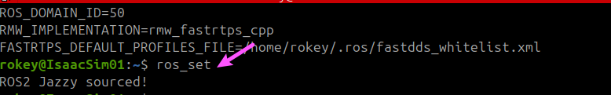

   - 토픽 목록 및 내용 확인

   ```bash
   ros2 topic list

   ros2 topic echo /clock --once
   ```

   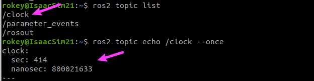

   - 확인 포인트: 목록에 `/clock`이 있고, `sec`과 `nanosec` 값이 출력됨
   - `sec`은 시뮬레이션 시간(Simulation Time)이다. 시뮬레이션에서 흐른 시간을 초 단위로 나타내며 실제 시계의 시각이 아니다

7. **다른 PC에서 수신 확인**
   같은 유선 LAN에 연결된 다른 PC에서 `/clock`을 수신해 PC 사이의 연동을 확인한다.

   - ROS2 환경 설정

   ```bash
   ros_set
   ```

   - 토픽 목록 확인

   ```bash
   ros2 topic list
   ```

   - 토픽 내용 확인

   ```bash
   ros2 topic echo /clock
   ```

   - 확인 포인트: 목록에 `/clock`이 있고, 시간 값이 계속 증가하며 출력됨
   - 두 PC의 `ROS_DOMAIN_ID`가 같아야 수신된다
   - Isaac Sim을 실행하지 않는 노트북에서 진행한다

8. **ROS 씬으로 저장**
   Clock Graph를 추가한 씬을 ROS 용 작업 씬으로 따로 저장한다. 기본 씬(`pick_place_cube.usd`)은 그대로 둔다.

   - 시뮬레이션 정지

   ```
   Stop 버튼 클릭
   ```

   - 다른 이름으로 저장

   ```
   File > Save As...
       └── ~/cobot3_ws/isaacpjt/M0609/scenes/pick_place_cube_ros.usd
   ```

   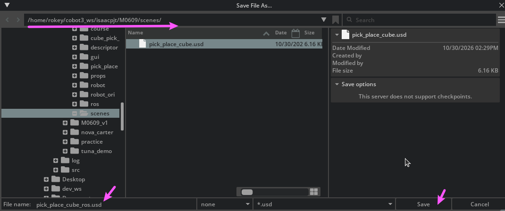

   - 확인 포인트: 창 제목에 `pick_place_cube_ros.usd` 가 표시됨
   - 같은 `scenes/` 폴더에 저장하므로 로봇·큐브의 상대 경로 참조(`../robot/...`, `../props/...`)가 그대로 맞는다
   - 확인 포인트: 폴더 구조

   ```
   ~/cobot3_ws/isaacpjt/M0609/
   ├── robot/m0609_rg2_d455.usd        로봇 자산 (수정하지 않음)
   ├── props/red_block/                큐브 자산 (수정하지 않음)
   └── scenes/
       ├── pick_place_cube.usd          로봇과 큐브를 참조하는 기본 씬 + 바닥
       └── pick_place_cube_ros.usd      기본 씬 + Clock Graph (ROS 용)
   ```

---

## 📝 요약 정리

```
ROS2 환경 설정 → isaac_ros → Isaac Sim 실행 → ROS2 Bridge 확장 확인
    → scenes/pick_place_cube.usd 열기
    → ROS 2 OmniGraphs > Clock 으로 그래프 생성 → 노드 연결·설정 확인 → Play
    → 같은 PC에서 /clock 수신 확인 → 다른 PC에서 수신 확인 → scenes/pick_place_cube_ros.usd 로 Save As
```

### 트러블슈팅

| 증상 | 원인 | 해결 |
|---|---|---|
| Console에 `ROS2 Bridge startup failed` | `isaac_ros`를 실행하지 않고 Isaac Sim을 실행함 | Isaac Sim 종료 → 같은 터미널에서 `isaac_ros` 후 `isaac` |
| `ros2 topic list`에 `/clock`이 없음 | Play 상태가 아니거나 ROS2 Bridge 확장이 꺼져 있음 | Play 상태와 확장 활성화 확인 |
| 같은 PC에서도 수신되지 않음 | Isaac Sim을 실행한 터미널과 `ROS_DOMAIN_ID`가 다름 | 두 터미널에서 `echo $ROS_DOMAIN_ID` 비교 |
| 같은 PC는 되는데 다른 PC에서 수신되지 않음 | `ROS_DOMAIN_ID` 불일치 또는 방화벽 | 두 PC의 `ROS_DOMAIN_ID` 확인, `sudo ufw disable` |
| `/clock`은 수신되지만 시간이 멈춤 | 시뮬레이션이 Pause 상태 | Play 버튼 상태 확인 |

## 📎 참고 문서
- ROS 2 Clock — https://docs.isaacsim.omniverse.nvidia.com/5.1.0/ros2_tutorials/tutorial_ros2_clock.html
- ROS 2 Installation — https://docs.isaacsim.omniverse.nvidia.com/5.1.0/installation/install_ros.html
