# GUI—ROS2 연동 Action Graph: RGB,Depth

## 📚 학습 목표
- Action Graph로 손목 카메라의 RGB·Depth 영상을 ROS2 토픽으로 발행할 수 있다
- 발행하는 영상의 크기를 설정하고 `/camera_info` 토픽으로 확인할 수 있다
- rqt로 같은 PC와 다른 PC에서 카메라 영상을 확인할 수 있다

## 🔑 핵심 개념
1. **Action Graph**
   - Isaac Sim의 노드 기반 비주얼 스크립팅(Visual Scripting) 도구다.
   - 노드를 연결해 ROS2 토픽 발행과 센서 연동을 구성하므로 Python 코드를 작성하지 않아도 된다.
   - `ROS 2 OmniGraphs` 메뉴는 자주 쓰는 그래프를 자동으로 만들어 준다.

2. **Camera Graph가 발행하는 토픽**
   카메라 한 대에서 영상 토픽과 카메라 정보 토픽이 함께 발행된다.

   | 토픽 | 메시지 타입 | 내용 |
   |---|---|---|
   | `/rgb` | `sensor_msgs/msg/Image` | 컬러 영상 |
   | `/depth` | `sensor_msgs/msg/Image` | 픽셀마다 카메라에서 물체까지의 거리(m) |
   | `/camera_info` | `sensor_msgs/msg/CameraInfo` | 영상 크기, 카메라 내부 파라미터 |

---

## ☑️ 사전 준비
1. **작업 씬**
   - 로봇과 큐브를 참조하고 Clock Graph가 들어 있는 큐브 Pick & Place 용 작업 씬

   ```
   ~/cobot3_ws/isaacpjt/M0609/scenes/pick_place_cube_ros.usd
   ```

2. **ROS2 환경변수 설정 후 Isaac Sim 실행**
   - 환경변수 설정, `isaac_ros`, `isaac` 을 **같은 터미널**에서 차례로 실행한다.

   ```bash
   #ROS 네트워크 설정
   export ROS_DOMAIN_ID=50
   export ROS_DISTRO=jazzy
   export RMW_IMPLEMENTATION=rmw_fastrtps_cpp
   export FASTRTPS_DEFAULT_PROFILES_FILE=$HOME/.ros/fastdds_whitelist.xml

   #아이작심 ROS 브릿지 설정 (Isaac Sim 내부 ROS2 라이브러리 경로 등록)
   isaac_ros

   #아이작심 시작
   isaac
   ```

---

## 💡학습 내용
1. **작업 씬 열기**
   Clock Graph를 추가해 둔 작업 씬을 열어 이어서 작업한다.

   ```
   File > Open > ~/cobot3_ws/isaacpjt/M0609/scenes/pick_place_cube_ros.usd
   ```

   - 확인 포인트: Stage에 `World > m0609_rg2_d455`, `World > GroundPlane`, `World > red_block`, `World > Graph > ROS_Clock` 이 있음

2. **로봇 자세 변경**
   카메라가 바닥의 큐브를 내려다보도록 관절을 움직인다.

   ```
   Tools > Physics > Physics Inspector
       ├── joint_3 Position: 90
       └── joint_5 Position: 90
   ```

   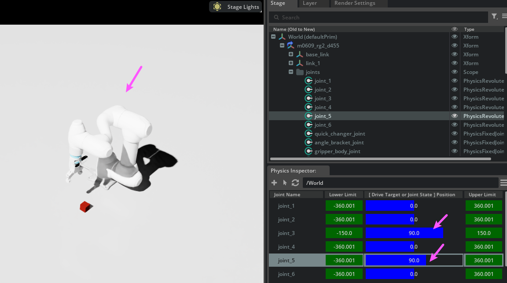

   - 확인 포인트: 그리퍼가 바닥을 향함

3. **카메라 시점 확인**
   뷰포트를 하나 더 열어 손목 카메라에 큐브가 보이는지 확인한다.

   - 두 번째 뷰포트 열기

   ```
   Window > Viewport > Viewport 2
   ```

   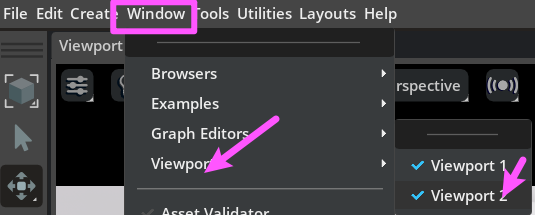

   - 손목 카메라 시점으로 전환

   ```
   Viewport 2 상단 카메라 메뉴 > Cameras > Camera_OmniVision_OV9782_Color
   ```

   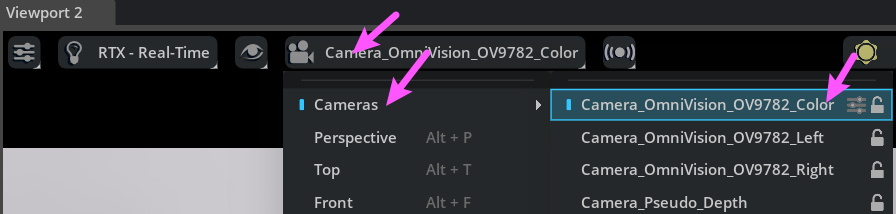

   - 시뮬레이션 실행

   ```
   Play 버튼 클릭
   ```

   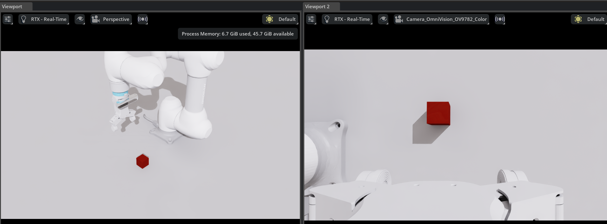

   - 확인 포인트: Viewport 2에 그리퍼 핑거와 큐브가 함께 보임

4. **Camera Graph 생성**
   ROS 2 OmniGraphs 메뉴로 RGB·Depth 영상을 발행하는 그래프를 자동 생성한다.

   - 메뉴 실행

   ```
   Tools > Robotics > ROS 2 OmniGraphs > Camera
   ```

   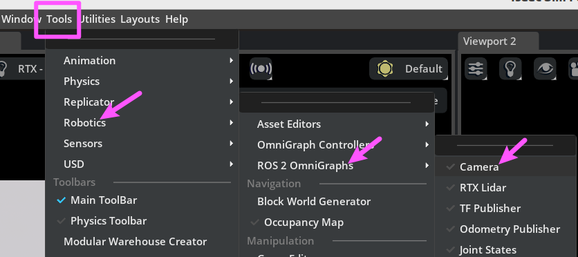

   - 그래프 경로와 카메라 지정

   ```
   ROS2 Camera Graph 창
       ├── Graph Path: /World/Graph/camera_graph
       └── Camera Prim: Add 클릭
           └── Select Targets 창
               ├── World > m0609_rg2_d455 > angle_bracket > realsense_d455 > RSD455 > Camera_OmniVision_OV9782_Color 선택
               └── Select 클릭
   ```

   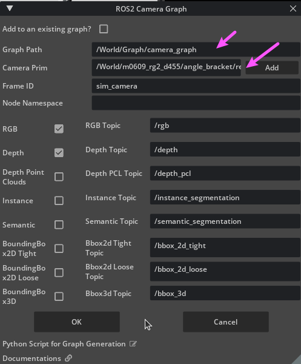

   - 발행할 데이터 선택

   ```
   ROS2 Camera Graph 창
       ├── Frame ID: Camera
       ├── RGB: 체크 (RGB Topic: /rgb)
       ├── Depth: 체크 (Depth Topic: /depth)
       └── OK 클릭
   ```

   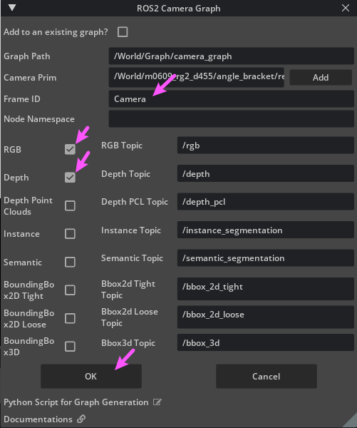

   - 확인 포인트: Stage에 `World > Graph > camera_graph` 가 생기고 그 아래 `OnPlaybackTick`, `CameraInfoPublish`, `RenderProduct`, `RunOnce`, `Context`, `RGBPublish`, `DepthPublish` 노드가 있음

   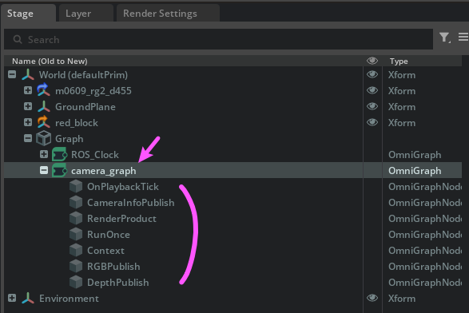

   > 📢 **Camera Graph 노드 구성**
   > 렌더 결과를 만드는 노드와 토픽을 발행하는 노드로 나뉜다.
   >
   > | 노드 | 역할 |
   > |---|---|
   > | `OnPlaybackTick` | Play 중 매 프레임마다 실행 신호 발생 |
   > | `RunOnce` | 시작할 때 한 번만 실행되도록 제한 |
   > | `RenderProduct` | 지정한 카메라의 렌더 결과 생성, 영상 크기 설정 |
   > | `Context` | ROS2 통신 설정 (Domain ID) |
   > | `RGBPublish` | 컬러 영상을 `/rgb`로 발행 |
   > | `DepthPublish` | 깊이 영상을 `/depth`로 발행 |
   > | `CameraInfoPublish` | 카메라 정보를 `/camera_info`로 발행 |

5. **영상 크기 설정**
   발행하는 영상의 크기를 640×640으로 설정한다.

   ```
   Stage: World > Graph > camera_graph > RenderProduct 선택
       └── Property > Isaac Create Render Product Node > Inputs
           ├── height: 640
           └── width: 640
   ```

   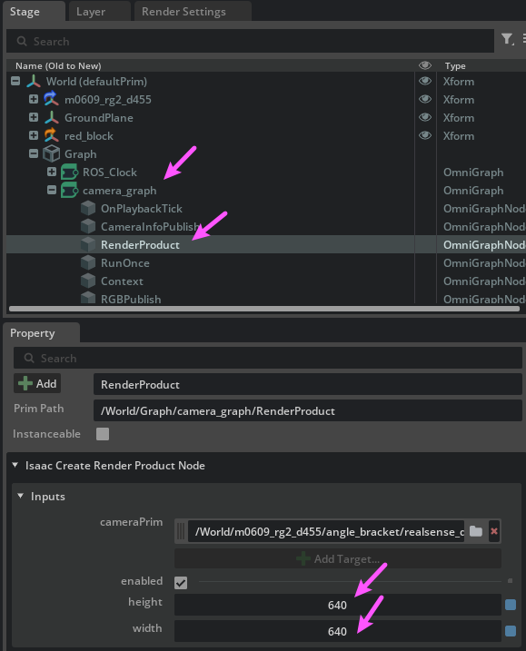

   - 확인 포인트: 같은 섹션의 `cameraPrim` 에 Camera Graph를 만들 때 선택한 카메라 경로가 표시됨

6. **시뮬레이션 실행**
   카메라 토픽은 Play 중에만 발행되므로 시뮬레이션을 실행한다.

   ```
   Play 버튼 클릭
   ```

7. **토픽 발행 확인**
   새 터미널에서 카메라 토픽이 발행되는지와 영상 크기를 확인한다.

   - ROS2 환경 설정

   ```bash
   ros_set
   ```

   - 토픽 목록 확인

   ```bash
   ros2 topic list
   ```

   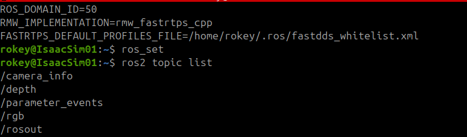

   - 확인 포인트: 목록에 `/rgb`, `/depth`, `/camera_info` 가 있음
   - 영상 크기 확인

   ```bash
   ros2 topic echo /camera_info --once
   ```

   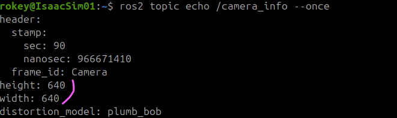

   - 확인 포인트: `height: 640`, `width: 640` 이 출력됨

   > ❓ **/camera_info의 k**
   >
   > `k`는 카메라 내부 파라미터(Intrinsic) 행렬이다.
   > 첫째 값과 다섯째 값이 초점 거리(fx, fy), 셋째 값과 여섯째 값이 영상 중심(cx, cy)이다.
   > 영상 크기가 640×640이면 영상 중심은 320, 320이다.
   >
   > 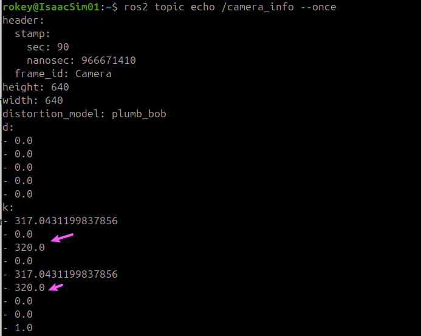

8. **rqt로 영상 확인**
   새 터미널에서 rqt를 실행해 컬러 영상과 깊이 영상을 확인한다.

   - ROS2 환경 설정

   ```bash
   #ROS 네트워크 설정
   export ROS_DOMAIN_ID=50
   export ROS_DISTRO=jazzy
   export RMW_IMPLEMENTATION=rmw_fastrtps_cpp
   export FASTRTPS_DEFAULT_PROFILES_FILE=$HOME/.ros/fastdds_whitelist.xml

   ros_set
   ```

   - rqt 실행

   ```bash
   rqt
   ```

   - 컬러 영상 열기

   ```
   rqt > Plugins > Visualization > Image View
       └── 토픽 선택: /rgb
   ```

   - 깊이 영상 열기

   ```
   rqt > Plugins > Visualization > Image View
       └── 토픽 선택: /depth
   ```

   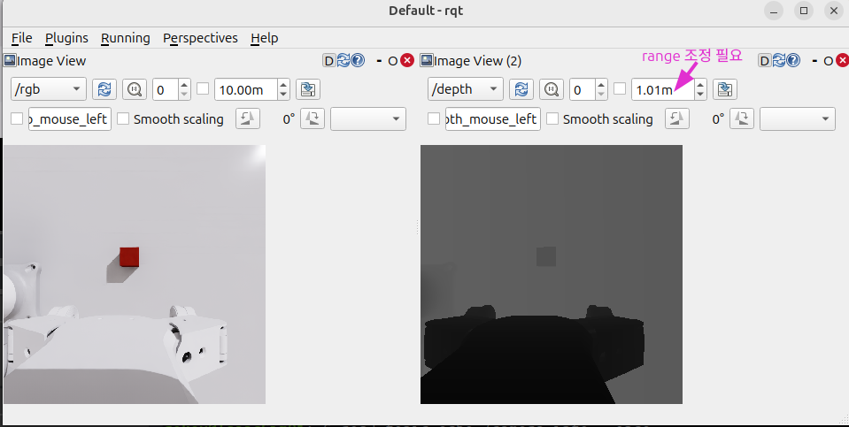

   - 확인 포인트: `/rgb` 에 그리퍼 핑거와 큐브가 보이고, `/depth` 에 같은 장면이 명암으로 표시됨
   - 깊이 영상이 거의 검게 보이면 Image View 상단의 최대 거리 값(기본 10.00m)을 1.00m 정도로 낮춘다

   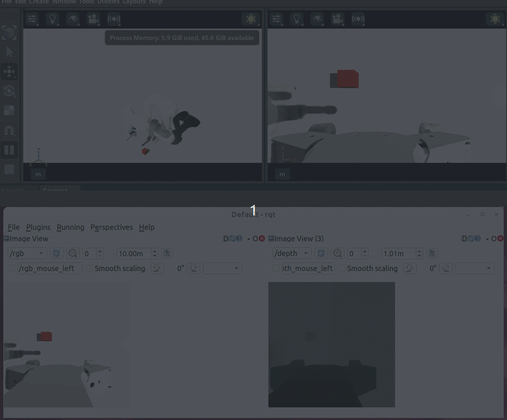

9. **다른 PC에서 영상 확인**
   같은 유선 LAN에 연결된 다른 PC에서 카메라 영상을 수신한다.

   - ROS2 환경 설정

   ```bash
   #ROS 네트워크 설정
   export ROS_DOMAIN_ID=50
   export ROS_DISTRO=jazzy
   export RMW_IMPLEMENTATION=rmw_fastrtps_cpp
   export FASTRTPS_DEFAULT_PROFILES_FILE=$HOME/.ros/fastdds_whitelist.xml

   ros_set
   ```

   - rqt 실행

   ```bash
   rqt
   ```

   - 컬러 영상 열기

   ```
   rqt > Plugins > Visualization > Image View
       └── 토픽 선택: /rgb
   ```

   - 확인 포인트: Isaac Sim을 실행한 PC와 같은 영상이 표시됨
   - 두 PC의 `ROS_DOMAIN_ID` 가 같아야 수신된다
   - Isaac Sim을 실행하지 않는 노트북에서 진행한다

10. **작업 씬 저장**
    Camera Graph를 추가한 작업 씬을 저장한다.

    - 시뮬레이션 정지

    ```
    Stop 버튼 클릭
    ```

    - 저장

    ```
    File > Save
    ```

    - 확인 포인트: 폴더 구조

    ```
    ~/cobot3_ws/isaacpjt/M0609/
    ├── robot/m0609_rg2_d455.usd        로봇 자산 (수정하지 않음)
    ├── props/red_block/                큐브 자산 (수정하지 않음)
    └── scenes/
        ├── pick_place_cube.usd          로봇과 큐브를 참조하는 기본 씬 + 바닥
        └── pick_place_cube_ros.usd      기본 씬 + Clock Graph, Camera Graph (ROS 용)
    ```

---

## 📝 요약 정리

```
scenes/pick_place_cube_ros.usd 열기 → 로봇 자세 변경 → 카메라 시점 확인
    → ROS 2 OmniGraphs > Camera 로 그래프 생성 → RenderProduct 640×640 → Play
    → 토픽 목록·/camera_info 확인 → rqt로 영상 확인 → 다른 PC에서 영상 확인 → 작업 씬 저장
```

### 트러블슈팅

| 현상 | 원인 | 조치 |
|---|---|---|
| `ros2 topic list` 에 `/rgb`, `/depth` 가 없음 | Play 상태가 아님 | Play 버튼 상태 확인 |
| Console에 `ROS2 Bridge startup failed` | `isaac_ros` 를 실행하지 않고 Isaac Sim을 실행함 | Isaac Sim 종료 → 같은 터미널에서 `isaac_ros` 후 `isaac` |
| rqt에 영상이 나오지 않음 | `ROS_DOMAIN_ID` 가 다름 | 두 터미널에서 `echo $ROS_DOMAIN_ID` 비교 |
| `/camera_info` 의 크기가 640이 아님 | `RenderProduct` 설정 누락 | 영상 크기 설정 단계 재확인 |
| 깊이 영상이 거의 검게 보임 | Image View의 최대 거리 값이 큼 | 최대 거리 값을 1.00m 정도로 낮춤 |
| 영상에 큐브가 보이지 않음 | 로봇 자세 또는 큐브 위치가 다름 | 관절 값과 큐브의 Translate 값 재확인 |

## 📎 참고 문서
- ROS 2 Cameras — https://docs.isaacsim.omniverse.nvidia.com/5.1.0/ros2_tutorials/tutorial_ros2_camera.html
