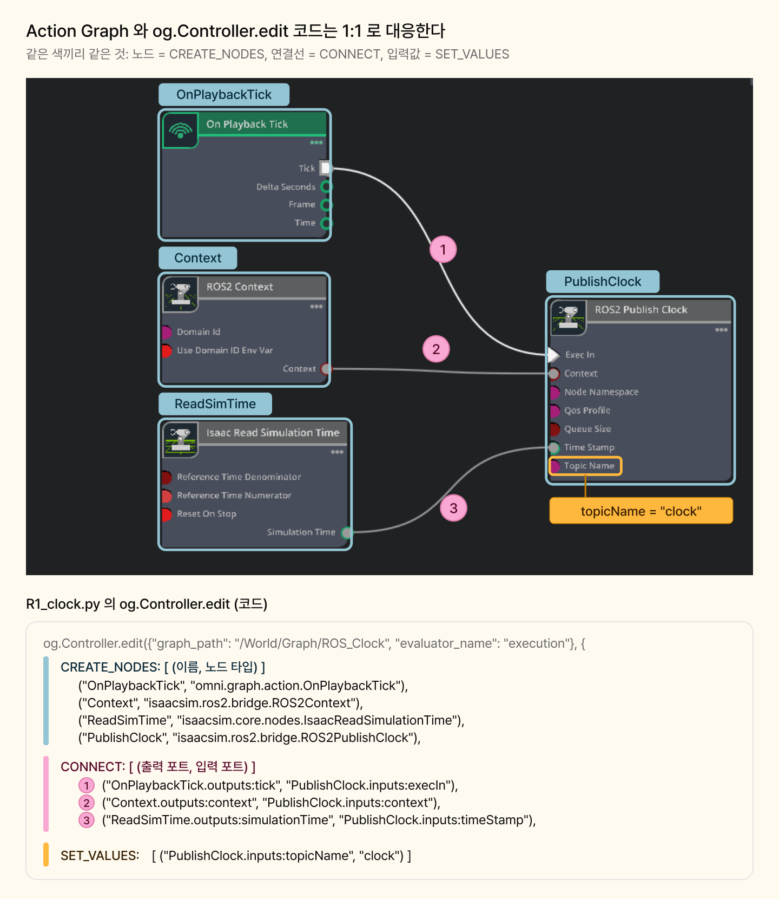
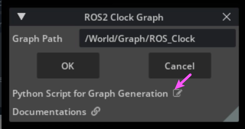
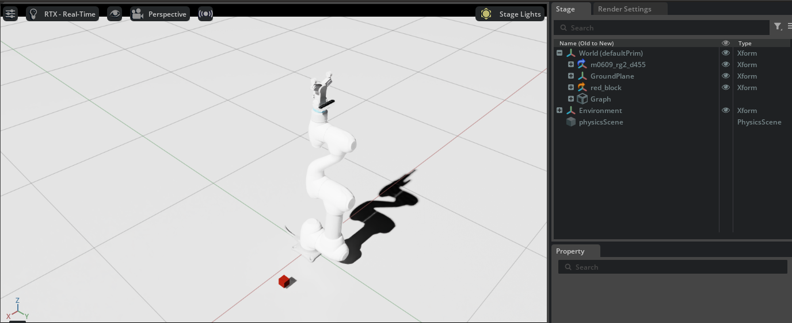
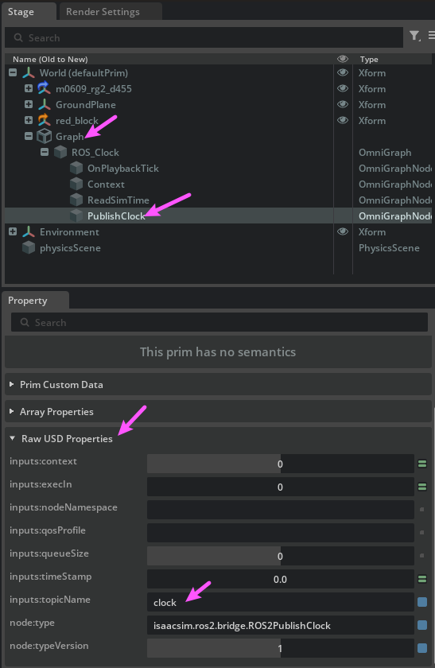
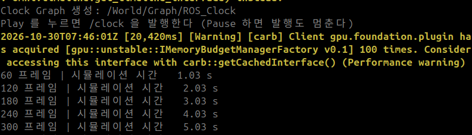
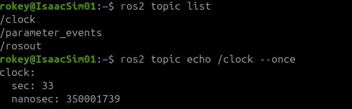
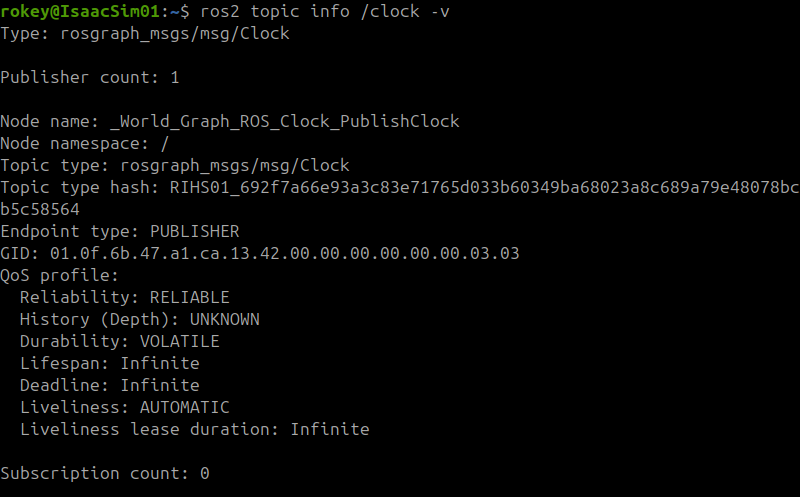
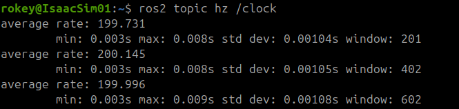

# R1. Clock Graph 를 코드로: /clock 발행

## 📚 학습 목표
- GUI 메뉴로 만들던 Clock Graph 를 Python 코드(`og.Controller.edit`)로 만들 수 있다
- Action Graph 의 노드, 연결선, 입력값이 코드의 어느 부분인지 설명할 수 있다
- standalone 코드에서 `/clock` 을 발행하고 `ros2 topic` 명령으로 확인할 수 있다

## 🔑 핵심 개념
1. **Action Graph 를 코드로 만들기**
   - GUI 메뉴로 만들던 Clock Graph 를 코드에서는 `og.Controller.edit` 한 번으로 만든다.
   - 그래프에서 보이는 것이 코드의 세 부분과 그대로 대응한다.

   

   | 그래프 | 코드 |
   |---|---|
   | 노드 | `CREATE_NODES` |
   | 연결선 | `CONNECT` |
   | 입력값 | `SET_VALUES` |

2. **ROS2 Bridge 확장 활성화**
   - standalone 코드는 ROS2 Bridge 확장을 직접 켜야 한다.
   - ROS2 노드를 쓰는 그래프를 만들기 **전에** 켠다.

   ```python
   simulation_app = SimulationApp({"headless": False})  # 1. 앱 시작
   enable_extension("isaacsim.ros2.bridge")            # 2. ROS2 Bridge 확장 켜기
   simulation_app.update()                             # 3. 앱을 한 번 갱신
   og.Controller.edit(...)                             # 4. ROS2 노드로 그래프 만들기
   ```

   - 확장을 켜기 전에 그래프를 만들면 ROS2 노드 타입을 찾지 못해 오류가 난다 (`Could not create node using unrecognized type 'isaacsim.ros2.bridge.ROS2Context'`)

---

## ☑️ 사전 준비
1. **작업 씬**
   - 로봇, 바닥, 큐브를 참조한 기본 씬 (GUI—자산 참조로 작업 씬 만들기에서 만든 씬)

   ```
   ~/cobot3_ws/isaacpjt/M0609/scenes/pick_place_cube.usd
   ```

2. **파일 위치**

   ```
   ~/cobot3_ws/isaacpjt/M0609/ros/
   ├── R1_clock.py          예제
   └── R1_clock_answer.py   연습 문제 정답
   ```

3. **ROS2 환경변수 (Isaac Sim 터미널)**
   - 환경변수 설정, `isaac_ros`, `isaac_python` 을 **같은 터미널**에서 차례로 실행한다.

   ```bash
   export ROS_DOMAIN_ID=50
   export ROS_DISTRO=jazzy
   export RMW_IMPLEMENTATION=rmw_fastrtps_cpp
   export FASTRTPS_DEFAULT_PROFILES_FILE=$HOME/.ros/fastdds_whitelist.xml
   isaac_ros
   ```

---

## 💡학습 내용
1. **공식 코드 찾기**
   ROS 2 OmniGraphs 메뉴 창에는 그 메뉴가 그래프를 만드는 공식 Python 코드를 여는 버튼이 있다.

   

   ```
   Tools > Robotics > ROS 2 OmniGraphs > Clock
       └── ROS2 Clock Graph 창
           └── Python Script for Graph Generation 오른쪽 연필 아이콘 클릭
               └── 메뉴의 소스 파일이 VS Code 로 열림
   ```

   - VS Code(`code` 명령)가 없으면 열리지 않는다. 그때는 파일을 직접 연다.

   ```
   ~/isaacsim/exts/isaacsim.ros2.bridge/isaacsim/ros2/bridge/impl/og_shortcuts/og_utils.py
   ```

   - `Ros2ClockGraph` 클래스의 `make_graph()` 안에 `og.Controller.edit` 가 있다. 이 부분을 내 코드로 옮기고 필요한 값만 바꾼다.

   ```python
   (graph, nodes, _, _) = og.Controller.edit(
       {"graph_path": self._og_path, "evaluator_name": "execution"},
       {
           keys.CREATE_NODES: [
               ("OnPlaybackTick", "omni.graph.action.OnPlaybackTick"),
               ("ReadSimTime", "isaacsim.core.nodes.IsaacReadSimulationTime"),
               ("PublishClock", "isaacsim.ros2.bridge.ROS2PublishClock"),
               ("Context", "isaacsim.ros2.bridge.ROS2Context"),
           ],
           keys.CONNECT: [
               ("OnPlaybackTick.outputs:tick", "PublishClock.inputs:execIn"),
               ("Context.outputs:context", "PublishClock.inputs:context"),
               ("ReadSimTime.outputs:simulationTime", "PublishClock.inputs:timeStamp"),
           ],
           keys.SET_VALUES: [
               ("ReadSimTime.inputs:resetOnStop", False),
           ],
       },
   )
   ```

   | 공식 코드 | R1_[clock.py](http://clock.py) | 이유 |
   |---|---|---|
   | `self._og_path` (창에 입력한 경로) | `GRAPH_PATH = "/World/Graph/ROS_Clock"` | 창이 없으므로 상수로 정한다 |
   | `topicName` 없음 | `topicName` 을 `"clock"` 으로 | 기본값이 `clock` 이지만, 토픽 이름을 코드에서 보이게 적었다 |

   - `CREATE_NODES` 의 노드 4개: (노드 이름, 노드 타입)

   | 노드 이름 | 노드 타입 | 역할 |
   |---|---|---|
   | `OnPlaybackTick` | `omni.graph.action.OnPlaybackTick` | Play 중 매 프레임 실행 신호 |
   | `Context` | `isaacsim.ros2.bridge.ROS2Context` | ROS2 통신 설정 (Domain ID) |
   | `ReadSimTime` | `isaacsim.core.nodes.IsaacReadSimulationTime` | 시뮬레이션 시간 읽기 |
   | `PublishClock` | `isaacsim.ros2.bridge.ROS2PublishClock` | 받은 시간을 `/clock` 으로 발행 |

2. **예제 실행**
   기본 씬을 열고 Clock Graph 를 코드로 만든 뒤, Play 를 기다린다.

   ### R1_clock.py

   ```python
   """[R1 예제] Clock Graph 를 코드로 만들어 /clock 발행

   실행: isaac_python R1_clock.py
         창에서 Play(▶) 를 누르면 /clock 이 발행된다. 새 터미널에서 ros2 topic echo /clock 으로 확인한다
   """

   from pathlib import Path

   # ============================================================
   # 1. 앱 시작 (Isaac 모듈보다 먼저)
   # ============================================================
   from isaacsim import SimulationApp

   simulation_app = SimulationApp({"headless": False})

   # ============================================================
   # 2. Isaac 모듈 import (앱을 켠 뒤에)
   # ============================================================
   import omni.graph.core as og
   from isaacsim.core.api import World
   from isaacsim.core.utils.extensions import enable_extension
   from isaacsim.core.utils.stage import open_stage

   SCENE_USD = Path(__file__).resolve().parents[1] / "scenes" / "pick_place_cube.usd"  # GUI 강의에서 만든 기본 씬
   GRAPH_PATH = "/World/Graph/ROS_Clock"  # GUI 강의와 같은 위치

   # (가) ROS2 Bridge 확장 켜기: ROS2 노드(ROS2Context, ROS2PublishClock 등)를 쓰기 전에 켠다
   enable_extension("isaacsim.ros2.bridge")
   simulation_app.update()

   # (나) 작업 씬 열기: 로봇, 바닥, 큐브가 들어 있는 기본 씬
   open_stage(str(SCENE_USD))
   world = World(stage_units_in_meters=1.0)

   # (다) Clock Graph 만들기: GUI 의 Tools > Robotics > ROS 2 OmniGraphs > Clock 과 같은 노드 4개
   og.Controller.edit(
       {"graph_path": GRAPH_PATH, "evaluator_name": "execution"},  # execution = Action Graph
       {
           og.Controller.Keys.CREATE_NODES: [
               ("OnPlaybackTick", "omni.graph.action.OnPlaybackTick"),              # Play 중 매 프레임 실행 신호
               ("Context", "isaacsim.ros2.bridge.ROS2Context"),                     # ROS2 통신 설정 (Domain ID)
               ("ReadSimTime", "isaacsim.core.nodes.IsaacReadSimulationTime"),      # 시뮬레이션 시간 읽기
               ("PublishClock", "isaacsim.ros2.bridge.ROS2PublishClock"),           # 시간을 토픽으로 발행
           ],
           og.Controller.Keys.CONNECT: [
               ("OnPlaybackTick.outputs:tick", "PublishClock.inputs:execIn"),       # 실행 신호
               ("Context.outputs:context", "PublishClock.inputs:context"),          # 통신 설정
               ("ReadSimTime.outputs:simulationTime", "PublishClock.inputs:timeStamp"),  # 시간
           ],
           og.Controller.Keys.SET_VALUES: [
               ("PublishClock.inputs:topicName", "clock"),                          # 토픽 이름: /clock
           ],
       },
   )
   print("Clock Graph 생성:", GRAPH_PATH)

   # (라) 멈춘 상태로 기다린다
   world.reset()
   world.pause()  # 화면 왼쪽의 Play(▶) 를 누르면 /clock 발행 시작
   print("Play 를 누르면 /clock 을 발행한다 (Pause 하면 발행도 멈춘다)")

   # ============================================================
   # 3. 메인 루프 (창이 열려 있는 동안 한 프레임씩 진행)
   # ============================================================
   frame = 0  # Play 중에 지난 프레임 수
   while simulation_app.is_running():
       world.step(render=True)
       if not world.is_playing():
           continue
       frame += 1
       if frame % 60 == 0:  # 60 프레임마다 시뮬레이션 시간 출력 (ros2 topic echo /clock 과 비교)
           print(f"{frame} 프레임 | 시뮬레이션 시간 {world.current_time:6.2f} s")

   # ============================================================
   # 4. 종료
   # ============================================================
   simulation_app.close()
   ```

   ```bash
   cd ~/cobot3_ws/isaacpjt/M0609/ros
   isaac_python R1_clock.py
   ```

   

   - 터미널에 `Clock Graph 생성: /World/Graph/ROS_Clock` 이 출력되고, 창에 로봇, 바닥, 큐브가 보임
   - Stage 에 `World > Graph > ROS_Clock` 이 있고 그 아래 `OnPlaybackTick`, `Context`, `ReadSimTime`, `PublishClock` 노드가 있음
   - Stage 에서 노드를 선택하면 Property 의 Raw USD Properties 에 포트와 노드 타입이 보임

   

   - 포트는 `inputs:topicName` 처럼 코드와 같은 이름으로 보인다. 코드에서는 앞에 노드 이름을 붙여 `PublishClock.inputs:topicName` 으로 쓴다
   - `node:type` 이 `CREATE_NODES` 에 쓴 노드 타입(`isaacsim.ros2.bridge.ROS2PublishClock`)이다
   - Play(▶) 를 누르면 60 프레임마다 시뮬레이션 시간이 출력된다

   

3. **ROS2 쪽에서 확인**
   새 터미널에서 `/clock` 토픽이 발행되는지 확인한다. Isaac Sim 은 Play 상태여야 한다.

   - ROS2 환경 설정 (`ROS_DOMAIN_ID` 는 Isaac Sim 터미널과 같게. `Context` 노드는 Isaac Sim 터미널의 `ROS_DOMAIN_ID` 를 쓴다)

   ```bash
   export ROS_DOMAIN_ID=50
   ros_set
   ```

   - 토픽 목록과 내용

   ```bash
   ros2 topic list
   ros2 topic echo /clock --once
   ```

   

   - 확인 포인트: 목록에 `/clock` 이 있고, `sec` 이 Isaac Sim 터미널에 출력되는 시뮬레이션 시간과 비슷함
   - 발행하는 노드와 주기

   ```bash
   ros2 topic info /clock -v
   ros2 topic hz /clock
   ```

   

   - 확인 포인트: `Node name: _World_Graph_ROS_Clock_PublishClock`. 그래프 경로와 노드 이름으로 ROS2 노드 이름이 정해진다

   

   - `/clock` 은 매 프레임 발행되므로 주기는 Isaac Sim 의 프레임 속도와 같다. PC 성능에 따라 다르다

4. **실습: Pause 와 토픽 이름**
   - Isaac Sim 창에서 Pause 를 누르고 `ros2 topic echo /clock` 을 실행한다. 아무것도 출력되지 않는다. `OnPlaybackTick` 은 Play 중에만 실행 신호를 내기 때문이다. 다시 Play 를 누르면 Pause 했던 시간부터 이어서 발행된다
   - `SET_VALUES` 의 토픽 이름을 `"sim_time"` 으로 바꿔 실행하고 `ros2 topic list` 에서 `/sim_time` 이 보이는지 확인한다

   ```python
   ("PublishClock.inputs:topicName", "sim_time"),
   ```

---

## ✏️ 연습 문제

### 시나리오: 두 개의 시계

`/clock` 옆에 **실제 시간**을 알려 주는 시계 `/system_clock` 을 하나 더 발행하고, 두 시계를 비교한다.

- 두 토픽을 `ros2 topic echo` 로 받아 `sec` 값을 비교한다
- Pause 를 잠깐 했다가 Play 하면 두 시계의 차이가 어떻게 바뀌는지 확인한다

```
/clock         sec: 15
/system_clock  sec: 1793344629
```

---

## 📝 요약 정리

```
메뉴 창의 Python Script 버튼 → 공식 og.Controller.edit 코드 확인
    → ROS2 환경 설정 → isaac_ros → isaac_python R1_clock.py
    → (코드) ROS2 Bridge 확장 켜기 → 기본 씬 열기 → og.Controller.edit 로 Clock Graph 생성
    → Play → ros2 topic list / echo / info / hz 로 /clock 확인
```

### 트러블슈팅

| 증상 | 원인 | 해결 |
|---|---|---|
| `OmniGraphError: Could not create node using unrecognized type 'isaacsim.ros2.bridge.ROS2Context'. Perhaps the extension 'isaacsim.ros2.bridge' is not loaded?` | ROS2 Bridge 확장을 켜기 전에 그래프를 만듦 | `enable_extension("isaacsim.ros2.bridge")` 와 `simulation_app.update()` 를 그래프 생성보다 먼저 |
| Console 에 `ROS2 Bridge startup failed` | `isaac_ros` 를 실행하지 않음 | 같은 터미널에서 `isaac_ros` 후 `isaac_python` |
| `ros2 topic list` 에 `/clock` 이 없음 | Play 상태가 아니거나 두 터미널의 `ROS_DOMAIN_ID` 가 다름 | Play 상태 확인, 두 터미널에서 `echo $ROS_DOMAIN_ID` 비교 |
| 창에 로봇이 없고 Console 에 `Failed to open : .../scenes/pick_place_cube.usd` | 기본 씬 파일이 없음 | GUI—자산 참조로 작업 씬 만들기에서 씬을 먼저 만든다 |

## 📎 참고 문서
- ROS 2 Bridge in Standalone Workflow — https://docs.isaacsim.omniverse.nvidia.com/5.1.0/ros2_tutorials/tutorial_ros2_python.html
- ROS 2 Clock — https://docs.isaacsim.omniverse.nvidia.com/5.1.0/ros2_tutorials/tutorial_ros2_clock.html
