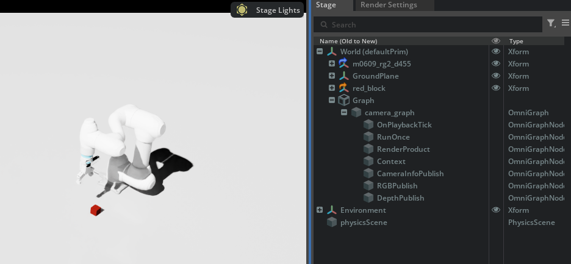
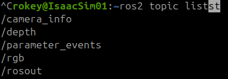
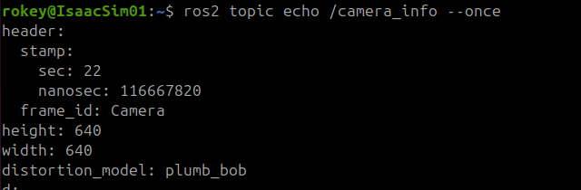
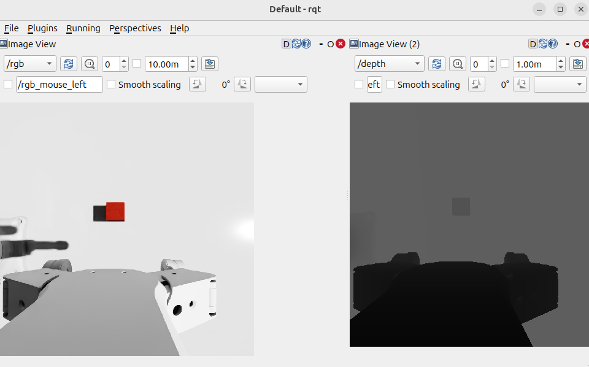
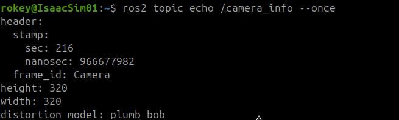
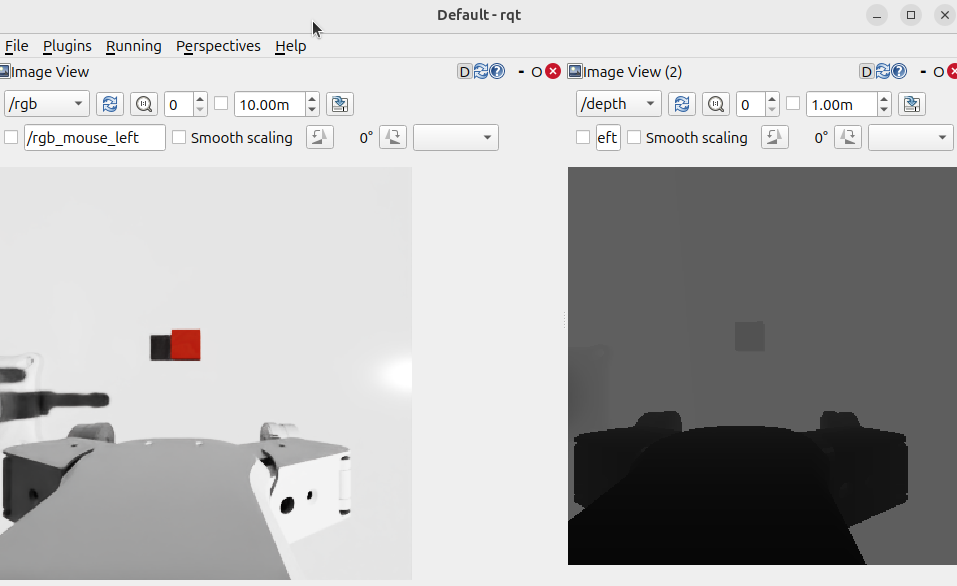
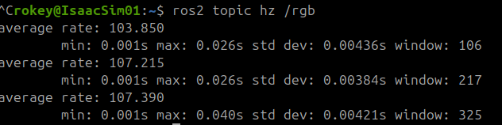
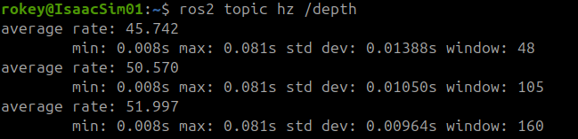

# R2. Camera Graph 를 코드로: /rgb, /depth, /camera_info 발행

## 📚 학습 목표
- GUI 메뉴로 만들던 Camera Graph 를 Python 코드(`og.Controller.edit`)로 만들 수 있다
- 손목 카메라의 컬러 영상, 깊이 영상, 카메라 정보를 ROS2 토픽으로 발행하고 확인할 수 있다
- 영상 크기와 발행 주기를 코드에서 바꿀 수 있다

## 🔑 핵심 개념
1. **Camera Graph 의 흐름**
   - 카메라의 렌더 결과를 한 번 만들고, 발행 노드들이 그 렌더 결과를 받아 토픽으로 발행한다.

   ```
   OnPlaybackTick → RunOnce → RenderProduct (카메라, 640×640)
                                  ├── CameraInfoPublish → /camera_info
                                  ├── RGBPublish        → /rgb
                                  └── DepthPublish      → /depth
   ```

2. **발행 주기**
   - 발행 노드는 매 프레임 발행한다. `frameSkipCount` 로 건너뛸 프레임 수를 정한다.
   - 발행 주기 = 프레임 속도 ÷ (`frameSkipCount` + 1). `frameSkipCount` 가 1 이면 2 프레임에 한 번 발행한다.

---

## ☑️ 사전 준비
1. **작업 씬**
   - 로봇, 바닥, 큐브를 참조한 기본 씬 (GUI—자산 참조로 작업 씬 만들기에서 만든 씬)

   ```
   ~/cobot3_ws/isaacpjt/M0609/scenes/pick_place_cube.usd
   ```

2. **ROS2 환경변수 (Isaac Sim 터미널)**
   - 환경변수 설정, `isaac_ros`, `isaac_python` 을 **같은 터미널**에서 차례로 실행한다.

   ```bash
   export ROS_DOMAIN_ID=50
   export ROS_DISTRO=jazzy
   export RMW_IMPLEMENTATION=rmw_fastrtps_cpp
   export FASTRTPS_DEFAULT_PROFILES_FILE=$HOME/.ros/fastdds_whitelist.xml
   isaac_ros
   ```

---

## 💡학습 내용
1. **공식 코드 찾기**
   Camera 메뉴 창의 Python Script for Graph Generation 버튼으로 공식 코드를 연다.

   ```
   Tools > Robotics > ROS 2 OmniGraphs > Camera
       └── ROS2 Camera Graph 창
           └── Python Script for Graph Generation 오른쪽 연필 아이콘 클릭
               └── 메뉴의 소스 파일이 VS Code 로 열림
   ```

   - VS Code(`code` 명령)가 없으면 파일을 직접 연다.

   ```
   ~/isaacsim/exts/isaacsim.ros2.bridge/isaacsim/ros2/bridge/impl/og_shortcuts/og_rtx_sensors.py
   ```

   - `CREATE_NODES` 의 노드 7개: (노드 이름, 노드 타입)

   | 노드 이름 | 노드 타입 | 역할 |
   |---|---|---|
   | `OnPlaybackTick` | `omni.graph.action.OnPlaybackTick` | Play 중 매 프레임 실행 신호 |
   | `RunOnce` | `isaacsim.core.nodes.OgnIsaacRunOneSimulationFrame` | Play 를 시작한 첫 프레임에만 다음 노드 실행 |
   | `RenderProduct` | `isaacsim.core.nodes.IsaacCreateRenderProduct` | 카메라의 렌더 결과 만들기, 영상 크기 설정 |
   | `Context` | `isaacsim.ros2.bridge.ROS2Context` | ROS2 통신 설정 (Domain ID) |
   | `CameraInfoPublish` | `isaacsim.ros2.bridge.ROS2CameraInfoHelper` | `/camera_info` 발행 |
   | `RGBPublish` | `isaacsim.ros2.bridge.ROS2CameraHelper` | `type` 이 `rgb` 일 때 `/rgb` 발행 |
   | `DepthPublish` | `isaacsim.ros2.bridge.ROS2CameraHelper` | `type` 이 `depth` 일 때 `/depth` 발행 |

   - `RGBPublish` 와 `DepthPublish` 는 같은 노드 타입이다. `inputs:type` 값으로 발행할 데이터를 정한다.

2. **예제 실행**
   기본 씬을 열고 Camera Graph 를 코드로 만든 뒤, 카메라가 큐브를 내려다보는 자세로 Play 를 기다린다.

   ### R2_camera.py

   ```python
   """[R2 예제] Camera Graph 를 코드로 만들어 /rgb, /depth, /camera_info 발행

   실행: isaac_python R2_camera.py
         창에서 Play(▶) 를 누르면 손목 카메라 영상이 발행된다. 새 터미널에서 rqt 로 확인한다
   """

   from pathlib import Path

   # ============================================================
   # 1. 앱 시작 (Isaac 모듈보다 먼저)
   # ============================================================
   from isaacsim import SimulationApp

   simulation_app = SimulationApp({"headless": False})

   # ============================================================
   # 2. Isaac 모듈 import (앱을 켠 뒤에)
   # ============================================================
   import numpy as np
   import omni.graph.core as og
   from isaacsim.core.api import World
   from isaacsim.core.prims import SingleArticulation
   from isaacsim.core.utils.extensions import enable_extension
   from isaacsim.core.utils.stage import open_stage

   SCENE_USD = Path(__file__).resolve().parents[1] / "scenes" / "pick_place_cube.usd"  # GUI 강의에서 만든 기본 씬
   GRAPH_PATH = "/World/Graph/camera_graph"  # GUI 강의와 같은 위치
   CAMERA_PRIM = "/World/m0609_rg2_d455/angle_bracket/realsense_d455/RSD455/Camera_OmniVision_OV9782_Color"  # 손목 컬러 카메라
   WIDTH, HEIGHT = 640, 640  # 발행할 영상 크기 (픽셀)
   FRAME_ID = "Camera"       # 메시지 header 의 frame_id
   CAMERA_LOOK_DEG = [0, 0, 90, 0, 90, 0]  # 카메라가 바닥의 큐브를 내려다보는 팔 자세 (joint_3, joint_5 = 90 deg)

   # (가) ROS2 Bridge 확장 켜기: ROS2 노드를 쓰기 전에 켠다
   enable_extension("isaacsim.ros2.bridge")
   simulation_app.update()

   # (나) 작업 씬 열기: 로봇, 바닥, 큐브가 들어 있는 기본 씬
   open_stage(str(SCENE_USD))
   world = World(stage_units_in_meters=1.0)
   robot = world.scene.add(SingleArticulation(prim_path="/World/m0609_rg2_d455", name="m0609"))

   # (다) Camera Graph 만들기: GUI 의 Tools > Robotics > ROS 2 OmniGraphs > Camera 와 같은 노드 7개
   og.Controller.edit(
       {"graph_path": GRAPH_PATH, "evaluator_name": "execution"},  # execution = Action Graph
       {
           og.Controller.Keys.CREATE_NODES: [
               ("OnPlaybackTick", "omni.graph.action.OnPlaybackTick"),                       # Play 중 매 프레임 실행 신호
               ("RunOnce", "isaacsim.core.nodes.OgnIsaacRunOneSimulationFrame"),             # 첫 프레임에만 다음 노드 실행
               ("RenderProduct", "isaacsim.core.nodes.IsaacCreateRenderProduct"),            # 카메라의 렌더 결과 만들기
               ("Context", "isaacsim.ros2.bridge.ROS2Context"),                              # ROS2 통신 설정 (Domain ID)
               ("CameraInfoPublish", "isaacsim.ros2.bridge.ROS2CameraInfoHelper"),           # /camera_info 발행
               ("RGBPublish", "isaacsim.ros2.bridge.ROS2CameraHelper"),                      # /rgb 발행
               ("DepthPublish", "isaacsim.ros2.bridge.ROS2CameraHelper"),                    # /depth 발행
           ],
           og.Controller.Keys.CONNECT: [
               ("OnPlaybackTick.outputs:tick", "RunOnce.inputs:execIn"),                     # 실행 신호 -> 첫 프레임만
               ("RunOnce.outputs:step", "RenderProduct.inputs:execIn"),                      # 첫 프레임에 렌더 결과 만들기
               ("RenderProduct.outputs:execOut", "CameraInfoPublish.inputs:execIn"),         # 렌더 결과를 만든 뒤 발행 노드 실행
               ("RenderProduct.outputs:execOut", "RGBPublish.inputs:execIn"),
               ("RenderProduct.outputs:execOut", "DepthPublish.inputs:execIn"),
               ("RenderProduct.outputs:renderProductPath", "CameraInfoPublish.inputs:renderProductPath"),  # 어느 렌더 결과를
               ("RenderProduct.outputs:renderProductPath", "RGBPublish.inputs:renderProductPath"),
               ("RenderProduct.outputs:renderProductPath", "DepthPublish.inputs:renderProductPath"),
               ("Context.outputs:context", "CameraInfoPublish.inputs:context"),               # 통신 설정
               ("Context.outputs:context", "RGBPublish.inputs:context"),
               ("Context.outputs:context", "DepthPublish.inputs:context"),
           ],
           og.Controller.Keys.SET_VALUES: [
               ("RenderProduct.inputs:cameraPrim", CAMERA_PRIM),                             # 어느 카메라로 찍을지
               ("RenderProduct.inputs:width", WIDTH),                                        # 영상 크기
               ("RenderProduct.inputs:height", HEIGHT),
               ("CameraInfoPublish.inputs:topicName", "camera_info"),                        # 토픽 이름
               ("CameraInfoPublish.inputs:frameId", FRAME_ID),
               ("RGBPublish.inputs:type", "rgb"),                                            # 발행할 데이터 종류
               ("RGBPublish.inputs:topicName", "rgb"),
               ("RGBPublish.inputs:frameId", FRAME_ID),
               ("DepthPublish.inputs:type", "depth"),
               ("DepthPublish.inputs:topicName", "depth"),
               ("DepthPublish.inputs:frameId", FRAME_ID),
           ],
       },
   )
   print("Camera Graph 생성:", GRAPH_PATH)

   # (라) 카메라가 큐브를 내려다보는 자세로 순간이동하고, 멈춘 상태로 기다린다
   world.reset()
   arm = [robot.get_dof_index(f"joint_{i}") for i in range(1, 7)]  # 팔 관절 6개가 관절 배열의 몇 번째인지
   pose = robot.get_joint_positions()
   pose[arm] = np.radians(CAMERA_LOOK_DEG)
   robot.set_joint_positions(pose)
   world.step(render=True)  # 한 프레임 진행해서 순간이동한 자세를 화면에 반영
   world.pause()            # 화면 왼쪽의 Play(▶) 를 누르면 영상 발행 시작
   print("Play 를 누르면 /rgb, /depth, /camera_info 를 발행한다")

   # ============================================================
   # 3. 메인 루프 (창이 열려 있는 동안 한 프레임씩 진행)
   # ============================================================
   while simulation_app.is_running():
       world.step(render=True)

   # ============================================================
   # 4. 종료
   # ============================================================
   simulation_app.close()
   ```

   ```bash
   cd ~/cobot3_ws/isaacpjt/M0609/ros
   isaac_python R2_camera.py
   ```

   

   - 터미널에 `Camera Graph 생성: /World/Graph/camera_graph` 이 출력되고, 그리퍼가 바닥을 향함
   - Stage 에 `World > Graph > camera_graph` 이 있고 그 아래 노드 7개가 있음
   - Play(▶) 를 누르면 영상 발행을 시작한다

3. **ROS2 쪽에서 확인**
   새 터미널에서 카메라 토픽을 확인한다. Isaac Sim 은 Play 상태여야 한다.

   - ROS2 환경 설정 (`ROS_DOMAIN_ID` 는 Isaac Sim 터미널과 같게)

   ```bash
   export ROS_DOMAIN_ID=50
   ros_set
   ```

   - 토픽 목록

   ```bash
   ros2 topic list
   ```

   

   - 카메라 정보

   ```bash
   ros2 topic echo /camera_info --once
   ```

   

   - 확인 포인트: `frame_id: Camera`, `height: 640`, `width: 640` 이 출력됨
   - 영상 확인

   ```bash
   rqt
   ```

   

   - `/rgb` 에 그리퍼와 큐브가 보임
   - 깊이 영상이 거의 검게 보이면 Image View 상단의 최대 거리 값(기본 10.00m)을 1.00m 정도로 낮춘다
   - 발행 주기

   ```bash
   ros2 topic hz /rgb
   ```

   - `frameSkipCount` 가 0 이므로 매 프레임 발행한다. 주기는 Isaac Sim 의 프레임 속도와 같고, PC 성능에 따라 다르다

4. **실습: 영상 크기와 발행 주기**
   - 영상 크기를 320×320 으로 바꿔 실행하고 `/camera_info` 의 `height`, `width` 가 320 인지 확인한다

   ```python
   WIDTH, HEIGHT = 320, 320  # 발행할 영상 크기 (픽셀)
   ```

   

   - 육안으로도 해상도가 떨어져보인다.

   

   - `DepthPublish` 에 `frameSkipCount` 를 1 로 넣어 실행하고, `ros2 topic hz /rgb` 와 `ros2 topic hz /depth` 를 비교한다. `/depth` 가 `/rgb` 의 약 절반 주기로 나온다

   ```python
   ("DepthPublish.inputs:frameSkipCount", 1),
   ```

   

   

---

## ✏️ 연습 문제

### 시나리오: 두 눈으로 보기

손목 카메라(D455)에는 컬러 카메라 옆에 왼쪽 카메라도 있다. 왼쪽 카메라 영상을 `/rgb_left` 로 함께 발행하고, `/rgb` 와 비교한다.

- 왼쪽 카메라: `/World/m0609_rg2_d455/angle_bracket/realsense_d455/RSD455/Camera_OmniVision_OV9782_Left`
- rqt 의 Image View 를 두 개 열어 `/rgb` 와 `/rgb_left` 를 나란히 놓고, 큐브가 보이는 위치를 비교한다

```
/camera_info
/depth
/rgb
/rgb_left
```

---

## 📝 요약 정리

```
메뉴 창의 Python Script 버튼 → 공식 Camera Graph 코드 확인
    → ROS2 환경 설정 → isaac_ros → isaac_python R2_camera.py
    → (코드) ROS2 Bridge 확장 켜기 → 기본 씬 열기 → og.Controller.edit 로 Camera Graph 생성 → 팔 자세 맞추기
    → Play → ros2 topic list / echo /camera_info / hz, rqt 로 영상 확인
```

### 트러블슈팅

| 증상 | 원인 | 해결 |
|---|---|---|
| `OmniGraphError: Could not create node using unrecognized type ...` | ROS2 Bridge 확장을 켜기 전에 그래프를 만듦 | `enable_extension("isaacsim.ros2.bridge")` 와 `simulation_app.update()` 를 그래프 생성보다 먼저 |
| Console 에 `ROS2 Bridge startup failed` | `isaac_ros` 를 실행하지 않음 | 같은 터미널에서 `isaac_ros` 후 `isaac_python` |
| `ros2 topic list` 에 `/rgb` 가 없음 | Play 상태가 아니거나 두 터미널의 `ROS_DOMAIN_ID` 가 다름 | Play 상태 확인, 두 터미널에서 `echo $ROS_DOMAIN_ID` 비교 |
| 깊이 영상이 거의 검게 보임 | Image View 의 최대 거리 값이 큼 | 최대 거리 값을 1.00m 정도로 낮춤 |

## 📎 참고 문서
- ROS 2 Cameras — https://docs.isaacsim.omniverse.nvidia.com/5.1.0/ros2_tutorials/tutorial_ros2_camera.html
- ROS 2 Publish Rate — https://docs.isaacsim.omniverse.nvidia.com/5.1.0/ros2_tutorials/tutorial_ros2_publish_rate.html
