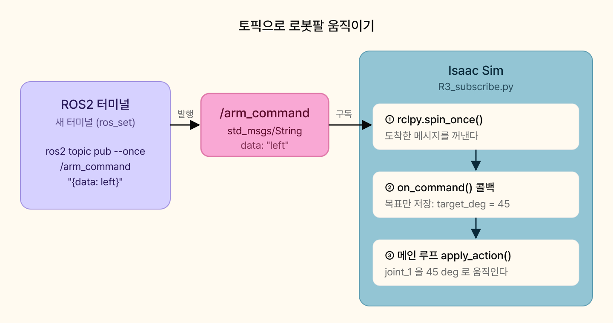
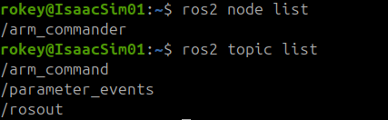
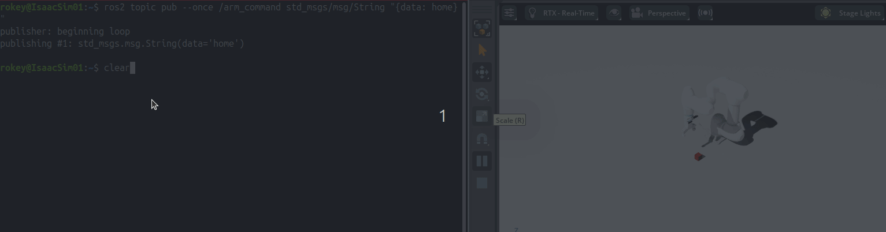
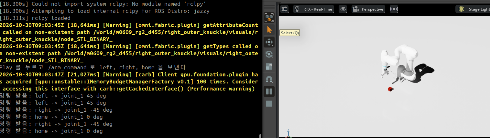
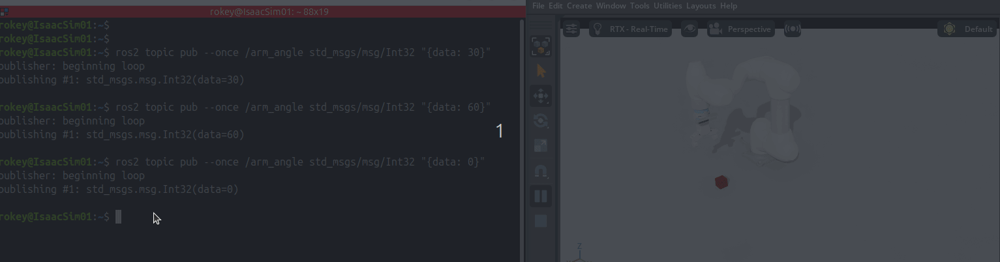

# R3. 토픽 구독: 명령을 받아 로봇팔 움직이기

## 📚 학습 목표
- standalone 코드에서 Isaac Sim 에 들어 있는 rclpy 로 ROS2 토픽을 구독할 수 있다
- 콜백에서 받은 값으로 메인 루프에서 로봇을 움직일 수 있다
- `ros2 topic pub` 으로 명령을 보내 동작을 확인할 수 있다

## 🔑 핵심 개념
1. **토픽으로 로봇 움직이기**
   - 터미널에서 보낸 문자열을 Isaac Sim 코드가 받아 joint_1 을 돌린다.

   

   - 콜백은 목표만 저장하고, 로봇은 메인 루프에서 움직인다.
2. **Isaac Sim 의 rclpy**
   - standalone 코드는 Isaac Sim 에 들어 있는 rclpy 를 쓴다.
   - 이 rclpy 는 ROS2 Bridge 확장이 켜질 때 준비되므로, 확장을 켠 **<span color="red">뒤에</span>** import 한다.

   ```python
   enable_extension("isaacsim.ros2.bridge")  # 1. ROS2 Bridge 확장 켜기
   simulation_app.update()                   # 2. 앱을 한 번 갱신
   import rclpy                              # 3. rclpy import
   ```

---

## ☑️ 사전 준비
1. **작업 씬**
   - 로봇, 바닥, 큐브를 참조한 기본 씬 (GUI—자산 참조로 작업 씬 만들기에서 만든 씬)

   ```
   ~/cobot3_ws/isaacpjt/M0609/scenes/pick_place_cube.usd
   ```
2. **파일 위치**

   ```
   ~/cobot3_ws/isaacpjt/M0609/ros/
   ├── R3_subscribe.py          예제
   └── R3_subscribe_answer.py   연습 문제 정답
   ```

---

## 💡학습 내용
1. **예제 실행**
   기본 씬을 열고 `/arm_command` 를 구독하는 ROS2 노드를 만든 뒤, 홈 자세로 Play 를 기다린다.

   ### R3_subscribe.py

   ```python
   """[R3 예제] 토픽을 구독해서 로봇팔 움직이기

   실행: isaac_python R3_subscribe.py
         창에서 Play(▶) 를 누르고, 새 터미널에서 /arm_command 토픽으로 left, right, home 을 보낸다
         ros2 topic pub --once /arm_command std_msgs/msg/String "{data: left}"
   """

   from pathlib import Path

   # ============================================================
   # 1. 앱 시작 (Isaac 모듈보다 먼저)
   # ============================================================
   from isaacsim import SimulationApp

   simulation_app = SimulationApp({"headless": False})

   # ============================================================
   # 2. Isaac 모듈 import (앱을 켠 뒤에)
   # ============================================================
   import numpy as np
   from isaacsim.core.api import World
   from isaacsim.core.prims import SingleArticulation
   from isaacsim.core.utils.extensions import enable_extension
   from isaacsim.core.utils.stage import open_stage
   from isaacsim.core.utils.types import ArticulationAction

   # (가) ROS2 Bridge 확장을 켠 뒤에 rclpy 를 import 한다 (Isaac Sim 에 들어 있는 rclpy)
   enable_extension("isaacsim.ros2.bridge")
   simulation_app.update()
   import rclpy
   from std_msgs.msg import String

   SCENE_USD = Path(__file__).resolve().parents[1] / "scenes" / "pick_place_cube.usd"  # GUI 강의에서 만든 기본 씬
   HOME_DEG = [0, 0, 90, 0, 90, 0]                       # 홈 자세 (deg)
   COMMANDS = {"left": 45.0, "right": -45.0, "home": 0.0}  # 명령 -> joint_1 목표 각도 (deg)

   # (나) 작업 씬 열기
   open_stage(str(SCENE_USD))
   world = World(stage_units_in_meters=1.0)
   robot = world.scene.add(SingleArticulation(prim_path="/World/m0609_rg2_d455", name="m0609"))

   # (다) ROS2 노드와 구독 만들기: /arm_command 로 문자열이 오면 on_command 가 불린다
   target_deg = None  # 콜백이 받아 둔 joint_1 목표 (deg). 아직 받은 명령이 없으면 None


   def on_command(msg):
       """명령을 받으면 목표 각도만 저장한다. 로봇은 메인 루프에서 움직인다"""
       global target_deg
       command = msg.data.strip()
       if command in COMMANDS:
           target_deg = COMMANDS[command]
           print(f"명령 받음: {command} -> joint_1 {target_deg:.0f} deg")
       else:
           print(f"모르는 명령: {command} (left, right, home 중 하나)")


   rclpy.init()
   node = rclpy.create_node("arm_commander")                             # ROS2 노드 이름
   node.create_subscription(String, "arm_command", on_command, 10)       # (메시지 타입, 토픽 이름, 콜백, 큐 크기)

   # (라) 홈 자세로 순간이동하고, 멈춘 상태로 기다린다
   world.reset()
   arm = [robot.get_dof_index(f"joint_{i}") for i in range(1, 7)]  # 팔 관절 6개가 관절 배열의 몇 번째인지
   home = robot.get_joint_positions()
   home[arm] = np.radians(HOME_DEG)
   robot.set_joint_positions(home)
   world.step(render=True)  # 한 프레임 진행해서 순간이동한 자세를 화면에 반영
   world.pause()            # 화면 왼쪽의 Play(▶) 를 누르면 시작
   print("Play 를 누르고 /arm_command 로 left, right, home 을 보낸다")

   # ============================================================
   # 3. 메인 루프 (창이 열려 있는 동안 한 프레임씩 진행)
   # ============================================================
   while simulation_app.is_running():
       world.step(render=True)
       rclpy.spin_once(node, timeout_sec=0.0)  # 도착한 메시지가 있으면 콜백 실행 (기다리지 않음)
       if world.is_playing() and target_deg is not None:
           goal = home.copy()
           goal[arm[0]] = np.radians(target_deg)  # joint_1 만 목표 각도로
           robot.apply_action(ArticulationAction(joint_positions=goal))
           target_deg = None  # 한 번 보냈으면 비운다 (모터가 목표까지 계속 움직인다)

   # ============================================================
   # 4. 종료
   # ============================================================
   node.destroy_node()
   rclpy.shutdown()
   simulation_app.close()
   ```

   ```bash
   cd ~/cobot3_ws/isaacpjt/M0609/ros
   isaac_python R3_subscribe.py
   ```

   - 터미널에 `Play 를 누르고 /arm_command 로 left, right, home 을 보낸다` 가 출력됨
   - Play(▶) 를 누른다
2. **구독 코드 살펴보기**
   - 구독 만들기

   ```python
   rclpy.init()
   node = rclpy.create_node("arm_commander")                             # ROS2 노드 이름
   node.create_subscription(String, "arm_command", on_command, 10)       # (메시지 타입, 토픽 이름, 콜백, 큐 크기)
   ```

   | 인자 | 값 | 뜻 |
   |---|---|---|
   | 메시지 타입 | `String` | `std_msgs/msg/String`. 문자열 하나(`data`)를 담는다 |
   | 토픽 이름 | `"arm_command"` | `/arm_command` 를 구독한다 |
   | 콜백 | `on_command` | 메시지를 꺼낼 때 부르는 함수 |
   | 큐 크기 | `10` | 꺼내기 전에 쌓아 둘 수 있는 메시지 수 |

   - 메인 루프

   ```python
   rclpy.spin_once(node, timeout_sec=0.0)  # 도착한 메시지가 있으면 콜백 실행 (기다리지 않음)
   if world.is_playing() and target_deg is not None:
       ...
       robot.apply_action(ArticulationAction(joint_positions=goal))
       target_deg = None
   ```

   - `spin_once` 를 부를 때 도착한 메시지가 있으면 콜백이 실행된다. `timeout_sec=0.0` 이라 메시지가 없으면 기다리지 않고 바로 다음 프레임으로 간다
   - 콜백(`on_command`)은 `target_deg` 에 목표만 저장한다. 로봇에 명령을 보내는 것은 메인 루프에서 한다
   - 목표를 한 번 보내면 `target_deg` 를 비운다. 모터는 목표에 갈 때까지 계속 움직인다
3. **ROS2 쪽에서 명령 보내기**
   새 터미널에서 `/arm_command` 로 문자열을 보낸다. Isaac Sim 은 Play 상태여야 한다.
   - ROS2 환경 설정 (`ROS_DOMAIN_ID` 는 Isaac Sim 터미널과 같게)

   ```bash
   export ROS_DOMAIN_ID=50
   ros_set
   ```

   - 노드와 토픽 확인

   ```bash
   ros2 node list
   ros2 topic list
   ```

   

   - 확인 포인트: 노드 목록에 `/arm_commander`, 토픽 목록에 `/arm_command` 가 있음
   - 명령 보내기

   ```bash
   ros2 topic pub --once /arm_command std_msgs/msg/String "{data: left}"
   ros2 topic pub --once /arm_command std_msgs/msg/String "{data: right}"
   ros2 topic pub --once /arm_command std_msgs/msg/String "{data: home}"
   ```

   

   - 확인 포인트: 명령마다 로봇팔이 왼쪽(45 deg), 오른쪽(-45 deg), 가운데(0 deg)로 돌고, Isaac Sim 터미널에 받은 명령이 출력됨

   

---

## ✏️ 연습 문제

### 시나리오: 숫자로 각도 보내기

문자열 명령 대신 **각도 숫자**를 받아 joint_1 을 그 각도로 돌린다.

- 토픽 `/arm_angle`, 메시지 타입 `std_msgs/msg/Int32` (정수 하나, 단위 deg)
- -90 ~ 90 deg 를 벗어난 값은 무시한다
- `/arm_command` 의 left, right, home 도 그대로 동작해야 한다

```bash
ros2 topic pub --once /arm_angle std_msgs/msg/Int32 "{data: 30}"
```



```
각도 받음: joint_1 30 deg
범위 밖 각도: 120 deg (-90 ~ 90)
```

---

## 📝 요약 정리

```
ROS2 환경 설정 → isaac_ros → isaac_python R3_subscribe.py
    → (코드) ROS2 Bridge 확장 켜기 → import rclpy → 노드와 구독 만들기
    → Play → 메인 루프: spin_once 로 메시지 꺼내기 → 콜백이 목표 저장 → apply_action
    → 새 터미널: ros2 topic pub --once /arm_command ... 로 명령 보내기
```

### 트러블슈팅

| 증상 | 원인 | 해결 |
|---|---|---|
| `ModuleNotFoundError: No module named 'rclpy'` | ROS2 Bridge 확장을 켜기 전에 `import rclpy` | `enable_extension("isaacsim.ros2.bridge")` 와 `simulation_app.update()` 뒤에 import |
| Console 에 `ROS2 Bridge startup failed` | `isaac_ros` 를 실행하지 않음 | 같은 터미널에서 `isaac_ros` 후 `isaac_python` |
| 명령을 보내도 Isaac Sim 터미널에 아무것도 출력되지 않음 | 두 터미널의 `ROS_DOMAIN_ID` 가 다름 | 두 터미널에서 `echo $ROS_DOMAIN_ID` 비교 |
| `모르는 명령` 이 출력되고 로봇이 움직이지 않음 | `COMMANDS` 에 없는 문자열 | left, right, home 중 하나를 보냄 |

## 📎 참고 문서
- ROS 2 Bridge in Standalone Workflow — https://docs.isaacsim.omniverse.nvidia.com/5.1.0/ros2_tutorials/tutorial_ros2_python.html
