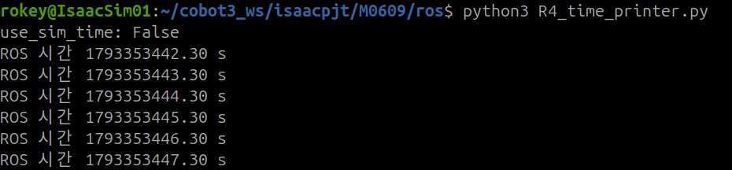
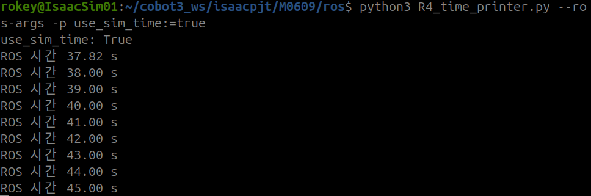

# R4. use_sim_time: ROS2 노드가 시뮬레이션 시간 쓰기

## 📚 학습 목표
- ROS2 노드를 실행할 때 `use_sim_time` 을 켜고 끌 수 있다
- `use_sim_time` 에 따라 노드의 현재 시간과 타이머가 무엇을 기준으로 하는지 설명할 수 있다
- Isaac Sim 과 함께 쓰는 노드가 시뮬레이션 시간을 써야 하는 이유를 설명할 수 있다

## 🔑 핵심 개념
1. **use_sim_time**
   - 모든 ROS2 노드에 있는 파라미터다. **<span color="pink">노드가 어떤 시계를 쓸지 정한다.</span>**

   | `use_sim_time` | 노드의 시간 | Isaac Sim 을 Pause 하면 |
   |---|---|---|
   | `False` (기본) | PC 의 실제 시간 | 계속 흐른다 |
   | `True` | `/clock` 토픽의 시간 (시뮬레이션 시간) | 멈춘다 |

   - 노드가 읽는 현재 시간(`get_clock().now()`)과 타이머(`create_timer`)가 모두 이 시계를 따른다.
2. **왜 맞춰야 하나**
   - Isaac Sim 이 발행하는 메시지(카메라 영상 등)의 시간(`header.stamp`)은 시뮬레이션 시간이다.
   - 메시지 시간과 노드 시간을 함께 쓰는 노드(TF 로 좌표 변환, 내비게이션 등)는 `use_sim_time` 을 켜서 같은 기준으로 맞춘다.

---

## ☑️ 사전 준비
1. **/clock 발행**
   - R1 예제(`R1_clock.py`)로 Isaac Sim 에서 `/clock` 을 발행한다.
2. **파일 위치**

   ```
   ~/cobot3_ws/isaacpjt/M0609/ros/
   ├── R1_clock.py                  /clock 발행 (R1 예제)
   └── R4_time_printer.py           예제: ROS2 노드
   ```
3. **터미널 두 개**
   - Isaac Sim 터미널: 환경변수 설정, `isaac_ros` 후 `isaac_python R1_clock.py`
   - ROS2 터미널: `ROS_DOMAIN_ID` 를 Isaac Sim 터미널과 같게 하고 `ros_set`

   ```bash
   export ROS_DOMAIN_ID=50
   ros_set
   ```

---

## 💡학습 내용
1. **Isaac Sim 에서 /clock 발행**
   Isaac Sim 터미널에서 R1 예제를 실행하고 Play(▶) 를 누른다.

   ```bash
   cd ~/cobot3_ws/isaacpjt/M0609/ros
   isaac_python R1_clock.py
   ```
2. **예제 노드 실행: use_sim_time 끄기 (기본)**
   1초마다 노드의 현재 시간을 출력하는 ROS2 노드다. Isaac Sim 이 아니라 ROS2 터미널에서 `python3` 로 실행한다.

   ### R4_time_printer.py

   ```python
   """[R4 예제] use_sim_time: ROS2 노드가 보는 현재 시간을 1초마다 출력

   실행 (ROS2 터미널, ros_set 후):
       python3 R4_time_printer.py                                   # 실제 시간 (기본)
       python3 R4_time_printer.py --ros-args -p use_sim_time:=true  # Isaac Sim 의 /clock 시간
   """

   import rclpy
   from rclpy.executors import ExternalShutdownException

   rclpy.init()
   node = rclpy.create_node("time_printer")  # ROS2 노드 이름
   print("use_sim_time:", node.get_parameter("use_sim_time").value)  # 모든 노드에 있는 파라미터 (기본 False)


   def on_timer():
       """노드의 시계로 현재 시간을 읽어 출력한다"""
       now = node.get_clock().now()  # use_sim_time 이 True 면 /clock 시간, False 면 실제 시간
       print(f"ROS 시간 {now.nanoseconds / 1e9:.2f} s")


   node.create_timer(1.0, on_timer)  # 1초마다 on_timer 실행 (노드의 시계 기준)

   try:
       rclpy.spin(node)  # Ctrl+C 를 누를 때까지 콜백 실행
   except (KeyboardInterrupt, ExternalShutdownException):
       pass
   node.destroy_node()
   rclpy.try_shutdown()
   ```

   ```bash
   cd ~/cobot3_ws/isaacpjt/M0609/ros
   python3 R4_time_printer.py
   ```

   

   - 실제 시간이 나온다. 1970년 1월 1일부터 센 초(Unix time)라서 값이 크다
   - `Ctrl+C` 로 끝낸다

   | 코드 | 뜻 |
   |---|---|
   | `node.get_parameter("use_sim_time").value` | 이 노드의 `use_sim_time` 값 |
   | `node.get_clock().now()` | 노드의 시계로 읽은 현재 시간 |
   | `node.create_timer(1.0, on_timer)` | 노드의 시계로 1초마다 `on_timer` 실행 |
3. **use_sim_time 켜고 실행**
   같은 노드를 `use_sim_time` 을 켜고 실행한다. 코드는 그대로이고 실행할 때 파라미터만 준다.

   ```bash
   python3 R4_time_printer.py --ros-args -p use_sim_time:=true
   ```

   

   - Isaac Sim 의 시뮬레이션 시간이 나온다. Isaac Sim 터미널에 출력되는 시뮬레이션 시간과 비교한다
   - 다른 터미널에서 실행 중인 노드의 파라미터를 확인할 수 있다

   ```bash
   ros2 param get /time_printer use_sim_time
   ```

   

   - 실제 프로젝트에서는 노드를 launch 파일로 실행하면서 같은 파라미터를 넣는다. 예를 들어 내비게이션(Nav2)의 `bringup_launch.py` 는 `use_sim_time` 을 launch 인자로 받아, 실행할 때 `use_sim_time:=True` 를 붙이면 모든 노드에 넣어 준다
4. **실습: Pause 해 보기**
   - ROS2 터미널 두 개에서 `use_sim_time` 을 끈 노드와 켠 노드를 함께 실행한다
   - Isaac Sim 에서 Pause 를 누른다. 켠 노드는 출력이 멈추고, 끈 노드는 계속 출력한다
   - 다시 Play 를 누르면 켠 노드가 멈췄던 시간부터 이어서 출력한다

---

## 📝 요약 정리

```
Isaac Sim 터미널: isaac_python R1_clock.py → Play (/clock 발행)
    → ROS2 터미널: python3 R4_time_printer.py                                   (실제 시간)
    → ROS2 터미널: python3 R4_time_printer.py --ros-args -p use_sim_time:=true  (/clock 시간)
    → Pause 하면 use_sim_time 을 켠 노드만 멈춘다
```

### 트러블슈팅

| 증상 | 원인 | 해결 |
|---|---|---|
| `use_sim_time: True` 만 출력되고 시간이 나오지 않음 | `/clock` 을 받지 못함 (Isaac Sim 이 Play 상태가 아니거나 `ROS_DOMAIN_ID` 가 다름) | Isaac Sim 에서 Play, `ros2 topic echo /clock --once` 로 확인, 두 터미널의 `ROS_DOMAIN_ID` 비교 |
| 큰 숫자(Unix time)가 나옴 | `use_sim_time` 이 꺼져 있음 | `--ros-args -p use_sim_time:=true` 를 붙여 실행 |

## 📎 참고 문서
- ROS 2 Clock — https://docs.isaacsim.omniverse.nvidia.com/5.1.0/ros2_tutorials/tutorial_ros2_clock.html
