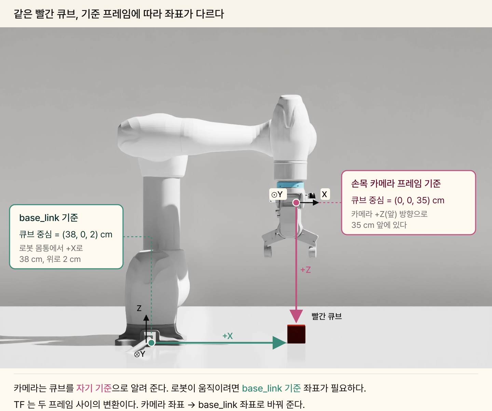
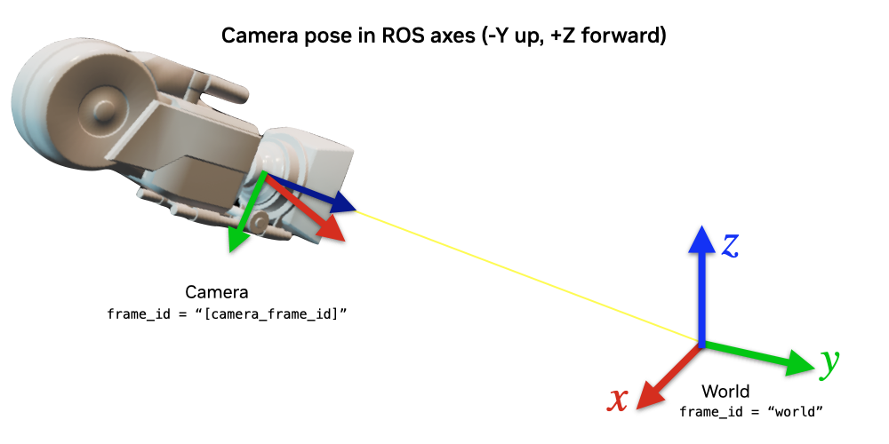
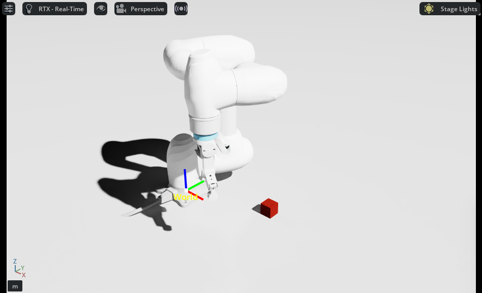
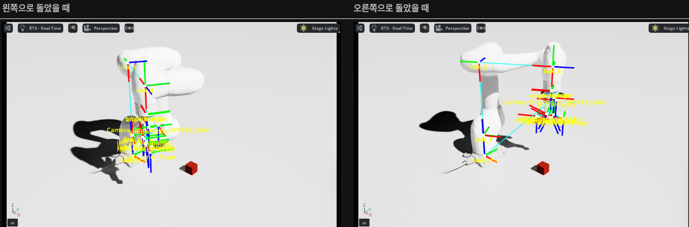
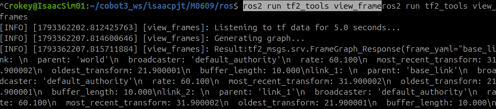
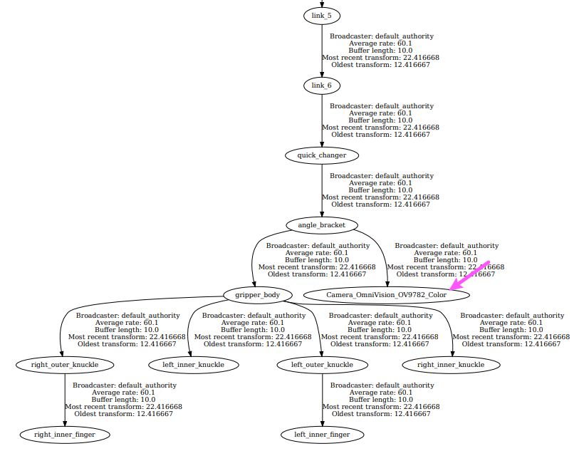
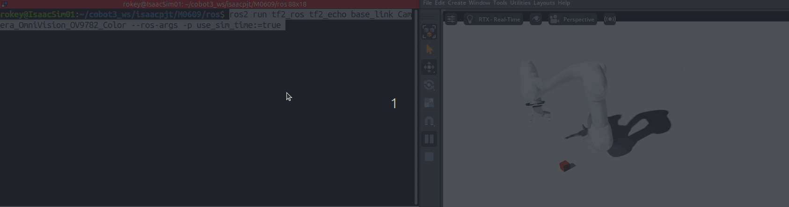
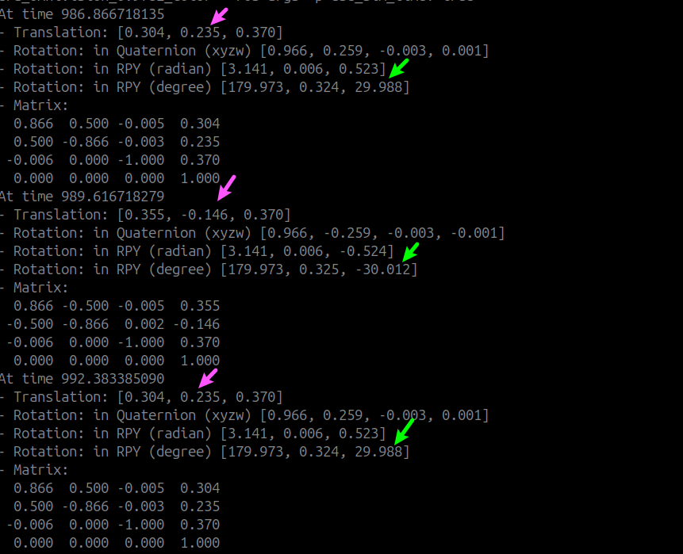

# R5. TF 를 코드로: 로봇과 손목 카메라의 위치 발행

## 📚 학습 목표
- Isaac Sim 에서 로봇 링크와 손목 카메라의 TF 를 코드(`og.Controller.edit`)로 발행할 수 있다
- ROS2 도구와 노드에서 두 프레임 사이의 TF 를 조회할 수 있다
- 손목 카메라 프레임이 어떤 좌표축으로 발행되는지 설명할 수 있다

## 🔑 핵심 개념
1. **TF 트리**
   - TF 는 프레임(좌표계)들의 부모-자식 관계와 위치를 시간과 함께 알려 주는 토픽(`/tf`)이다.

     
   - 이 강의에서 발행하는 TF 트리

   ```
   world
    └── base_link → link_1 → … → link_6 → quick_changer → angle_bracket
                                                           ├── gripper_body → 손가락 링크
                                                           └── Camera_OmniVision_OV9782_Color   (손목 컬러 카메라)
   ```

   - 팔이 움직이면 각 링크와 손목 카메라의 좌표계(프레임)도 함께 움직인다.
   - Isaac Sim 은 이 프레임들의 위치 관계(TF)를 계속 발행한다.
   - 외부 노드는 필요한 두 프레임을 골라 그 사이의 변환을 조회만 하면 된다.
2. **카메라 프레임의 좌표축**
   - 카메라 프레임은 ROS 카메라 규약(+Z 앞, +X 오른쪽, +Y 아래)으로 발행된다

     
   - 그래서 픽셀과 깊이로 구한 카메라 기준 좌표를 그대로 TF 로 변환할 수 있다.

---

## ☑️ 사전 준비
1. **작업 씬**
   - 로봇, 바닥, 큐브를 참조한 기본 씬 (GUI—자산 참조로 작업 씬 만들기에서 만든 씬)

   ```
   ~/cobot3_ws/isaacpjt/M0609/scenes/pick_place_cube.usd
   ```
2. **파일 위치**

   ```
   ~/cobot3_ws/isaacpjt/M0609/ros/
   ├── R5_tf.py          예제 (Isaac Sim)
   └── R5_tf_answer.py   연습 문제 정답 (ROS2 노드)
   ```

---

## 💡학습 내용
1. **공식 코드 찾기**
   TF Publisher 메뉴 창의 Python Script for Graph Generation 버튼으로 공식 코드를 연다.

   ```
   Tools > Robotics > ROS 2 OmniGraphs > TF Publisher
       └── ROS2 TF Publisher Graph 창
           └── Python Script for Graph Generation 오른쪽 연필 아이콘 클릭
               └── 메뉴의 소스 파일이 VS Code 로 열림
   ```

   - VS Code(`code` 명령)가 없으면 파일을 직접 연다. Clock 메뉴와 같은 파일이다.

   ```
   ~/isaacsim/exts/isaacsim.ros2.bridge/isaacsim/ros2/bridge/impl/og_shortcuts/og_utils.py
   ```

   - `CREATE_NODES` 의 노드 6개: (노드 이름, 노드 타입)

   | 노드 이름 | 노드 타입 | 역할 |
   |---|---|---|
   | `OnPlaybackTick` | `omni.graph.action.OnPlaybackTick` | Play 중 매 프레임 실행 신호 |
   | `Context` | `isaacsim.ros2.bridge.ROS2Context` | ROS2 통신 설정 (Domain ID) |
   | `ReadSimTime` | `isaacsim.core.nodes.IsaacReadSimulationTime` | 시뮬레이션 시간 읽기 |
   | `PublisherTF` | `isaacsim.ros2.bridge.ROS2PublishTransformTree` | 로봇 링크의 TF 를 `/tf` 로 발행 |
   | `PublisherCameraTF` | `isaacsim.ros2.bridge.ROS2PublishTransformTree` | 손목 카메라의 TF 를 `/tf` 로 발행 |
   | `PublishClock` | `isaacsim.ros2.bridge.ROS2PublishClock` | `/clock` 발행 |

   - `targetPrims` 에 로봇 링크(`base_link`)를 넣으면 로봇의 링크 전체가 발행된다.
   - 로봇 prim(`/World/m0609_rg2_d455`)을 넣으면 그 prim 하나만 발행된다
   - `parentPrim` 은 발행할 TF 의 부모 프레임이다. 비워 두면 `world` 가 부모가 된다
   - `parentPrim` 은 노드 전체에 적용된다. 그래서 부모가 `world` 인 로봇과 부모가 `angle_bracket` 인 카메라를 노드 2개로 나눈다
   - `PublisherTF`, `PublisherCameraTF`, `PublishClock` 은 같은 `ReadSimTime` 의 시간을 쓴다. TF 의 시간과 `/clock` 이 같은 시뮬레이션 시간이다
2. **예제 실행**
   기본 씬을 열고 TF Graph 를 코드로 만든 뒤, Play 하면 joint_1 이 3초마다 좌우(±30 deg)로 움직인다.

   ### R5_tf.py

   ```python
   """[R5 예제] TF 를 코드로 발행: 로봇 링크와 손목 카메라의 위치

   실행: isaac_python R5_tf.py
         창에서 Play(▶) 를 누르면 /tf, /clock 이 발행되고, 로봇팔이 좌우로 움직인다
         새 터미널에서 ros2 run tf2_ros tf2_echo base_link Camera_OmniVision_OV9782_Color 로 확인한다
   """

   from pathlib import Path

   # ============================================================
   # 1. 앱 시작 (Isaac 모듈보다 먼저)
   # ============================================================
   from isaacsim import SimulationApp

   simulation_app = SimulationApp({"headless": False})

   # ============================================================
   # 2. Isaac 모듈 import (앱을 켠 뒤에)
   # ============================================================
   import numpy as np
   import omni.graph.core as og
   from isaacsim.core.api import World
   from isaacsim.core.prims import SingleArticulation
   from isaacsim.core.utils.extensions import enable_extension
   from isaacsim.core.utils.stage import open_stage
   from isaacsim.core.utils.types import ArticulationAction

   SCENE_USD = Path(__file__).resolve().parents[1] / "scenes" / "pick_place_cube.usd"  # GUI 강의에서 만든 기본 씬
   GRAPH_PATH = "/World/Graph/ROS_TF"  # TF 그래프 위치
   ROBOT_BASE = "/World/m0609_rg2_d455/base_link"  # 로봇 링크 전체를 발행할 시작 prim
   BRACKET_PRIM = "/World/m0609_rg2_d455/angle_bracket"  # 손목 카메라의 부모 프레임
   CAMERA_PRIM = "/World/m0609_rg2_d455/angle_bracket/realsense_d455/RSD455/Camera_OmniVision_OV9782_Color"  # 손목 컬러 카메라
   HOME_DEG = [0, 0, 90, 0, 90, 0]  # 홈 자세 (deg). 카메라가 바닥을 내려다본다
   SWING_DEG = 30.0                 # joint_1 을 좌우로 돌릴 각도 (deg)
   SWING_SEC = 3.0                  # 이 시간(시뮬레이션 초)마다 방향을 바꾼다

   # (가) ROS2 Bridge 확장 켜기: ROS2 노드를 쓰기 전에 켠다
   enable_extension("isaacsim.ros2.bridge")
   simulation_app.update()

   # (나) 작업 씬 열기
   open_stage(str(SCENE_USD))
   world = World(stage_units_in_meters=1.0)
   robot = world.scene.add(SingleArticulation(prim_path="/World/m0609_rg2_d455", name="m0609"))

   # (다) TF Graph 만들기: GUI 의 Tools > Robotics > ROS 2 OmniGraphs > TF Publisher 와 같은 노드 4개 + 카메라 TF 발행 노드 + /clock 발행 노드
   og.Controller.edit(
       {"graph_path": GRAPH_PATH, "evaluator_name": "execution"},  # execution = Action Graph
       {
           og.Controller.Keys.CREATE_NODES: [
               ("OnPlaybackTick", "omni.graph.action.OnPlaybackTick"),              # Play 중 매 프레임 실행 신호
               ("Context", "isaacsim.ros2.bridge.ROS2Context"),                     # ROS2 통신 설정 (Domain ID)
               ("ReadSimTime", "isaacsim.core.nodes.IsaacReadSimulationTime"),      # 시뮬레이션 시간 읽기
               ("PublisherTF", "isaacsim.ros2.bridge.ROS2PublishTransformTree"),    # 로봇 링크 /tf 발행
               ("PublisherCameraTF", "isaacsim.ros2.bridge.ROS2PublishTransformTree"),  # 손목 카메라 /tf 발행
               ("PublishClock", "isaacsim.ros2.bridge.ROS2PublishClock"),           # /clock 발행 (외부 노드의 use_sim_time 용)
           ],
           og.Controller.Keys.CONNECT: [
               ("OnPlaybackTick.outputs:tick", "PublisherTF.inputs:execIn"),       # 실행 신호
               ("Context.outputs:context", "PublisherTF.inputs:context"),          # 통신 설정
               ("ReadSimTime.outputs:simulationTime", "PublisherTF.inputs:timeStamp"),  # TF 의 시간 = 시뮬레이션 시간
               ("OnPlaybackTick.outputs:tick", "PublisherCameraTF.inputs:execIn"),
               ("Context.outputs:context", "PublisherCameraTF.inputs:context"),
               ("ReadSimTime.outputs:simulationTime", "PublisherCameraTF.inputs:timeStamp"),
               ("OnPlaybackTick.outputs:tick", "PublishClock.inputs:execIn"),
               ("Context.outputs:context", "PublishClock.inputs:context"),
               ("ReadSimTime.outputs:simulationTime", "PublishClock.inputs:timeStamp"),  # /clock 도 같은 시뮬레이션 시간
           ],
           og.Controller.Keys.SET_VALUES: [
               ("PublisherTF.inputs:targetPrims", [ROBOT_BASE]),                    # 로봇 링크 (부모: world)
               ("PublisherCameraTF.inputs:parentPrim", [BRACKET_PRIM]),             # 카메라의 부모: angle_bracket
               ("PublisherCameraTF.inputs:targetPrims", [CAMERA_PRIM]),             # 손목 카메라
           ],
       },
   )
   print("TF Graph 생성:", GRAPH_PATH)

   # (라) 홈 자세로 순간이동하고, 멈춘 상태로 기다린다
   world.reset()
   arm = [robot.get_dof_index(f"joint_{i}") for i in range(1, 7)]  # 팔 관절 6개가 관절 배열의 몇 번째인지
   home = robot.get_joint_positions()
   home[arm] = np.radians(HOME_DEG)
   robot.set_joint_positions(home)
   world.step(render=True)  # 한 프레임 진행해서 순간이동한 자세를 화면에 반영
   world.pause()            # 화면 왼쪽의 Play(▶) 를 누르면 시작
   print("Play 를 누르면 /tf, /clock 을 발행하고, joint_1 이 좌우로 움직인다")

   # ============================================================
   # 3. 메인 루프 (창이 열려 있는 동안 한 프레임씩 진행)
   # ============================================================
   direction = 0  # 지금 보낸 방향 (1: 왼쪽, -1: 오른쪽, 0: 아직 안 보냄)
   while simulation_app.is_running():
       world.step(render=True)
       if not world.is_playing():
           continue
       want = 1 if int(world.current_time // SWING_SEC) % 2 == 0 else -1  # SWING_SEC 마다 방향을 바꾼다
       if want != direction:
           direction = want
           goal = home.copy()
           goal[arm[0]] = np.radians(SWING_DEG * direction)  # joint_1 만 좌우로
           robot.apply_action(ArticulationAction(joint_positions=goal))

   # ============================================================
   # 4. 종료
   # ============================================================
   simulation_app.close()
   ```

   ```bash
   cd ~/cobot3_ws/isaacpjt/M0609/ros
   isaac_python R5_tf.py
   ```

   - 터미널에 `TF Graph 생성: /World/Graph/ROS_TF` 이 출력됨
   - Play(▶) 를 누르면 로봇팔이 3초마다 좌우로 움직인다
3. **TF 를 눈으로 보기: TF Viewer**
   예제 코드에서 켠 `isaacsim.ros2.tf_viewer` 확장은 받은 `/tf` 를 뷰포트에 그려 준다. Play 상태에서 연다.

   ```
   Window > TF Viewer
       └── Root Frame: world 선택 (소문자)
   ```

   - Root Frame 기본값 `World` 로 두면 World 축 하나만 보이고 로봇 프레임은 그려지지 않는다. 이 TF 트리의 맨 위 프레임 이름이 `world` 이기 때문이다

     
   - `world` 로 바꾸면 링크와 손목 카메라 프레임이 축(빨강 X, 초록 Y, 파랑 Z)으로 그려지고, 하늘색 화살표가 부모와 자식 프레임을 잇는다
   - 팔이 좌우로 움직이면 프레임도 함께 움직인다

     
4. **ROS2 쪽에서 확인**
   새 터미널에서 TF 를 확인한다. Isaac Sim 은 Play 상태여야 한다.
   - ROS2 환경 설정 (`ROS_DOMAIN_ID` 는 Isaac Sim 터미널과 같게)

   ```bash
   export ROS_DOMAIN_ID=50
   ros_set
   ```

   - TF 트리 확인: 현재 폴더에 `frames_날짜.pdf` 가 만들어진다. 열어서 트리를 본다

   ```bash
   ros2 run tf2_tools view_frames
   ```

   

   

   [frames_2026-10-31_00.19.26.pdf](frames_2026-10-31_00.19.26.pdf)

   - 두 프레임 사이 변환 확인: `base_link` 기준 손목 카메라의 위치와 회전

   ```bash
   #tf2_echo A B는 A 기준으로 본 B를 보여 주므로

   #base_link에서 본 Camera의 위치
   ros2 run tf2_ros tf2_echo base_link Camera_OmniVision_OV9782_Color --ros-args -p use_sim_time:=true

   #Camera에서 본 base_link의 위치
   ros2 run tf2_ros tf2_echo Camera_OmniVision_OV9782_Color base_link --ros-args -p use_sim_time:=true
   ```

   

   

   - 확인 포인트: 팔이 움직일 때마다 `Translation` 의 y 와 RPY 의 세 번째 값(약 ±30 deg)이 바뀜
   - RPY 의 첫 번째 값(roll)이 약 180 deg 다. 카메라가 바닥을 내려다보고 있고, 카메라 프레임의 +Z(앞)가 아래를 향하기 때문이다

   > 💡 R2 의 카메라 영상은 `frame_id` 가 `Camera` 다. 영상과 TF 를 함께 쓰려면 Camera Graph 의 `frameId` 를 TF 프레임 이름(`Camera_OmniVision_OV9782_Color`)과 같게 정한다

---

## ✏️ 연습 문제

### 시나리오: 그리퍼 위치 읽기

외부 ROS2 노드에서 TF 를 조회해 `base_link` 기준 그리퍼(`gripper_body`) 위치를 1초마다 출력한다.

- 노드는 `use_sim_time` 을 켜고 실행한다
- 로봇팔이 좌우로 움직일 때 y 값이 바뀌는지 확인한다

```
  3.00 s | gripper_body 위치 x 0.340  y 0.203  z 0.375 m
  4.00 s | gripper_body 위치 x 0.346  y -0.193  z 0.375 m
```

---

## 📝 요약 정리

```
메뉴 창의 Python Script 버튼 → 공식 TF Publisher Graph 코드 확인
    → ROS2 환경 설정 → isaac_ros → isaac_python R5_tf.py
    → (코드) ROS2 Bridge 확장 켜기 → 기본 씬 열기 → og.Controller.edit 로 TF Graph 생성 (base_link, 카메라(부모 angle_bracket), /clock)
    → Play → ros2 run tf2_tools view_frames / tf2_ros tf2_echo 로 확인
```

### 트러블슈팅

| 증상 | 원인 | 해결 |
|---|---|---|
| TF 트리에 `world → m0609_rg2_d455` 하나만 있음 | `targetPrims` 에 로봇 prim(`/World/m0609_rg2_d455`)을 넣음 | `targetPrims` 에 `/World/m0609_rg2_d455/base_link` 를 넣음 |
| `tf2_echo` 가 `frame does not exist` 만 출력 | Isaac Sim 이 Play 상태가 아니거나 `ROS_DOMAIN_ID` 가 다름 | Play 상태 확인, 두 터미널의 `ROS_DOMAIN_ID` 비교 |
| `TF_OLD_DATA ignoring data from the past` 경고가 계속 나옴 | 같은 `ROS_DOMAIN_ID` 에서 Isaac Sim 이 두 개 실행되어 `/tf` 를 함께 발행 | Isaac Sim 을 하나만 실행 |

## 📎 참고 문서
- ROS 2 Transform Trees and Odometry — https://docs.isaacsim.omniverse.nvidia.com/5.1.0/ros2_tutorials/tutorial_ros2_tf.html
